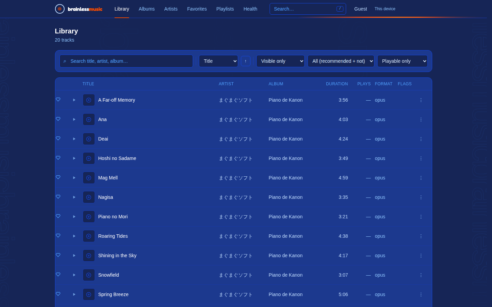
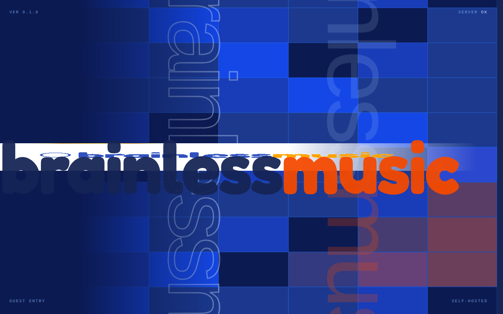

# Changelog

Backfilled 2026-09-03 (didn't exist before). Newest first. Only covers backend/frontend code changes, not doc-only commits.

---

## 2026-10-12: Scheduled scans survive restarts

- The full library scan ran on a 12-hour `setInterval` started at boot. Auto-deploy (A120) restarts the app on every
  backend or frontend push, so on a day with deploys every hour or two the scheduled scan never ran. That also meant
  v0.4's regrouping (migration `0030`) sat waiting after its deploy.
- Migration `0033` adds `library_roots.last_full_scan_at`, stamped only by a real scan (a manual one too). At boot every
  root is reconciled as before, and any root whose last full scan is NULL or 12+ hours old is scanned; after that the
  check runs hourly. `LIBRARY_SCAN_INTERVAL_HOURS` and `LIBRARY_SCAN_ENABLED` keep their meaning.
- First boot after this deploys: every root has NULL, so each is scanned once right away. On smol that is the v0.4
  regroup, disc numbers and genres (owner asked for the scan now, 2026-10-12).
- Verified: `npm test` 544 pass, 4 new in `services/librarySync.test.ts` (`isScanDue`: never scanned, exactly 12 h,
  a second short, an unreadable stamp counts as due; a reconcile-only sync leaves `last_full_scan_at` NULL and a scan
  stamps it). `tsc --noEmit` clean. The hourly timer itself isn't exercised by a test.

## 2026-10-12: Disc order and genres (v0.4 boxes 26, 27)

- Two-disc albums sorted by track number alone, so disc 1 and disc 2 interleaved (smol: 4,555 tracks on disc 2 or
  later). Migration `0031` adds `tracks.disc_number` from the disc tag; album pages, the track list's artist/album
  sorts and album shuffle now go disc (untagged = 1), then track. Album detail tracks carry `discNumber`.
- Genres: migration `0032` adds `genres` (name unique without case) and `track_genres`. The genre tag's values are
  split on `;` and `/`, trimmed, and merged without case (rule 5); commas are kept, so "Chiptune, Video Game Music"
  stays one name. Every scan replaces a track's genres; track deletes clear them first.
- New endpoints, any signed-in user including guests: `GET /genres` (name, playable track and album counts; not paged,
  smol has 359) and `GET /genres/:id` (the genre and its albums). Hidden and missing tracks don't count, so a genre
  with only hidden tracks isn't listed.
- Disc numbers and genres refresh for admin-edited tracks too; the edit form has neither field.
- Verified: `npm test` 540 pass, 4 new in `services/albumGrouping.test.ts` (a two-disc album in CD1/CD2 plays
  D1T1, D1T2, D2T1, D2T2 with `discNumber` 1,1,2,2; album shuffle puts an untagged disc first; genre splitting and case
  merge; `GET /genres` data with a hidden-only genre left out, a deleted track's genres cleared, a rescan not doubling
  counts). `guestAccess.test.ts` classifies the two new routes. `tsc --noEmit` clean. Endpoints not called over HTTP
  (the db functions behind them are). Not deployed.

## 2026-10-12: Albums grouped by album artist, compilations, redirects for old album ids (v0.4 box 25, A148, A149)

- Albums were keyed by (title, track artist), so a compilation or an album with "feat." tracks split into one album
  per artist: smol had 14,123 albums for 32,409 tracks. Now an album is keyed by title, album artist and album folder
  ([features/metadata-model/planning.md](features/metadata-model/planning.md), rules 1-3, 1b, 7).
- Album artist: the albumartist tag; Various Artists when the compilation flag is set; with no tag, the artist on more
  than half the album's tracks, else Various Artists (A148), worked out after each scan by `settleAlbums`.
- Album folder: the file's folder, or the one above for a disc folder (`CD1`, `Disc 2`), so two unrelated
  "Original Soundtrack" albums under Various Artists stay apart and a two-disc album stays one.
- Migration `0030` rebuilds `albums` (the old `UNIQUE(title, artist_id)` can't be dropped in place) with every id kept,
  adding `folder`, `artist_from_tracks` and `merged_into_id`, and recreates the `albums_fts` triggers. Dry-run on a copy
  of the dev database: same rows, `foreign_key_check` empty, search and the tracks_fts album name still update.
- Old album ids keep working: the first scan adopts a pre-0030 row for one of its own tracks where it can, and an album
  a scan empties records where its tracks went. `GET /albums/:id` and `/albums/:id/cover` follow that and add
  `mergedFrom`, so old links and Android download groups (`album:<id>`) land on the merged album.
- Album detail tracks now carry `artistId` and `artistName` (a compilation's tracks differ from the album's artist).
  Artist detail adds `appearsOn` (A149). Artist lists include album-only artists such as Various Artists, and
  `albumCount` counts only albums with a playable track, so emptied rows don't inflate it.
- Admin-edited tracks (`tags_edited_at`) stay where the admin put them; an edited album goes by the edited track artist.
- Nothing keyed by track moves: favorites, playlists, history, less-often and Android downloaded songs are untouched.
- Verified: `npm test` 536 pass, 8 new in `services/albumGrouping.test.ts` (disc folders, compilation, albumartist
  grouping, A148 majority and Various Artists, same title in two folders vs. CD1/CD2, a second scan changes nothing,
  a pre-0030 library: three fragments become one album on an adopted old id, every old id resolves to it, favorites
  and playlist order untouched, the guest is under "Appears on" with no album of their own; an edited track stays).
  `tsc --noEmit` clean. Not tested over HTTP: the `mergedFrom` answer of `GET /albums/:id` (`resolveAlbumId` is).
  Old clients: Android parses with Gson, which ignores the new fields. Not deployed; smol's first scan after deploy
  regroups the library (plan, Phase 4).

## 2026-10-12: Account invites, and turning a guest into an account (A107-A112)

- Friends kept asking to sign up, and open registration stays off (A76). Now the admin makes a one-use invite link on
  the Users page ("Invite someone"), and the friend picks their own name and password at `/invite/<token>`, then is
  signed in. A link lasts 7 days (A108). Only a SHA-256 of the token is stored, so a link is shown once, when made.
- Guest rows on the Users page get "Make an account": the same kind of link, tied to that guest. Accepting turns the
  same `users` row into an account (A107), so resume stays. The guest's codes are deleted so they stop signing anyone in,
  and `session_version` is bumped so the guest's other devices sign out; the accepting device gets a fresh token. A
  name the guest chose is kept as the display name; a random `Guest 1234` is dropped. A new upgrade link for the same
  guest revokes the old one; deleting or pruning the guest kills its open link.
- Usernames are now case-insensitive (A111): migration `0029` adds a unique index on `username COLLATE NOCASE`, and
  `findUserByUsername`, `setAdmin` and `setPasswordHash` match without case. Login with `Ali` finds `ali`.
- Names starting with `guest-` are refused on register and invite accept (A112).
- Guest rows on the Users page no longer show "Make admin" / "Set password", which did nothing useful for a guest; the
  role column says Guest.
- Endpoints: `POST/GET /admin/invites`, `DELETE /admin/invites/:id` (admin); `GET /invites/:token`,
  `POST /invites/:token/accept` (public, 20 accepts per address per hour), classified in `guestAccess.test.ts`.
- Verified: `npm test` 527 pass, 13 of them new in `invites.test.ts` (fresh invite, used twice, expired, revoked,
  unknown token, case clash, `guest-` refused, listing, upgrade keeps id and resume and revokes codes and old sessions,
  random name dropped, new link revokes old, account refused as upgrade target, deleted guest). `tsc --noEmit` clean;
  frontend `tsc -b` and `npm run lint` clean (no new warnings). Ran a scratch backend from source on :3100 with a
  scratch database, and drove it in headless Chromium: made a link and a guest-upgrade link on the Users page, accepted
  the first on a phone-sized screen (`OWNER` refused as taken, `ali` accepted), reopened it (shows "doesn't work any
  more"), upgraded guest Sam to `sam`; both log in, Sam kept id 2 and display name. Scratch server stopped after.
- smol's check for names differing only by case (planning doc, Phase 1) came back `[]` on 2026-10-12, so `0029` is
  safe there.

## 2026-10-12: A fuller Playlists tab; Hear less is Dislike, on the heart (backend + Android)

- Owner (A152): the Library's Playlists tab was three plain rows. Now Liked songs leads as a card (the latest covers as
  a mosaic, the count, Play and Shuffle) under a label in the skin's game: COLLECTION (Hit circle), PACK (Lane),
  FAVORITE (Gear's orange folder tab), MY LIST (Ring); none for Standard. Disliked songs sits under it as a slim row.
  Playlists are a two-column grid of cover mosaics, New playlist the first tile, with a hint when there are none.
  Guests get a card saying likes and playlists are for accounts.
- Backend: `GET /playlists` adds `coverAlbumIds` to each playlist, up to four different albums in playlist order
  (`listPlaylistsForUser`). Additive; older apps ignore it. New test in `db/favorites.test.ts`.
- Owner (A153): "Hear less" / "Play less often" is now Dislike in the app (song menu, queue swipe, Settings →
  Playback, the list's title). Same behaviour: shuffle picks the song about one pass in four. A song is liked or
  disliked, never both: liking a disliked song undislikes it and the other way round (`ProfileRepository.setDisliked`,
  `dislikedIds`, loaded from `GET /me/less-often/ids`). Every like button (the top-bar heart, Standard's pills, Gear's
  FX key, Ring's rim button) is tap to like, hold to dislike, tap again to clear.
- `FeelingHeart` animates it: liking pops the heart and sends out a burst in the skin's shape (a ring with sparks,
  osu!'s double hit ring, a diamond, a chamfered frame, maimai's two rings); disliking cracks it and tips the halves
  apart; clearing puts it back. Still on first show and with animations off.
- Backend: `npm test` (528 pass) and `tsc --noEmit`. Android: compiled (`compileDebugKotlin`); not run on a phone.

## 2026-10-12: A guest's Home follows the reworked Home too (Android)

- Owner: a guest's Home still had the old player card ("Guest" with an icon) and the Shuffle library / Listen together
  buttons, which A134 took off Home; v0.3.57 only reworked the signed-in path. Now the card where an account's
  listening card goes shows the library's size with the guest note under it, Listen together is the top-bar icon for
  guests as well (A136), and shuffling is the Library's button. `StartRow`, `Avatar` and `YouViewModel.shuffleLibrary`
  are gone with it.
- Compiled (`compileDebugKotlin`); not run on a phone.

## 2026-10-12: The player opens and closes in the skin's game style (Android)

- Owner (A145, A146): opening and closing the player was half-baked, a 0.7 s crossfade both ways, and a swipe down
  stopped where the finger let go and faded from there. Now `PlayerEntrance` draws the player arriving and leaving,
  driven by the NavHost's own transition (`playerPresence`), while the screen under it holds still (`UnderPlayer`) and
  comes back at once when it closes. Standard: a plain sheet up from the bottom and back down. Hit circle: zooms out of
  the mini player's cover and fades in (osu! starting a map). Lane: Arcaea's song-start shutter, closing over the old
  screen and parting on the player. Gear: a fast slam up with a slanted leading edge lit in the accent. Ring: a circle
  growing from the cover, rim lit, springing a little past round. Closing reverses each.
- A swipe past the line now carries the player off the bottom (`swiped`), and the skin's close is skipped.
- The mini player reports its cover's place (`PlayerAnchor`) for Hit circle and Ring.
- Compiled (`compileDebugKotlin`); not watched on a phone.

## 2026-10-12: The first-run setup asks for notifications, and explains storage (Android)

- Owner request. A new step before "All set", "What it can use": Notifications (player controls in the shade and on
  the lock screen, downloads as they run) with an Allow button that asks Android, or opens the app's notification
  settings once refused; Storage, with nothing to allow because downloads live in the app's own files, showing the free
  space instead; Install updates, which opens Android's per-app "install unknown apps" switch for the update sheet. Each
  row shows Allowed once it is, read again on coming back from Android's settings. The ask on first playback stays for
  anyone who skipped it.
- Compiled (`compileDebugKotlin`); not run on a phone.

## 2026-10-12: One bottom bar for every tab, so it stays still on a switch (Android)

- Owner: the bar "refreshing" on every tab switch was jarring. Each tab screen drew its own bar in its `Scaffold`, so
  the bar faded, scaled or slid with the page. Now `SharedTabBar` (the mini player, the offline line and the tabs) is
  drawn once over the NavHost and shows on the five tabs only, fading out when a detail page, Now Playing or sign-in
  opens. The tab screens keep a `TabBarSpace` of its measured height in their bottom slot, so their content and the
  Library button sit where they did. Library's tap-again-to-top now listens on `TabReselect`.
- Built (`assembleDebug`); not watched on a phone.

## 2026-10-12: Sign-in is an arcade title screen, per skin, with TAP TO START (Android)

- Owner request (A143, A144). The sign-in screen opens on the title alone, the band with the wordmark over the skin's
  attract backdrop, and a blinking TAP TO START; a tap (anywhere) brings up the two ways in, and back from them
  returns to the title. `TitleBackdrop`: Standard keeps the web's beat mosaic; Hit circle osu!'s menu (triangles
  drifting up, the logo circle beating at 128 BPM in its visualiser); Lane Arcaea's title (slanted rays, a slow-turning
  outlined diamond, light motes falling); Gear SOUND VOLTEX's attract (the lane in perspective with chips coming down,
  the lasers swaying, the critical line); Ring maimai's attract (the eight buttons lighting in a chase, the slide
  star orbiting). Once the form is up it runs at about a third of the speed under a heavier veil; with animations off
  it holds still.
- The skin and colours are the phone's and survive a sign-out, so the title screen after signing out is in the skin
  last worn; a fresh install shows Standard.
- Compiled (`compileDebugKotlin`); not watched on a phone.

## 2026-10-12: The first-run setup is per account (Android)

- Owner (A142): a second account signing in on a phone should get the setup too. `AppearanceSettings` now keeps the
  usernames that have been through it (`setup_accounts`, guests by their server username) in place of v0.3.62's single
  `setup_done` flag, which is no longer read. Opening on a saved session adds that account, so accounts signed in when
  this shipped skip it (A141). A phone that did the setup on v0.3.62 and signs in again before opening on a saved
  session sees it once more.
- Compiled (`compileDebugKotlin`).

## 2026-10-12: A first-run setup after a phone's first sign-in (Android)

- Owner request (A139-A141; plan in `.docs/features/first-run-setup/planning.md`). After the first sign-in on a phone,
  guests included, `SetupScreen` walks through four steps: what the app is (library, downloads, Listen together,
  skins); the look (light or dark, skin, colours, the app restyling as you pick; a game skin also picks its matching
  colours); three playback switches (volume levelling, auto-play on resume, data saver); done. "Skip setup" on any
  step keeps what was picked. The end opens Home and plays the welcome in the chosen skin.
- `setup_done` lives with the phone's settings (`AppearanceSettings`), so a reinstall or cleared data shows it again.
  Opening on a saved session sets it, so phones already signed in when this shipped skip it.
- Settings' `ColorThemeTile` is now internal, shared with the setup.
- Compiled (`compileDebugKotlin`); not tried on a phone.

## 2026-10-12: Tab switches look the same every way, in the skin's manner (Android)

- Owner: the change between tabs looked different by tab. Every move used NavHost's 0.7 s crossfade, and going to Home
  is a pop (the tabs sit on the Home anchor) while the other tabs push, so the two screens layered differently.
- `tabEnter` / `tabExit` (`TabTransitions.kt`) give tab-to-tab switches their own short transition, the same for
  push and pop: Standard fades through (0.21 s in after a 0.09 s fade out), Hit circle pops in and bursts out slightly,
  Lane slides along in the switch's direction, Gear slams in from the side, Ring bounces in on a spring. Motions are
  small, since each tab draws its own bottom bar. Opening and closing pages keep the 0.7 s crossfade.
- Compiled (`compileDebugKotlin`); not watched on a phone.

## 2026-10-12: A goodbye on sign-out, each skin's welcome in reverse (Android)

- Owner asked for a sign-out animation like the welcome (A138). `ArcadeGoodbye` plays over the move to the sign-in
  screen, which shows as it ends. Standard: the reader's light runs back, the card rises out, "See you" and the name.
  Hit circle: "see you next time" in the disc as the visualiser quietens, then it folds to a line and the disc
  shrinks away. Lane: the shutter closes on the app, "SEE YOU" on a slanted plate, then parts onto sign-in. Gear: the
  critical line drops, the appeal card slides out, the lasers pull back, THANK YOU FOR PLAYING stamps in. Ring: the
  name plate lifts off, the slide star runs the ring back, "See you next play!" bounces in, the round screen swells
  and shrinks shut. About 1.6 s; a tap skips it; off with animations off. Guests see it after the confirm.
- `Goodbye.play(name)` is posted from Settings → Account before sign-out clears the name.
- Compiled (`compileDebugKotlin`); not watched on a phone (playing it signs the phone out).

## 2026-10-12: Floating buttons and messages wear the skin (Android)

- Owner: the floating shuffle button and the toast messages didn't match the skins.
- `SkinFab` replaces the Material floating buttons (Library's Shuffle all, Downloads' Play all and Shuffle all): Hit
  circle's accent circle ringed in the ink, Lane's accent diamond, Gear's console keys (an orange FX key, a white BT
  key for the smaller Play all), Ring's lit cabinet button with a pale rim. Flat, no shadow. Standard keeps the
  Material button.
- `Notices` / `NoticeHost` replace all 17 `Toast` calls: one message at a time near the bottom, over the bars, as Hit
  circle's outlined pill, Lane's cut panel, Gear's chamfered plate, or Ring's navy plate with the sky rim; read out
  as a polite live region. Standard still shows the system toast, so it looks as before.
- Compiled (`compileDebugKotlin`).

## 2026-10-12: Settings no longer picks a skin when you tap an empty spot (Android)

- Owner: after changing skin and leaving Appearance, tapping an empty spot on Settings changed the skin, a different
  skin by where the tap was (the bottom bar gave Ring, the space under the logo Lane).
- Cause, seen on the owner's phone (Poco F5, screen recording over adb on v0.3.57): going back, NavHost (navigation
  2.7.7) draws the page being left above the returning one while it fades out, and that page still takes taps. A tap
  in that window, on a spot Settings doesn't use, landed on whichever Appearance row was under it. The page did not
  stay around after the fade.
- Every destination now goes through `screen()` / `OnTopOnly` in `BrainlessNavGraph.kt`: a screen that isn't the back
  stack's top is laid out far off screen, where no tap reaches, and drawn back in place, so fades look the same and
  its state is kept.
- Verified on the phone with v0.3.58: the owner switched skins and tapped Settings' empty spots and the bottom bar
  right after going back; no skin changed that wasn't picked. Compiled (`compileDebugKotlin`).

## 2026-10-12: Ring's Library search button is back (Android)

- Owner found no search button in the Library under Ring. Ring's genre chips stretch to fill, and the header gave them
  the whole row (only Lane and Gear were sized to the space beside the button), so the button was pushed off screen
  (since v0.3.55). `LibraryHeader` now gives Ring's tabs the same leftover space.
- Compiled (`compileDebugKotlin`); not checked on a phone.

## 2026-10-12: Control Center "Levelling" tab (backend, web)

- Owner request: see which songs volume levelling has reached. A fourth Control Center tab, `/control-center/levelling`:
  songs levelled out of all on disk with a bar, the song being measured now (or why nothing is), filters All /
  Levelled / Waiting / Couldn't measure with counts, a search over title, artist and album (FTS, LIKE under the
  trigram floor), and a table of each song's loudness and gain ("Waiting", "Couldn't measure", "Silent" where there is
  none), 50 a page. Waiting songs list in the order they will be measured.
- `GET /admin/loudness` (admin only) backs it. "Couldn't measure" is the in-memory failure set, so it resets on a
  restart, when those songs are tried again.
- Verified: backend `npm test` 514/514 (new: the summary counts, each filter, paging, search incl. a two-letter query;
  the route is in the admin gate table); `tsc -b` and `npm run lint` clean for the new files. Ran the tab in headless
  Chromium against a dev backend at 1280 and 375 wide: each filter selects and narrows (9/10/0/19 rows), search finds
  "Little fragments" and shows the no-match line, Tab + Enter moves the filter with a visible focus ring, "Measuring
  now" showed a live song mid-run, no horizontal overflow, no console errors. Not clicked: Previous / Next, since the
  dev library has 19 songs (fewer than a page).

## 2026-10-12: Home leads with your listening; Playlists move to the Library (Android)

- Owner's rework (A134-A137). Home is now the range picker, then the skin's listening card, then Recently played and
  the top lists. The player card, the Shuffle library and Listen together buttons, and the Liked / Playlists / Hear
  less tiles are gone.
- Hours, plays and songs, with the change against the window before, now sit inside each skin's listening card
  (`ListeningTotals`): Gear's radar, Hit circle's circles, Lane's potential, Ring's rating plate. Standard, which has
  no game reading, gets a plain card with just those (`StandardListening`). Screen readers hear the totals first.
- Listen together is an icon in Home's top bar for signed-in users, since the player only opens while a song is
  loaded. A guest's Home is unchanged.
- The Library's Genres placeholder tab is replaced by Playlists: Liked songs first, a New playlist row, then your
  playlists. Guests get a line saying they can't keep either. The separate Playlists page and its route are gone.
- Settings → Playback → Songs you hear less gains a "See songs" button beside Reset.

## 2026-10-12: The sign-in welcome plays in each skin's game (Android)

- Owner asked for the app's opening welcome to follow the skin. `ArcadeWelcome` now plays one per skin, each after
  its game's own greeting. Standard keeps the card reader. Hit circle follows osu!lazer's "Welcome" intro: the word
  unfolds from a thin line in a disc ringed by visualiser bars, then the disc beats twice and the name shows. In Lane
  the app opens from behind Arcaea's shutter: a diamond lock, a slanted plate where "SYNCHRONIZING" turns to
  "WELCOME BACK" over the name, then the shutter parts. Gear runs SOUND VOLTEX's entry: the lasers, an ENTRY stamp
  with a jolt, the appeal card sliding in, and the critical line with GAME START. In Ring, maimai's round screen pops
  open, the slide star runs the ring, "Welcome!" bounces in, and the name plate drops in. Still about 2.1 s, a tap
  skips it, and nothing plays with animations off.
- The shutter drawing moved to `drawShutter()` in `SkinTransition.kt`, so the skin-change intro and the welcome share it.
- Compiled (`compileDebugKotlin`); not run on a phone, as no device was connected.

## 2026-10-12: Volume levelling (backend, web, Android)

- Owner noticed the volume jumping between songs. The server now measures every track's loudness with ffmpeg's
  `ebur128` filter (integrated LUFS and true peak), in the background, one ffmpeg at a time at `nice 10`: at boot,
  after each scan, after an upload. Migration `0028` adds `tracks.loudness_lufs` / `loudness_peak`; a rescan that
  sees a different file size clears them so the file is measured again. Recently played tracks are measured
  first, and a streamed unmeasured track jumps the line (`prioritizeLoudness`, at most 100 waiting), so it is levelled
  from its next play; the play that asked stays unlevelled, as its client already holds a null gain. A progress line
  every 500 tracks. File tags are ignored: this library's
  R128/ReplayGain tags disagree with a measurement (`R128_TRACK_GAIN=-15`, i.e. -0.06 dB, on a -23 LUFS track).
- Every track payload (browse, search, album, playlist, favorites, history, top, resume, room queue) carries
  `gainDb`: aim at -18 LUFS (ReplayGain 2.0), never raising the true peak past -1 dBTP, never more than +12 dB;
  null until measured, and clients play null at unity. Computed in SQL from the stored measurement
  (`trackGainSql`), so the target can change without measuring again.
- Applied client-side, per A3. Web: the element volume carries the cut; an element is routed through a Web Audio
  `GainNode` only the first time a song needs raising past full. Android: `VolumeRamps` now keeps each player's
  fade and level apart (volume = fade × level), and a boost goes through a `LoudnessEnhancer` on the player's
  audio session; the crossfade tail keeps the outgoing song's level. Downloads keep the gain (Room v5) so offline
  songs are levelled.
- A "Volume levelling" switch, on by default, per device: web Options → Playback (hidden on iPhone/iPad, which
  ignore volume), Android Settings under the fades.
- Measured the local library (19 Opus tracks): -20.5 to -26.4 LUFS, so every one is raised, +2.5 to +8.4 dB, several
  held back by their peaks. Measuring takes 1.4-8.6 s a track here. smol's library (A133: 30 random tracks of
  32,405, streamed through a guest session and measured here) is the opposite: -17.4 to -4.5 LUFS, median -8.8,
  25 of 30 peaking over 0 dBTP, so every one is lowered (-0.6 to -13.5 dB) and smol plays ~9 dB quieter with
  levelling on. At ~4 s a track the first pass there is roughly a day and a half, hence recent-first and play-first.
- Verified: backend `npm test` 511/511 (new `loudness.test.ts`: summary parsing incl. frame lines and `-inf`, the
  gain caps, rescan invalidation, the unmeasured list, a real ffmpeg measurement 12 dB apart, recent-first order); `tsc` clean; dev
  backend on :3001 against the dev DB measured all 19 tracks and logged "Loudness: measured 19 tracks."; frontend
  `npm run build`-level type check (`tsc -b`) and `npm run lint` (no new warnings); Android `compileDebugKotlin`
  and `testDebugUnitTest` pass. Not run: the web player in a browser and the app on a phone, so the actual
  loudness change hasn't been heard yet.

## 2026-10-12: Ring, the maimai skin, and the Candy colour theme (Android)

- The fifth skin, after research (`.docs/features/player-skins/ring-research.md`: official site screens, open-source
  maimai tools for the rank and DX-score tables) and the owner's picks A129-A132: M PLUS Rounded 1c throughout,
  subset with fonttools to Latin, symbols and kana (about 430 KB a weight instead of 3.5 MB; kanji fall back to the
  phone's Japanese face); MingCute 3.0.2 icons (`RingIcons.kt`, generated from the SVGs, line set with Filled for
  play, pause, skip and a liked heart; all 48 rendered to a contact sheet and picked by eye); the Candy colour theme,
  phone-only, the mockup's pink, sky and yellow with maimai's navy, made for light and dark (light accent 5.0:1).
- Owner on the design canvas: the round screen centred and as wide as the phone, a little lower than first drawn;
  the ring's colour from the play count.
- Theme parts: rounded shapes, rows as rounded cards, a tap that lights a cabinet button under the finger
  (`RingButtonIndication`).
- Player (`RingDeck`): the cabinet as wide as the phone, centred above the title; the cover as the round screen with
  the combo on it; the judgement ring fills clockwise in the play-count difficulty colour (BASIC to Re:MASTER), with
  the slide star at its head; dragging around the ring seeks by angle (not across 12 o'clock); eight buttons on the
  ring at the cabinet's angles: repeat, add, next, play, queue, previous, like, shuffle (like and add dimmed for
  guests, shuffle and repeat in a room); the time in the bottom gap; the achievement (A132) with its rank and lamp.
  Ring hides the top bar's like and add, which its rim buttons replace.
- App-wide parts: tabs as round lit buttons, a star-headed progress bar and a lit play button in the mini player,
  genre-chip Library tabs, a lit-button playing marker, a skin intro (eight buttons light clockwise as the star runs
  the ring), the sign-in reads "WELCOME", and Home's DX RATING plate (`RingListening`).
- M PLUS Rounded 1c and MingCute credited in Settings → Licenses (OFL, Apache 2.0).
- Verified: `./gradlew :app:compileDebugKotlin` builds; `./gradlew :app:testDebugUnitTest`: 123 tests, 1 skipped, 0
  failed (new `RingScoreTest`: achievement, ranks, difficulty, rating). **Not run:** on a phone; there is no phone or
  emulator on this machine, so no screen of Ring has been seen.

## 2026-10-12: Listening on Home for Hit circle and Lane, and their bottom bars restyled (Android)

- **Listening for every game skin.** Gear's listening radar now has a match in the other two, the same six readings
  (plays, time, variety, reach, devotion, loved) in each game's manner: Hit circle sets them as osu! numbered hit
  circles, each ringed to its reading, under a large circle with the overall reading and an approach ring that closes
  as it lands (`HitCircleListening`); Lane gives the overall reading as Arcaea's potential, 0.00 to 13.00, in its
  diamond badge coloured by band, with the six as slanted bars (`LaneListening`). Both sit under the range picker.
- **Bottom bars.** Hit circle's selected tab is now a lit hit circle (filled accent, white edge) with an approach ring
  closing on it when opened, the others outlined circles; Lane's is a lit parallelogram key in place of the diamond
  outline. Both now take their own face for tab names at 12 sp on one line (Fredoka, Exo 2), so "Downloads" fits.
- Checked: `compileDebugKotlin` and the unit tests (115, 1 skipped, 0 failed). Not run on a phone.

## 2026-10-12: Listen together and in-app update fixes from the code review

Ten findings from a review of the room sync and updater work (2026-10-11), all fixed:

- **Android phones dropped out of a room on reconnect.** `RoomSocket` let status reports, commands and pings onto a
  socket still connecting; OkHttp flushed them ahead of the hello (sent after a main-thread hop), so the server closed
  it as `no-hello` and the client took that as final. Everything but `hello` now waits for `welcome` (`joined`).
  Reproduced first: the extended `RoomSocketLiveTest` (a status every 2 ms through a forced drop) failed on the old
  socket ("timed out waiting for back live") and passes on the new one.
- **Web went live before it had a clock.** `RoomClient` switched to `live` on a fixed timer; with no pong yet,
  `serverNow()` was `performance.now()` and the start-time wait overflowed into a setTimeout spin. `live` now waits for
  the first pong. Checked in Chromium with every pong held 3 s: not live meanwhile, 3 timers in that second, live
  once a pong landed.
- **Leave while reconnecting was lost** on both clients, so the server kept the member and a reload rejoined. New
  `POST /rooms/leave` (guest-level, 204), used when the socket can't carry the leave. Chromium: forced the socket
  down, pressed Leave room, `/rooms/mine` then answered `null`.
- **Web Play in a room** sent the whole list (songs before the picked one, no cap; a long list hit the 500 cap and
  added nothing). Now the picked song onward, 50 at most, as Android. Chromium: Play on Tone 3 of 4 added 3 and 4 and
  the room jumped to 3.
- **Web reload in a room:** the saved-playback restore could replace the room's song while it was still loading;
  it now stands aside in a room. A superseded room load no longer clears the loading flag of the newer one.
- **Kick broadcast twice** (`removeMember` and `command` both did). Now once; new registry test, and the live test
  checks one state per kick.
- **Updater:** an offline launch no longer counts as the day's check; a cancelled download stops writing progress.
- `pendingOps` on web and Android keep only the newest 50 (accepted commands get no reply).
- **CI fix:** `scripts/android-notes.mjs` dated a not-yet-committed note with the UTC date, but git dates it locally
  once committed (UTC+8 here), so the "JSON is committed" CI check failed on `e6490fa`. Both now use the local date.
- Verified: backend `npm test` 501/501; `npm run build` clean, lint adds nothing; Android unit suite 114 tests,
  1 skipped, 0 failures; `RoomSocketLiveTest` passes against a scratch server. Not run on a phone.

## 2026-10-11: Gear's bottom-bar labels fit

- Owner's report: in Gear the bottom bar's text was a bit off, too big. Its labels took the label style, which in Gear
  is Orbitron, too wide for a tab ("Downloads" ran past its slot). A new `TabLabel` sets them in Gear's text face,
  Chakra Petch SemiBold 12 sp, on one line; the other skins keep Material's label. The lit key behind a tab's icon
  is a little shorter (44 × 26 dp), so the labels sit where the other skins' do.
- Verified: `./gradlew :app:compileDebugKotlin` builds. **Not run:** on a phone.

## 2026-10-11: The skin intro and the sign-in welcome play again

- Owner's report: the skin-change intro and the sign-in welcome didn't work properly. Two causes, found by reading
  the code (no phone or emulator here to watch them):
  - `BrainlessMusicTheme` called `content()` from a different branch of a `when` per skin. A skin change put the
    whole app under a new composition group, throwing away all state below the theme: `SkinTransition`'s memory of the
    skin before, so it never saw a change, and with it the open screen's state. Now one call site provides the
    skin's indication (`LocalIndication.current` for Standard).
  - `ArcadeWelcome` ran its animation in `LaunchedEffect(due)` and cleared the flag first, which changed the key and
    cancelled the effect on its first frame: the animation never ran, and an invisible full-screen layer stayed over
    the app until tapped. It now collects the flag from one long-lived effect.
- Verified: `./gradlew testDebugUnitTest`: 114 tests, 1 skipped, 0 failed (compiles). **Not run:** on a phone.

## 2026-10-11: The combo in Hit circle and Lane too

- Owner's request: Gear's CHAIN (`PlaybackUiState.chain`, songs played through in a row, broken by a skip) now shows
  in the other game skins in their own games' manner. Hit circle: osu!'s combo counter at the bottom left of the
  cover, "12x" in Fredoka, a faint copy swelling out of it on each new link. Lane: Arcaea's combo in the track's far
  part, the count in thin Exo 2 with "COMBO" under it, kicking on each link. Both hide at 0, hold still with
  animations off, and take no touches (Lane's track still seeks under it).
- Verified: `./gradlew testDebugUnitTest`: 114 tests, 1 skipped, 0 failed (compiles). **Not run:** on a phone.

## 2026-10-11: Gear's CHAIN, and a listening radar on Home

- Owner's go-ahead on two follow-ups from the Gear research. **CHAIN:** the playback controller counts songs heard
  to the play threshold in a row (`chain`, up at each scrobble, back to 0 when a song is recorded as a skip, A113),
  kept on the phone for this run of the app, and `PlaybackUiState.chain` carries it. Gear's lane shows it as the
  game does, "CHAIN" over four wide digits with the leading zeros dim, kicking up on each new link.
- **Listening radar:** in Gear, Home shows a hexagon chart of the picked range under the range picker, after SOUND
  VOLTEX's EFFECT RADAR, its six axes in that radar's colours: PLAYS (plays a day), TIME (hours a day), VARIETY
  (songs per play), REACH (artists per song), DEVOTION (the top artist's share) and LOVED (liked songs). All from the
  stats Home already loads; no server change. It grows in on load unless animations are off.
- Verified: `./gradlew testDebugUnitTest`: 114 tests, 1 skipped, 0 failed (new `ListeningRadarTest`: range lengths,
  the empty case, each reading). **Not run:** on a phone.

## 2026-10-11: Gear, the SOUND VOLTEX skin, and the Voltage colour theme

- The fourth skin in the mockup's order, after research (`.docs/features/player-skins/gear-research.md`) and the
  owner's picks A125-A128: Orbitron (display, headlines, labels) with Chakra Petch (titles, text); Phosphor Bold icons,
  Fill for play, pause and a liked heart (`GearIcons.kt`, generated from Phosphor 2.1.1's SVGs, all 48 rendered to a
  contact sheet and checked); the Voltage colour theme, phone-only, from the mockup's swatch (cyan accent on navy;
  the light accent darkened to 4.9:1).
- Theme parts: chamfered shapes, rows cut to a point on the right, a square-chip tap feedback (`GearHitIndication`).
- Player (`GearDeck`): song banner with a play-count difficulty box on the jacket; a score strip with the listening
  score (10,000,000 × plays ÷ (plays + skips), A128), the game's grade and clear medal; the lane with the red critical
  line at the song's position (tap or drag to seek), knob cursors for shuffle and repeat, falling BT and FX chips; a
  gauge beside it that turns pink once the play counts (A113's half-song-or-4-minutes); the console with knobs
  (shuffle, repeat), BT keys (previous, play, next) and FX keys (like, add to playlist; hidden for guests). Gear hides
  the top bar's like and add, which its FX keys replace.
- App-wide parts: bars dock under a cyan edge, tabs as BT keys, the mini player's progress as a laser with a red
  tick and its play as a small key, the Library's tabs as difficulty boxes, queue rows numbered on keys, sheets as a
  chamfered card in the middle of the screen, segmented pickers chamfered at the ends; a skin intro (the lane runs in
  and the critical line slams across); the sign-in reads "ENTRY".
- Orbitron, Chakra Petch and Phosphor credited in Settings → Licenses (OFL, OFL, MIT).
- Verified: `./gradlew :app:compileDebugKotlin` builds; `./gradlew testDebugUnitTest`: 110 tests, 1 skipped, 0
  failed (new `GearScoreTest`: score and grade thresholds). **Not run:** on a phone; no screen of it has been seen.

## 2026-10-11: Lane's player, a floor a shade apart; the score strip in light mode

- Owner's request: in Lane's player the lower half, from the buttons down (the stream readout and Up next card sit on
  it), is a band of `surfaceContainer` under an edge line, running to both screen edges and the bottom, so it reads
  apart from the lane above. Unlit floor buttons move up a shade (`surfaceContainerHighest`) to stay apart from it.
- Owner's report: in light mode the score strip ("New track" and the rest) didn't show. Its fill,
  `surfaceContainerHighest`, is the page's own blue in the light scheme. In light mode it now takes the card white,
  and in both modes it has an outline that traces its slant.
- Verified: `./gradlew :app:compileDebugKotlin` builds. **Not run:** on a phone.

## 2026-10-11: Lane's sheets open in the middle of the screen

- Owner's request: in Lane every sheet (song actions, Add to playlist, queue, update) opens as a card in the middle of
  the screen, as Hit circle's do, instead of docking at the bottom. The card is cut on two corners (`laneCut(28.dp)`)
  and capped at 85% of the screen's height, so the queue scrolls inside it. `SkinSheet` now docks only in Standard.
- Verified: `./gradlew :app:compileDebugKotlin` builds. **Not run:** on a phone.

## 2026-10-11: Hit circle's tab bar a shade apart too

- Owner's request, after Lane's: Hit circle's floating tab bar takes `surfaceContainerHighest`, a shade up from the
  floating mini player above it (`tabBarColor` now covers every game skin). Standard keeps Material's.
- Verified: `./gradlew :app:compileDebugKotlin` builds. **Not run:** on a phone.

## 2026-10-11: Lane, the missing icons back; the tab bar a shade apart

- Owner's report: icons missing in Lane, the play/pause button among them. The Lucide generator read `<polygon>` and
  `<polyline>` points as `x,y` pairs, but Lucide writes them space-separated, so seven icons came out as invalid path
  data and drew nothing: Play, Previous, Next, Download, Log out, the circled Play and Trending down. The parser now
  pairs the numbers itself; `LaneIcons.kt` regenerated. All 48 were rendered to a contact sheet and checked by eye.
- Owner's request: Lane's bottom bar takes `surfaceContainerHighest`, a shade up from the mini player docked above it
  (`tabBarColor`). Standard and Hit circle keep Material's.
- Verified: `./gradlew :app:compileDebugKotlin` builds; the icon paths rendered with ImageMagick. **Not run:** on a phone.

## 2026-10-11: Lane, docked bars and tabs in its own style

- Owner's request: in Lane, the Library's tabs (Songs, Albums, Artists, Genres) stop floating as a pill and dock as a
  full-width strip under an edge line, each tab a slanted segment, the open one filled in the accent; the search button
  is a hexagon and the filter field corner-cut (`SlantTabs`, `dockedHeader`). Segmented pickers (light/dark, fade
  length, Week/Month/Year) cut their outer ends instead of rounding them (`segmentShape`).
- Same for the mini player, the bottom bar and the sheets: all docked. The bottom bar gets an edge line along its top
  (`EdgeLine`), the mini player's play becomes a small accent diamond (`MiniPlayButton`), and every sheet's handle is a
  slanted bar between two diamonds (`SkinDragHandle`, also in the queue). Standard and Hit circle are unchanged.
- Verified: `./gradlew :app:compileDebugKotlin` builds. **Not run:** on a phone.

## 2026-10-11: An arcade welcome on the way in

- Owner's idea: entering the app plays a card-in, like signing in to an arcade machine. After a sign-in, or when the app
  opens on a saved session (not on returning to it), a player card drops into a reader, the reader reads it, and the
  screen says "Welcome back" with the display name (`ArcadeWelcome` in `ui/splash/`). In the skin's style, with a
  skin-specific reader label and card mark. About 2 s over Home as it loads; a tap skips; none with animations off.
- `StartViewModel` holds whether it is due (`welcome`, set on a restored session and by the login screen; cleared when
  it starts, so a rotation doesn't replay it).
- Verified: `./gradlew :app:compileDebugKotlin` builds; `:app:testDebugUnitTest` 105 tests, 1 skipped, 0 failed.
  **Not run:** on a phone.

## 2026-10-11: Android, Hit circle's sheets open as a centred card; sheet borders stay on the card

- Owner's report: on the floating sheets the outline and the card were drawn apart. `ModalBottomSheet` applies its
  `modifier` before it slides the sheet into place, so `.border()` and the float's padding stayed where the sheet was
  laid out.
- Owner's pick (A124): Hit circle's `SkinSheet` is now a `Dialog`, an outlined card centred on the screen (max 560 dp
  wide, 85% of the height so the queue scrolls inside it), no drag handle. Lane's cut-corner panel stays docked but
  draws its border inside the sheet's content on a transparent sheet, so it moves with the panel. Standard unchanged.
- Verified: `./gradlew :app:compileDebugKotlin` builds. **Not run:** on a phone (no device attached), so neither sheet
  has been seen.

## 2026-10-11: Web, a "NOW LOADING" screen after a refresh

- Owner's request: a refresh showed a blank page, then a small plain "Loading…" in the corner. Both waits (the session
  check in `RequireAuth`, then the page's chunk in `App`'s `Suspense`) now show `NowLoading`: a full-screen IIDX-style
  "NOW LOADING" plate in Barlow Condensed over a seven-key strip whose lit key walks across on `--beat` (150 BPM).
- Flat and in the theme's tokens: the app's own ground (`.app-ground`), keys `blue-900`/`blue-700`, the lit key the
  accent. Held back 250 ms from app start so a quick refresh shows only the ground; the two copies read their phase off
  the page clock, so the hand-over doesn't restart the walk. Reduced motion: no walk, the middle key stays lit.
- Verified: `npm run build` (type check) and `npm run lint` (no new warnings) pass. In headless Chromium against the dev
  server, with `/api/auth/me` held open: the plate renders at 1280×800 and 360×740 with no horizontal overflow, the lit
  key moves between frames, Crimson recolours it, reduced motion holds key 4, and the console has no errors. A fast
  answer showed only the ground. **Not run:** on a real phone or against production.

## 2026-10-11: Lane skin (after Arcaea), Lavender colours, and a skin-change intro

- Owner's pick (A121): Lane goes next, app-wide. Researched first from the Arcaea wiki's screenshots (play screen, song
  select, clear titles): slanted panels with cut corners, diamond badges, one thin geometric face, lavender and plum.
- Type is Exo 2 (A122, `res/font/exo2.ttf`, OFL); icons are Lucide 0.460.0 (A123, `LaneIcons.kt`, generated from the
  SVGs, ISC); both credited in Settings → Licenses. `AppIcons.pick` takes a third set.
- `Skin.LANE`: typography, cut-corner `Shapes`, `SlantShape` rows, `laneCut` covers and `LaneHitIndication` (dashed ring)
  in `ui/theme/Skin.kt`; diamonds, mini progress, tab mark and a cut-corner docked sheet in `ui/common/SkinParts.kt`.
- Player `LaneDeck` (`ui/playback/skins/Lane.kt`): pane, score banner (Track lost / complete, Full recall, Pure memory
  at 10+ unbroken plays; grades D, AA, EX, EX+), a perspective lane seeking by vertical drag or tap with notes falling
  while playing, hexagon buttons and a diamond play, a "PURE" pop per tap. Accessible as a progress bar.
- `ColorTheme.LAVENDER` (phone-only, no web id, A116), contrast checked (accent 7.5:1 dark, 5.7:1 light). Theme sync now
  keeps any phone-only theme over the profile's, not just Material You (`AuthRepository.syncTheme`).
- Owner's idea: `SkinTransition` plays a short intro when the skin changes (fade, approach ring and burst, shutter).
- Verified: `./gradlew :app:compileDebugKotlin` builds; `:app:testDebugUnitTest` 105 tests, 1 skipped, 0 failed.
  **Not run:** on a phone, so no screen of Lane or the intro has been seen yet.

## 2026-10-11: Hit circle, the queue numbered like a combo

- Owner's request: the queue sheet (already floating since v0.3.38) gets Hit circle parts. Each row leads with a hit
  circle numbered in play order from the playing song (next is 1, then 2, 3), as osu! numbers a combo; the playing
  song is a filled accent circle and played songs fade (`QueueMarker` in `ui/common/SkinParts.kt`). The header's
  count reads as a combo counter, "12x". Numbers follow the shuffled play order and stay put while searching.
  Standard is unchanged.
- Verified: `./gradlew :app:compileDebugKotlin` builds. **Not run:** on a phone.

## 2026-10-11: Hit circle, repeat one shows osu!'s reverse arrow

- Owner's idea: with repeat one on, the Hit circle slider's end gets a reverse arrow, an end circle with an arrow
  pointing back along the track, as an osu! slider shows when it repeats. It pulses while the song plays (still with
  animations off); the ball passes over it at the end (`drawReverseArrow` in `skins/HitCircle.kt`). Repeat all and off
  show none.
- Verified: `./gradlew :app:compileDebugKotlin` builds. **Not run:** on a phone.

## 2026-10-11: Hit circle, bottom sheets float

- Owner's request: in Hit circle the bottom sheets (song options from holding the cover, Add to playlist, Queue, the
  update offer) float off the screen's edges as an outlined card with all four corners rounded, like its mini player
  and tab bar. `SkinSheet` in `ui/common/SkinParts.kt` wraps `ModalBottomSheet`; Standard is unchanged.
- Verified: `./gradlew :app:compileDebugKotlin` builds. **Not run:** on a phone.

## 2026-10-11: Home's Week/Month/Year no longer glitches on quick taps

- Owner's report: tapping between the range buttons quickly made Home stutter. `ProfileRepository.callApi` wrapped
  calls in `runCatching`, which also caught the coroutine's cancellation, so a stats request superseded by the next
  tap reported a connection error. Home flashed the error, and a tap during it dropped the page to the skeleton for
  a full reload. Cancellation is now rethrown, as `LibraryRepository.callApi` already did (C21).
- Verified: `./gradlew :app:compileDebugKotlin :app:testDebugUnitTest` pass. **Not run:** on a phone.

## 2026-10-11: Hit circle player, a hit burst on every tap

- Owner's request, alongside the fill: tapping any circle in the Hit circle player (shuffle, previous, play, next,
  repeat) plays osu!'s hit explosion, a ghost of the circle in the accent swelling to 1.5x and fading over 320 ms
  (`Hit`, `HitBurst` in `skins/HitCircle.kt`). Skipped with animations off.
- Verified: `./gradlew :app:compileDebugKotlin` builds. **Not run:** on a phone.

## 2026-10-11: Hit circle player, shuffle and repeat fill when on

- Owner's request: an active shuffle or repeat circle is filled in the accent with the icon in `onPrimary`, like the
  play circle, instead of only tinting the icon (`HitButton` in `skins/HitCircle.kt`). Off stays dark.
- Verified: `./gradlew :app:compileDebugKotlin` builds. **Not run:** on a phone.

## 2026-10-11: Android Settings → Licenses

- Owner's request: credits on a page of their own rather than under Skin. Settings has a Licenses row (above the
  wordmark) opening a page (`ui/settings/LicensesContent.kt`) with: brainlessmusic itself (Apache 2.0, full text);
  Fredoka and Barlow Condensed (SIL OFL 1.1, full text, each font's copyright); Font Awesome Free 6.5.2 (CC BY 4.0,
  link) and Material Icons (Apache 2.0); and every shipped library with its version and holder (Apache 2.0, full
  text). Full texts are `res/raw/license_apache_2_0.txt` (the repo's `LICENSE`) and `license_ofl_1_1.txt` (Google
  Fonts' OFL.txt). The one-line Font Awesome credit under Skin moved here.
- Verified: `./gradlew :app:compileDebugKotlin :app:testDebugUnitTest` pass. **Not run:** on a phone.

## 2026-10-11: Hit circle gets osu!'s icons, a ringed mini cover and floating bars

Owner's requests, Android, all under Hit circle only (Standard is unchanged):

- **Icons:** every icon now goes through `AppIcons` (`ui/theme/AppIcons.kt`, 50 meanings): Material under Standard, Font
  Awesome Free 6.5.2 under Hit circle (`OsuIcons.kt`, generated from FA's SVGs; osu!lazer draws its UI with Font
  Awesome). Repeat-one is FA's repeat with FA's "1" set in the loop. CC BY 4.0: credited in Settings under Skin and in
  the file header. 23 screens switched from `Icons.*` to `AppIcons.*`.
- **Mini player:** the progress line is gone; the round cover is ringed by the song's progress, clockwise from the top
  (`MiniCover`).
- **Bottom bar:** no Material pill behind the selected tab; its ring is the mark (`tabColors()`).
- **Floating:** the mini player and the tab bar float as outlined pills (1 dp border, no shadow) with a margin, above
  the system bar (`floatingBars`). The gap shows the page background; content does not scroll beneath them.
- Verified: `./gradlew :app:compileDebugKotlin :app:testDebugUnitTest` 105 tests, 1 skipped, 0 failed. **Not run:** on a
  phone.

## 2026-10-11: Auto-deploy ships exactly the commit CI passed for

- `deploy.sh` takes an optional `DEPLOY_REF=<commit>` (default `origin/main`) and refuses a commit that isn't on
  `origin/main`. `auto-deploy.sh` passes the commit it checked, replacing the re-fetch-and-compare workaround, so a
  push landing mid-check can no longer go out before its own CI passes. Owner approved touching `deploy.sh`.
- Docs moved from "the owner runs deploy.sh" to automatic: A120 in `QUESTIONS.md` (A47 points to it), root
  `CLAUDE.md`, `STATUS.md`, and the deployment guide.
- Verified in a throwaway clone with `docker` stubbed and the `.env` check removed from the test copy:
  `DEPLOY_REF=685de32` stopped there with `origin/main` at 27e7752, `deadbeef` was refused, and no `DEPLOY_REF` went
  to the newest. `bash -n` clean on both scripts. **Not run:** on smol.

## 2026-10-11: Automatic deploys to smol once CI passes

- New `scripts/auto-deploy.sh`, run every 5 minutes by a systemd timer it installs on smol (`sudo
  ./scripts/auto-deploy.sh install`). When `origin/main` has a new commit, it asks the GitHub API whether `ci.yml`
  passed for it. Pass: runs `deploy.sh`, and `deploy.sh rollback` if the app ends up unhealthy. Fail: skips that
  commit. Still running: waits for the next check. Commits that touch nothing in the image (`android/`, `.docs/`,
  workflows) only fast-forward the clone, so Android-only pushes don't restart production. A `flock` stops overlapping
  runs. A commit it gave up on is kept in `.git/auto-deploy-skipped` and not retried.
- `deploy.sh` itself is unchanged. Setup and caveats are in `.docs/ops/cloudflare-tunnel-deployment.md`, "Automatic
  deploys".
- Verified in a throwaway clone (`bash -n` clean; no shellcheck here): the CI lookup returned `success` for
  87ea327, `none` for a commit from before CI existed, and `pending` while a run was going. A docs-only update
  fast-forwarded without calling `deploy.sh`, and a second run did nothing. **Not run:** on smol, and against real
  Docker.
- The CI entry below says it was not run on GitHub. It since has: run 38142225525 passed both jobs.

## 2026-10-11: Android skins go app-wide; Hit circle styles the whole app

- Owner's decisions A117-A119: one **Skin** setting (Settings → Appearance) restyles every screen and the player;
  colours stay a separate pick; the original look is kept as **Standard**, the default. Player buttons and Progress
  bar now show only under Standard, which they shape. A Hit circle pick from v0.3.32 (`controls_style`) carries over
  as the app skin; a Pills pick stays Pills.
- New `ui/theme/Skin.kt`: `LocalSkin`, per-skin `Typography` and `Shapes`, `cardShape` / `tileShape()` / `rowShape` /
  `coverShape()`, and `ApproachRingIndication`, Hit circle's tap (a ring closing on the finger on every plain
  `clickable`; Material's own buttons keep their ripple; animations off leaves only the pressed tint).
  `BrainlessMusicTheme(skin = ...)`, read synchronously at start like the colours so the first frame is right.
- New `ui/common/SkinParts.kt`: `PlayingMarker` (album and queue rows), `MiniProgress` (mini player), `TabIcon` (bottom
  bar). `CoverImage`, the Home avatar, skeletons, the downloads mosaic, Home/Settings/Downloads cards, tiles and queue
  and playlist rows read the skin; every Standard radius and part is unchanged.
- Hit circle: Fredoka for headings, titles and labels; round covers and avatars; larger radii and pill rows; ringed
  selected tab; slider progress in the mini player; `HitCircleDeck` as the player. DESIGN.md documents skins.
- Verified: `./gradlew :app:compileDebugKotlin :app:testDebugUnitTest` 105 tests, 1 skipped, 0 failed. **Not run:** on a
  phone; Standard was checked by reading every changed value, not on screen.

## 2026-10-11: CI for backend and frontend on every push

- New `.github/workflows/ci.yml`: on every push to `main`, every pull request, or by hand. Two jobs. **backend**:
  installs ffmpeg (the transcode, waveform, upload and scanner tests call it), `tsc --noEmit`, `npm test`. **frontend**:
  `npm run build` (tsc + vite), checks `src/lib/androidChangelog.json` matches the release notes (the Docker build
  ships the committed copy), `npm run lint`. Publishes nothing. Step 1 toward automatic deploys to smol, which would
  wait on this passing.
- Verified locally with the same commands: backend `tsc --noEmit` clean, `npm test` 499/499; frontend build passes,
  changelog JSON unchanged, lint exit 0 (warnings only). **Not run:** on GitHub Actions (not pushed yet).

## 2026-10-11: Android update sheet drops "Skip this version"

- Owner's request, reversing A105: it did the same job as Later. The sheet offers Install now and Later; Later keeps it
  away until the next daily launch check. `UpdateRepository.skip()` and the `update_skipped_version` check are gone (a
  value already stored on a phone is simply no longer read).
- Verified: `./gradlew :app:compileDebugKotlin :app:testDebugUnitTest` pass. **Not run:** on a phone.

## 2026-10-11: Player skins begin: Hit circle (osu!), with your record for the song

- Owner's decisions A114 to A116. "Player buttons" in Settings → Appearance becomes **Player skin** (`PlayerSkin`, same
  DataStore key, so a Pills pick carries over). Skins come one at a time in the mockup's order; this is the first.
- **Hit circle** (`ui/playback/skins/HitCircle.kt`): a round cover ringed like a hit circle, title in Fredoka, a slider
  seek bar with ball and follow circle, and the buttons as numbered hit circles. Play is the big one; while playing an
  approach ring keeps closing on it (fixed 1.1 s; the library has no BPM to time it by). Still under animations off.
  Swipe to skip and hold for the menu work on the cover as in Standard. Colours come from the theme (A116); Magenta,
  already after osu!, is its match.
- **Score strip (A115):** your grade, plays and time for the song, with a lamp (New, Failed, Clear, Full combo) from
  plays vs skips, `clearFor()` in `skins/SongRecord.kt`. Accounts only. Fetched as the song starts.
- **Backend:** `GET /me/stats/tracks/:id` now returns `skips` (`getTrackStat`). An older server leaves it out and the
  app reads 0.
- `SeekCanvas()` split out of `SeekBar()` so skins draw their own bars with the same touch and accessibility handling.
- Verified: backend `npm test` 499/499 and `tsc --noEmit` clean; Android `compileDebugKotlin` + `testDebugUnitTest`
  105 tests, 1 skipped, 0 failed (new `SongRecordTest`). **Not run:** on a phone.

## 2026-10-11: Android player, a Pills button style and a Waveform seek bar

- Owner's idea, from a screenshot: rounded pill buttons, a hollow play button and a visualiser-like seek bar, as
  options rather than a new default.
- **Settings → Appearance → Player buttons** (new, `ControlsStyle`): Standard (unchanged) or Pills. Pills puts like,
  shuffle, repeat and add to playlist in a row of rounded buttons above the seek bar (like and add leave the top bar,
  and hide for guests as before), and the transport becomes previous, an accent ring play button, next.
- **Progress bar → Waveform** (new `SeekStyle`): bars at the song's loudness from `GET /tracks/:id/waveform`, scaled per
  track with the web's A8 rule (`barsFromPeaks`, ported). Played bars in the accent; no handle. Peaks are kept in
  memory per track; offline, or before they arrive, a steady stand-in shape is drawn. A 503 gets two retries 5 s apart.
- Verified: `./gradlew :app:compileDebugKotlin :app:testDebugUnitTest` pass, including new `WaveformBarsTest` (3/3).
  **Not run:** on a phone.

## 2026-10-11: Web, Enter on the title screen no longer goes blank after a deploy

- Owner report: clicking Enter showed a blank page until a refresh. Cause: every page is its own lazily loaded chunk
  with a hashed name. A tab opened before a deploy still asks for the old `AccountSelectPage-<hash>.js`, the server
  answers 404, the dynamic import rejects, and with no error boundary React unmounts the whole app.
- New `lazyPage()` (`frontend/src/lib/lazyPage.ts`) wraps `React.lazy`: on a failed load it reloads once, which fetches
  the new `index.html` and chunk names at the same address. A second failure within 10 s throws as before, so a down
  server cannot cause a reload loop. All 17 lazy pages in `App.tsx` and `RequireAuth.tsx` use it.
- Verified: `npm run build` and `npm run lint` pass. Headless Chromium against a local static server: load `/` on one
  build, swap in a newer build, click Enter. Old code: "Failed to fetch dynamically imported module", blank `/login`.
  Fixed code: reloads and shows sign-in. **Not run:** on smol or a phone.

## 2026-10-11: Android logo moves from the Library title to the foot of Settings

- Owner's request. The Library top bar is the word "Library" only. Settings ends with `AppSignature()`: the mark
  beside "brainlessmusic" in Fredoka (`BrandFontFamily`), "music" in `accentInk` like the login wordmark, then
  "Version x.y.z" under it. It replaces the plain "brainlessmusic x.y.z" line.
- Verified: `./gradlew :app:compileDebugKotlin` builds. **Not run:** on a phone.

## 2026-10-11: Android Home tidied: actions under the player card, lists in cards

Owner's requests, 2026-10-11, all in `ui/profile/YouScreen.kt`:

- **Top bar:** the greeting only. The Shuffle button and the Listen together icon left it.
- **`StartRow`:** under the player card, "Shuffle library" (filled, the page's one accent action) and "Listen
  together" (outlined), side by side and labelled. Guests get the same row under their card.
- **Player card, compact:** a 40 dp avatar beside the name, the three numbers straight under it with no divider,
  numbers at `headlineSmall` instead of `headlineLarge`. The guest card follows the same shape.
- **Top songs and Top artists in cards (`ListCard`):** the same bordered surface as the player card. Top songs ends
  with labelled Play and Shuffle buttons (`CardActions`) instead of two icons beside the heading. The rows now sit in
  one list item each, so they no longer slide to their new places when the range changes.
- Verified: `./gradlew :app:compileDebugKotlin` builds. **Not run:** on a phone or emulator (none here), so the layout,
  narrow-screen fit of the two buttons and the light themes are unchecked.

## 2026-10-11: Android pauses on a swipe from recents from the activity too (A58 backstop)

- **Why:** on a Pixel, with "Keep playing when swiped away" off and not in a room, music kept playing after the app
  was swiped from recent apps, and the media notification stayed. The code path in `PlaybackService.onTaskRemoved`
  looks right and the cause isn't confirmed; no phone was available to log it.
- **`MainActivity.onDestroy`:** on Android 12+ (where Back leaves the root activity alive and nothing in the app calls
  `finish()`), a finishing, non-config-change destroy means the task was closed; with the setting off it pauses
  through `sessionPlayer`, the same way the service does. Left to the service below Android 12.
- **Logging:** `PlaybackService` logs "Task removed" with the setting and `playWhenReady`; `MainActivity` logs "Task
  closed" with the setting, so a Logcat run on the phone shows which fired.
- The notification staying is Media3 behaviour: `stopSelf()` is a no-op while a controller is bound
  (androidx/media#805), and `PlaybackController` keeps one bound for the process. Not changed.
- Verified: `./gradlew :app:compileDebugKotlin :app:testDebugUnitTest` builds, 98 tests, 1 skipped, 0 failures.
  **Not run:** on a phone, so the fix is unconfirmed until it's tried on the Pixel.

## 2026-10-11: Skipped songs are recorded, as skips (A113)

- **Why:** a song was only sent once half of it (or 4 minutes) had played, so a listener who skips a lot left no
  trace. Account `user` listened for 30 minutes on smol and Home showed 0 plays, 0 minutes and an empty Recently
  played. A live log on smol confirmed recording itself works (a full song sent `POST /scrobble` then `PATCH
  /me/history/135`).
- **Backend:** migration `0027` adds `play_history.skipped`. `POST /tracks/:id/scrobble` takes an optional boolean
  `skipped` (400 for anything else); a skip is stored with `ms_final = 1` and leaves `tracks.play_count` and
  `last_played_at` alone. `/me/stats` counts skips in time listened only: plays, songs, artists, top lists and the
  previous-window ranks leave them out, as do `/me/stats/tracks/:id` plays, `GET /tracks/:id/history` and Smart
  shuffle's recency. `GET /me/history` includes them, with a `skipped` flag.
- **Android:** when a song ends, is skipped or the queue is replaced or stopped before the threshold, and it played
  at all, `PlaybackController.recordSkip()` sends it with `skipped: true` and the time heard. Offline, it waits in
  `pending_play` like a play (Room version 4 adds `skipped`, `MIGRATION_3_4`). `HistoryEntryDto` reads the flag.
- **Not changed:** the web player still sends plays only.
- Verified: `npm test` 499/499 pass, including two new tests in `listeningStats.test.ts` (a skip adds 12 s to time
  listened, shows in history with `skipped: true`, and is left out of plays, top lists, the track's counters, its
  per-song stat and its shared history; a non-boolean `skipped` is a 400). `npx tsc --noEmit` clean. Android: `./gradlew :app:compileDebugKotlin
  :app:testDebugUnitTest` builds, 98 tests, 1 skipped (the live room test), 0 failures. **Not run:** on a phone, so the
  skip send, the offline queue's skip rows and the Room 3 → 4 migration are untested on a device.

## 2026-10-11: Android checks GitHub for updates and installs them in-app (A104–A106)

- **`update/UpdateRepository`**: on launch, at most once a day (quiet when offline, quiet for a skipped version),
  and from a new "Check for updates" row in Settings, it reads `api.github.com/repos/meranisu/brainlessmusic/releases`.
  `update/Releases.kt` picks the newest `vX.Y.Z` release with an APK, ignoring drafts and pre-releases, plus the
  notes of every release newer than the installed one (A106), without the workflow's appended "Installing" part.
- **Update sheet** (`ui/update/UpdateSheet.kt`, over any screen): the notes, size, Install now / Later / Skip this
  version (A105), download progress, and Try again on a failure. A warning when music is playing; the queue is saved
  before the hand-off.
- **Download and install:** streamed into `cache/updates/` while hashing, checked against GitHub's SHA-256 asset
  `digest` (deleted on a mismatch), then opened with Android's installer through a `FileProvider`. New
  `REQUEST_INSTALL_PACKAGES` permission. The first time, Android's "Install unknown apps" setting opens instead, and
  the sheet says to come back and tap Install. The person always confirms in Android's own dialog.
- GitHub calls use a copy of the shared OkHttp client with its interceptors removed, so the server's sign-in token
  never goes to GitHub. Off in debug builds (a separate `.debug` app). Gson parses into an array, not a `TypeToken`,
  so R8 can't break it; keep rules for the two GitHub classes.
- Verified: `./gradlew assembleDebug` builds; unit suite 98 tests, 1 skipped (the live room test), 0 failures. New
  `ReleasesTest` covers version order (`0.3.9` < `0.3.10`), drafts, pre-releases, odd tags, a newest release without an
  APK, and notes trimming. A one-off parse of GitHub's real releases JSON (30 releases) offered v0.3.28 with the notes
  for 0.3.28, 0.3.27 and 0.3.26 from 0.3.25, nothing from 0.3.28, and a SHA-256 equal to `sha256sum` of the real
  APK. **Not run:** on a phone (none here), so the sheet, the download and the installer hand-off are untested until
  a phone on this version sees the next release.

## 2026-10-11: Listen together opens through the arcade card, like the tabs

- The More menu's links were plain links, so Listen together appeared with no transition while the tabs, Options
  and Control Center all go through the arcade card (`leaveThrough`). Now `NavOverflow` hands each click to the
  shell (`onNavigate`): Listen together plays the card "Listen together / Same song, same moment", and a tab repeated
  in the phone's More menu plays its card like the bar's tab does. Modified clicks, reduced motion and the page
  you're already on skip the card. Owner request.
- The room links in the player bar and Now Playing ("Room ABCDEF") still open the page directly.
- Verified: `npm run build` clean, lint clean on both files. Headless Chromium against the scratch server, desktop
  and 390 px: the card shows with both lines while the old page is still underneath, then lands on `/together`; no
  card when already there; the phone's Library entry in More plays its card; reduced motion goes straight there; no
  page errors.

## 2026-10-11: Listen together on Android (room sync spec step 4)

- **Room socket** (`rooms/RoomSocket.kt`): the Android twin of the web's `roomClient.ts` on OkHttp's WebSocket, with
  the same protocol and timings: `hello` first, 8 quick pings then every 3 s for 30 s then every 20 s, the clock
  offset as the median of the 3 quickest round trips in 2 minutes (`ClockEstimator`, on `elapsedRealtime`), drop
  after 30 s silent, reconnect at 1, 2, 4, 8, 10 s. Commands aren't queued while reconnecting.
- **Room session** (`rooms/RoomSession.kt`, singleton next to the player): start a room from the current queue (a
  queue past 500 starts at the current song), look up a code, join, leave, end, remove someone. Gets back into the
  account's room after a restart (`GET /rooms/mine`) and stops on sign-out. Notices (room ended, removed, a
  rejected command) show as a toast from `MainActivity`.
- **Room mode in `PlaybackController`**: while in a room the player follows the room's state and every control,
  including the lock screen, notification and headset buttons, sends a room command instead. It follows the web
  rules: the drift rule (seek after 300 ms off twice), the learned seek lead, waiting for a new song's start time,
  and `pauseAtEndOfMediaItems` so the server ends songs. Offline, it moves to the next song it last saw. Adding a
  song keeps the playing one where the room still has it, so nobody's song restarts. Shuffle, repeat and fades are
  off in a room and come back on leaving, and the music keeps playing after leaving. A call or headphones coming
  out pauses this phone only, and Play rejoins the room's position. A song that fails to load is retried every
  5 s rather than skipped alone. Play on a song adds it (and up to 49 after it) after the current one, then
  jumps there for everyone.
- **Listen together screen** (`ui/together/`): join by code (live lookup), start a room, and inside a room the
  code with Share, connection state, now playing, members with Host, Guest and Away, Remove for the host, Leave,
  and End with a confirm. Reached from a people icon on Home and Now Playing; Now Playing names the room under its
  title and greys out shuffle and repeat in a room.
- R8 keep rules for the room snapshot classes (Gson).
- Verified: `./gradlew assembleDebug` builds; the unit suite passes (92 tests, 1 skipped: the live test without
  `ROOM_TEST_URL`). New `RoomClockTest` covers the offset maths and the position formula. New `RoomSocketLiveTest`
  ran two sockets (an account and a guest) against a scratch backend on :3191 with its own DB and generated tracks.
  Results: clock within 1 ms of the server, a double skip moved one song (the other got `stale`), the 1.5 s lead,
  the guest's add, pause, seek, move, End refused as host-only, kick, a dropped socket reconnected by itself,
  End closed the room. **Not run:** the app on a phone or emulator (none available here), so the player
  following the room, the screen, screen-off and the lock-screen buttons are untested; the release (R8) build.

## 2026-10-11: Web 0.3.0, "What's new" from the title screen, with web and Android tabs and the APK download

- **"VER 0.3.0" on the title screen is a button** that opens What's new (`ChangelogDialog`). It was inside the
  click-through, aria-hidden readout layer, so the button sits outside it in the same corner.
- **Two tabs: Web and Android app.** Web notes are `lib/webChangelog.ts` (0.3.0 written from everything since 0.2.0;
  0.2.0 says where the list starts). Android notes are `android/release-notes/*.md`, turned into
  `lib/androidChangelog.json` by `scripts/android-notes.mjs`, which runs before every `npm run build`. The Docker
  build has no `android/` (`.dockerignore`), so there the committed JSON is used.
- **Android tab: "Get the app"** asks GitHub's API for the latest release when the tab opens and links its APK
  ("Download v0.3.27 (3.1 MB)"); if GitHub can't be reached, a link to the releases page instead. The APK file name
  carries the version, so a fixed `releases/latest/download` link couldn't work.
- **Web version 0.2.0 to 0.3.0** (`frontend/package.json`).
- Keyboard: focus starts on Close, Left/Right switch tabs, Escape or the backdrop closes, focus returns to VER.
- Verified: `npm run build` clean (the generator found 29 Android releases), lint adds nothing. Headless Chromium,
  signed out, desktop and 390 px: VER opens the window on Web with 0.3.0 marked, arrow key to Android, the download
  link to `.../releases/download/v0.3.27/brainlessmusic-v0.3.27.apk`, Android notes with the newest marked Latest,
  GitHub blocked shows the releases-page link, Escape and backdrop close, focus back on VER, no sideways scroll, no
  console errors. VER button contrast 10.49:1.

## 2026-10-11: Control Center is the admin dashboard, with Upload and Users as tabs

- **One dashboard** at `/control-center` with tabs Overview (the old page), Upload and Users (`AdminDashboard`,
  nested routes). Tabs, not a sidebar: DESIGN.md rules out the SaaS dashboard shell. Each tab is its own address,
  so reloading or linking lands on it; uploads keep going while switching tabs. Owner request.
- **Its own header button** for admins (a faders icon with a "Control Center" tip), where the Admin badge was; marked
  current while on the dashboard. Icon only: a text label squeezed the search box against More at every width,
  because the bar stops growing at `max-w-6xl`.
- **More menu** holds only Listen together now. **Old addresses** `/upload` and `/users` redirect to their tabs.
- The tab pages' titles became `h2` under the dashboard's `h1`, and their section titles `h3`.
- Verified: `npm run build` clean, lint adds nothing. Headless Chromium against the scratch backend: the button at
  1280 px and on a phone, More showing only Listen together, all three tabs, uploads continuing from the Upload tab
  into Overview, both redirects, a reload staying on its tab, a guest seeing no button and "Admins only" at
  `/control-center`, an 80 px gap between More and search at 1280 and 1600 px, no sideways scroll on a phone, and no
  console errors.

## 2026-10-11: Upload list scrolls in its own box, failed uploads get their own box, back-to-top button

- **Control Center uploads scroll inside a box** (about six rows, 20rem), so a big batch no longer pushes every other
  section down the page. The box can be focused with Tab and scrolled with the arrow keys. The Upload page keeps the
  full-length list (`UploadQueueList scrollable`, owner request).
- **Failed uploads have their own box** under the progress list (both pages), with a red border and "Failed (n)":
  for each file the server's message, a plain hint when the cause is known (no response: retry; 413: over Cloudflare's
  100 MB, use Tailscale per A99; 401: sign in again; 5xx: check the log), and the size, type, HTTP status and time.
  Retry per file and "Retry all". The progress list now shows only waiting, uploading and finished files.
  `UploadItem` keeps `httpStatus` and `failedAt` for this.
- **Back to top:** a round button bottom right on every page once it has scrolled 600 px, above the player bar when
  one is showing; a jump with no smooth scroll under reduced motion (owner request).
- Verified: `npm run build` clean, lint adds nothing. Against the scratch backend in headless Chromium: 12 uploads made
  the Control Center box 318 px tall with 539 px inside, End scrolled it, the next section stayed on screen and all 12
  finished there. Three text files named `.mp3` plus two real ones: a separate Failed (3) box with "No playable audio
  found", "server answered 400", size and type; the good files only in the progress list; Retry all and Retry re-ran
  them; Clear finished removed the box; desktop and 390 px. Back to top: hidden at the top, shown after scrolling,
  click and Enter both reach the top, and it sits above the player bar (704 vs 730 px desktop, 764 vs 784 px phone).
  No sideways scroll and no console errors.

## 2026-10-11: Control Center shows "Listen together" rooms (room sync spec step 3)

- **New section** after "Now playing": one card per room with its code, what's playing or paused, when it started,
  and each person (Host and Guest marked) with their last reported drift in words: "In step (52 ms behind)", or the
  distance in red at 300 ms or more, "Buffering", "Away" or "Waiting for a report". Polls `GET /admin/rooms` every
  5 s, the rate players report at. Loading, error and empty states; the empty state links to Listen together.
- Verified: `npm run build` clean, lint adds nothing. Against the scratch backend: the empty state with no rooms, a
  two-person room showing its code and both people in step, no sideways scroll at 390 px, and the room gone after the
  host ended it; no console errors. The first shot caught one person 689 ms behind in red right after a page load, back
  in step (44 ms) a second later.

## 2026-10-11: "Listen together" on the web (room sync spec step 2)

- **New page `/together`** (More menu, everyone including guests, A100): start a room from what's playing, or type a
  six-letter code; the code is looked up as you type and shows who's in and what's on before joining. Inside a room:
  the code as six tiles with Copy, who's there (Host, Guest, Away), now playing, and the queue with play now, move up
  and down, and remove. The host can remove people and end the room (with a confirm step); anyone can leave.
- **The player follows the room** (`PlayerBar`): `syncToRoom` loads the room's song, waits for a new song's start
  time, and seeks when it's 300 ms or more off twice running. Play, pause, skip, previous, seek and picking a queue
  row send room commands, from the bar, Now Playing, the keyboard and the lock screen. Play on an album or song adds
  it after the current one and jumps there. Shuffle, repeat and crossfade are off in a room; closing the player leaves
  the room. The bar and Now Playing show "Room CODE", or "Reconnecting…" while the socket is down; the music carries on
  meanwhile, moving to the next song in the last queue seen.
- **`lib/roomClient.ts`:** the socket, hello, NTP-style clock sync (median of the 3 quickest of the last 2 minutes'
  samples; pings every 3 s for 30 s, then 20 s), reconnect backing off to 10 s, half-open detection. `RoomProvider`
  holds the room in React and rejoins after a reload (`GET /rooms/mine`).
- **Backend:** a newcomer no longer gets a `state` broadcast just before its `welcome`.
- **Dev:** the Vite proxy passes WebSockets (`ws: true`).
- **Found while testing and fixed:** the client never connected (an event fired from inside its constructor read the
  instance before it existed, and the rejoin path swallowed the error); first-burst clock samples taken during page
  load were 0.5 s off; every start and correction landed ~0.7 s late, now offset by a per-device seek lead.
- Verified: frontend `npm run build` clean, `npm run lint` adds only the hook-export warning every provider has;
  backend `npm test` 497 pass (one new test). Against a scratch backend on :3191 (own DB, three generated tones), two
  headless Chromium sessions (an account and a guest): start, join by code, Play album, measured position against the
  server clock within ±0.25 s, guest skip and pause reached the other session, both sockets force-closed for 15 s
  (Away and "Reconnecting…" shown, back in step at 67 ms), no sideways scroll at 390 px, host ended the room, no
  console errors other than the test tones' missing covers. **Not run:** a real phone, a real network drop (Playwright
  offline mode doesn't close an open WebSocket, so the drop was forced in the page), and the autoplay-blocked
  rejoin after a reload, which headless Chromium was told to allow.

## 2026-10-11: Room sync backend ("Listen together", roadmap box 22, spec step 1)

- **New:** an in-memory room registry (`services/rooms.ts`) and its routes (`routes/rooms.ts`): `POST /api/rooms`,
  `GET /api/rooms/mine`, `GET /api/rooms/:code`, `GET /api/admin/rooms` (admin) and the WebSocket `GET /api/rooms/ws`.
  Design: [specs/room-sync.md](specs/room-sync.md).
- **The server holds the truth:** one shared queue and a `{playing, positionMs, anchorMs}` playback state; clients send
  commands and get full snapshots back. The server ends songs on its own timer, with a 1.5 s load lead for each new
  song. Commands that name a song (`next`, `previous`, `seek`) are refused as `stale` once it isn't current, so two
  skips at once move one song.
- **WebSocket auth** is the first message, `hello {token, code}`, within 5 s; it gets the same session-version check
  as `authenticate`, repeated on every command. Pings answer with the server clock for client clock sync; protocol
  pings every 30 s drop sockets that vanished.
- **Membership:** up to 8; one room per user (a second device or another room takes over); a dropped member stays as
  away for 2 minutes; the host role passes to the longest-present member; the room goes when its last member does.
  Guests join with full controls (A100); only the host ends the room or removes people (A101).
- **Dependency:** `@fastify/websocket` 11.3.1 (pinned; brings `ws` 8.22.0), `@types/ws` 8.18.1 (dev).
- Verified: `cd backend && npm test`, 496 tests pass, including 26 new registry tests (fake clock) and 14 new route
  and socket tests (`injectWS`); `npx tsc --noEmit` clean. The route gate table in `guestAccess.test.ts` lists the
  new routes. **Not run:** against a real browser or phone; no client uses it yet (spec steps 2–4).

## 2026-10-11: Uploads keep going on other pages; Control Center shows them

- **The upload queue moved up to the app** (`UploadProvider`, mounted in `main.tsx`), so leaving the Upload page no
  longer drops it. Uploads carry on while the admin browses, and the queue is the same wherever it's shown.
- **Control Center has an Uploads section** at the top: the same list as the Upload page, with progress, Retry and
  "Clear finished", titled "Uploads (n in progress)" while any run. Empty, it says "No uploads in this tab" and links
  to the Upload page. It sits outside the health data, so it shows even when the server checks fail.
- **Closing or reloading the tab mid-upload asks first** (`beforeunload`). Uploads live in the tab, so that still ends
  them; the section's description says so.
- **List rows wrap on a phone:** a long error or title moves to its own line instead of pushing the page sideways
  (the Upload page had the same overflow before). Rows show "Waiting" or a percentage while not finished.
- Verified: `cd frontend && npm run build` and `npm run lint` (one new warning, the same only-export-components one
  `ToastProvider` has, for the `useUploads` hook). In headless Chromium against a scratch backend on :3091: started a
  3.5 MB `.wav` throttled to 400 KB/s plus a fake `.mp3`, moved to the Library and then the Control Center without a
  reload, saw "Uploads (1 in progress)" at 28% with the fake's error and Retry; closing the tab raised the
  `beforeunload` prompt; the `.wav` finished and was filed; Clear finished brought the empty state back. No sideways
  scroll at 390 px or 1200 px. **Not run:** on a real phone.

## 2026-10-11: Upload refuses files with no audio; web page takes .wav and .aac

- **Backend:** `POST /tracks/upload` now returns 400 "No playable audio found" when the tag reader finds no duration.
  music-metadata parses a text file named `.mp3` or `.wav` without throwing, so before this it was filed into the
  library as a track that could never play. Library scans are unchanged; the check is in the upload route only.
- **Web upload page:** accepts `.wav` and `.aac`, which the server already took but the page filtered out. Files it
  can't take are now listed ("Skipped 1 file that isn't audio: readme.txt") instead of vanishing. A 413 that isn't
  JSON (a proxy's own page, such as Cloudflare's) reads "File is too large for the server to accept".
- **Tests:** `upload.test.ts` gained a fake-audio refusal, a non-admin 403, and a real ffmpeg-made MP3 filed under
  Artist/Album with staging left empty.
- Verified: `cd backend && npm test` (456/456, none skipped); `cd frontend && npm run build` and `npm run lint` (no
  warnings in UploadPage). Ran a separate backend on :3091 with scratch DB and library paths and used the page in
  headless Chromium: real `.mp3` and `.wav` filed under `Scratch Artist/Scratch Album/`, the fake `.mp3` showed the new
  error with Retry, `readme.txt` was listed as skipped, staging was empty afterwards. **Not run:** the non-JSON 413
  path (needs Cloudflare in front); not tried on a phone.
- Uploads over 100 MB through music.nobrainmusic.my: upload them over Tailscale instead (A99), documented in
  `.docs/ops/cloudflare-tunnel-deployment.md`.

## 2026-10-11 — Android: Downloads play buttons move to the corner

- **Play all and Shuffle leave the storage panel** and float at the bottom right, like the library's Shuffle: Shuffle
  as the round main button, a smaller Play all above it. The panel is now just space used, the limit bar and counts.
- Both still play every finished download, whatever the search or filter shows. The grid's bottom padding grew to
  136dp so the last row scrolls clear of the buttons.
- Verified: `./gradlew :app:compileDebugKotlin`. **Not run:** not seen on a phone or emulator.

## 2026-10-11 — Android: a fuller Home for guests

- **Guest card** in the player card's place: "Guest", a line saying plays, likes and playlists are only kept for
  accounts, then the library's song, album and artist counts. It replaces the single line of text guests had.
- **Songs to try:** 12 random songs (`GET /browse/shuffled` with a fresh seed), as covers. Tap plays them from there;
  long press opens the song menu, which already hides account-only rows. A New picks button rerolls.
- **Albums to try:** up to 10 albums from the same random page, skipping the song picks' albums first. Tap opens it.
- Pull to refresh rerolls; a failed reroll keeps the picks already up. Still no stats for guests (A98).
- Recently played and the guest rows share one `CoverRow`.
- Verified: `./gradlew :app:testDebugUnitTest` for `GuestPicksTest` (3/3, new), `YouStatsTest`, `DownloadSearchTest`.
  **Not run:** not seen on a phone or emulator.

## 2026-10-11 — Android: search and sort on the Downloads tab

- **A search field above the filter chips** finds albums and playlists by name or artist, and songs by title, artist
  or album. Case and accents don't matter ("beyonce" finds "Beyoncé"), and every word typed has to match. The chips
  still apply while searching.
- **On All, a search lists matching songs too**, under the matching tiles with a "N songs" heading, so a song title
  turns something up. The Songs tile drops out of search results, since its songs are listed one by one.
- **Sort menu** beside the field: Recently added (as before), Name, Artist. The icon turns accent-coloured while the
  order isn't Recently added. The Songs tile stays first under Name and Artist.
- No match shows "Nothing downloaded matches ..." with a Clear search button. Tapping a song plays the list on
  screen, so a search result plays just the results.
- Verified: `./gradlew :app:testDebugUnitTest` for `DownloadSearchTest` (8/8, new) and `MosaicCoversTest` (3/3).
  **Not run:** no phone or emulator here, so the search field has not been seen or typed into.

## 2026-10-11 — Android: Home order changed, Shuffle in the top bar

- **Home now runs:** your card (name, hours, plays, songs), the Liked / Playlists / Hear less tiles, the range picker,
  Recently played, Top songs, Top artists. Recently played used to sit right under Shuffle, with the card below the
  range picker. Owner's order; it replaces A97's.
- **Shuffle is a small "Shuffle" button in the top bar**, beside the greeting, instead of a full-width button at the
  top of the page. It stays put while the page scrolls and while stats load; guests get it there too.
- Verified: `./gradlew compileDebugKotlin`. **Not run:** not tried on a phone.

## 2026-10-11 — Android: Songs tile mosaic of up to six covers

- **The Songs tile and its page header combine up to six covers**, laid out by count: one fills the tile, two side by
  side, three as one tall and two stacked, then 2+2, 2+3 and 3+3 columns. It was one cover, or a 2×2 at four or more.
- One cover per album, newest first (`mosaicCovers`): songs off the same album share art, so repeats are skipped;
  songs with no saved cover are skipped too.
- Verified: `./gradlew compileDebugKotlin :app:testDebugUnitTest` for `MosaicCoversTest` (3/3, new) and
  `DownloadRowTest`. **Not run:** no phone or emulator here, so the tile has not been seen.

## 2026-10-11 — Android: Downloads empty state, album on download song lists

- **With nothing downloaded, the Downloads tab explains itself** instead of one line of text: a download icon, "Nothing
  downloaded yet", why it's worth it (plays with no signal, no data), the two ways to download (the download icon on
  an album or playlist, or press and hold a song), a Browse your library button and a Download settings link. Offline,
  the button gives way to "Connect to the internet to download something."
- `LoadStateContent` takes an optional `empty` slot for screens that need more than the one-line message.
- **Album on a download's song list:** the Songs tile and playlist pages showed only the artist; they now read
  "Artist · Album" (album pages keep the artist alone, the header names the album). The Songs page shows each song's
  cover where the others show track numbers.
- Verified: `./gradlew compileDebugKotlin`. **Not run:** no phone or emulator here, so neither screen has been seen.

## 2026-10-11 — Android: the You tab becomes Home (A97, A98)

- **Home is the first tab and where the app opens.** Tabs: Home, Library, Search, Downloads, Settings. Home replaces
  Library as the anchor every tab pops back to (`navigateToTab`, the offline banner, the start route, login, logout);
  `Routes.YOU` is now `Routes.HOME`. An offline start with downloads still opens Downloads, on top of Home.
- **Layout (A97):** the greeting is the top bar title ("Good evening, imran"), then Shuffle my library, Recently
  played, the library tiles, the range picker, the player card, Top songs and Top artists. Shuffle shows at once and
  stays usable while the stats load or fail.
- **Guests (A98):** the greeting without a name, Shuffle my library, and a line on why stats need an account.
- **Shared library shuffle:** `LibraryShuffle` (playback) now backs both Library's shuffle button and Home. It used to
  do nothing when the server couldn't be reached; it now says so.
- Verified: `./gradlew compileDebugKotlin :app:testDebugUnitTest` succeeds (`YouStatsTest` 5/5, new greeting test).
  **Not run:** no phone or emulator here, so navigation (cold start, back from each tab, offline start, guests) has not
  been tried. Plan: [features/home-tab/planning.md](features/home-tab/planning.md).

## 2026-10-11 — Player "On this phone" (A95), Go to artist, Your library tiles on You (A96)

- **Player, downloaded songs (A95):** the readout keeps the format line and swaps "buffered … ahead · network …" for
  a download-done icon and "On this phone" (`StreamInfo.onPhone`). The data saver button hides when no song in the queue
  would stream (`PlaybackUiState.queueStreams`).
- **Go to artist** in the long-press song sheet, next to Go to album, wherever the sheet opens (Library, Search, album,
  playlist, You, Now Playing). The queue only knows the artist's name, so a tap looks the id up from
  `GET /tracks/:id`, which now returns `artistId` (`getTrackDetailById`). From Now Playing the artist opens in the
  player's place, like the album. Needs a connection, like Go to album.
- **Your library on You (A96):** Liked, Playlists and Hear less are three tiles under the player card, above the range
  picker, instead of a card at the bottom of the page (`LibraryTiles`). They don't fade with a range switch.
- Verified: `cd backend && npm test` 453/453 (new test: `GET /tracks/:id` carries `artistId`); backend `tsc --noEmit`
  clean; `./gradlew compileDebugKotlin :app:testDebugUnitTest` succeeds. **Not run:** no phone or emulator here.

## 2026-10-11 — Android: Downloads grid covers, smaller tiles; sheets keep light status bar icons in dark mode

- **Songs tile had no picture.** Songs downloaded one at a time go into the "Songs" group, which never saved a cover,
  so its tile and those songs' rows were blank. `downloadSong` now saves each song's cover (`download-covers/song-<id>`)
  before the row appears; the Songs tile and its page header show the newest four as a 2×2 mosaic (`CoverMosaic`),
  or one cover with fewer. The covers are local files, so they show offline, and songs played from Downloads carry
  them into the player. Removing a song, the Songs group or everything deletes them.
- **Smaller grid:** tiles are `Adaptive(minSize = 100.dp)`, three to a row on a phone (was two).
- **Song rows say what they are:** the Songs filter shows "Artist · Album".
- **Black status bar icons over the queue sheet in dark mode.** Material3 1.3.0's `ModalBottomSheet` window takes
  its status bar icon colour from the phone's dark setting, not the app's, so with the app dark and the phone light a
  fully open sheet showed black icons. `SheetStatusBarFollowsApp()` (`Theme.kt`, via new `LocalDarkTheme`) sets them
  from the app's setting in the queue sheet, the song menu and song details.
- Verified: `./gradlew compileDebugKotlin :app:testDebugUnitTest` succeeds. **Not run:** no phone or emulator here,
  so none of this has been seen; older single-song downloads have no saved cover until downloaded again.

## 2026-10-11 — Android: Settings matches the rest of the app again (A94)

- `SettingsScreen.kt` and `DownloadSettings.kt` restored to their pre-A92 state (0c03a5e^): the main page is one
  outlined card of rows (icon, name, what's set, chevron), and sub-pages use the app's outlined cards, outlined
  buttons and bordered colour tiles. DESIGN.md no longer lists Settings as an exception.
- This also removes the review findings on the A93 code: the dark-mode segmented buttons whose selected segment matched
  the others, the second page opened by a quick second tap, and the row turning disabled during the flash.
- The "is the app dark?" rule now lives once, `ThemeMode.isDark()` in `Theme.kt`, used by `MainActivity` and Settings.
- Verified: `./gradlew compileDebugKotlin` and `:app:testDebugUnitTest` succeed. **Not run:** no phone or emulator,
  so the restored look has not been seen.

## 2026-10-11 — You tab: smooth range switch; review fixes for 3724daa

- **Range switch no longer blanks the page.** Picking Week/Month/Year set the whole tab back to `Loading`, so the
  page, range tabs included, dropped to the skeleton and redrew. Now the page stays up: the summary card, top songs
  and top artists fade to half strength until the new numbers land, then rows move into place
  (`YouViewModel.setRange`, `switching`; `YouScreen.kt`, `rangeAlpha`, `animateItem`). A failed switch still shows
  the error screen. A quick second pick doesn't clear the fade early.
- **Song Details lands in one update.** Your numbers and the file details arrive together, so the dialog no longer
  grows under a thumb when your numbers come in late. Your numbers still show when the file details fail.
- **Previous-window ranks** join `artists` only for the artist ranking, as an inner join, instead of a `LEFT JOIN` on
  every ranking plus `a.id IS NOT NULL` (`previousRanks` takes `{ join, where }`).
- **Tests:** a new test covers an artist id with no artists row in the window before; the history test now uses
  different track numbers, so it would catch the wrong column.
- Left as they are: `compared` (review #4). If none of last week's plays are still listed, NEW is the correct label.
- Verified: `cd backend && npm test` 452/452 pass (one earlier run had two failures in "listing tracks", untouched
  here; they passed on the next run). Android `compileDebugKotlin` and `:app:testDebugUnitTest` succeed. **Not run:** no phone or emulator,
  so the range fade has not been seen.

## 2026-10-11 — Android: Settings review fixes, brighter dark cards and a tap flash (A93)

- **Cards stand out again in the dark.** Without outlines, the sub-page card (`surfaceContainer`) sat 1.07-1.43:1
  off the ground, 1.07 in Magenta. In dark themes `Card` now fills with `surfaceContainerHighest` (1.24-1.67:1) and
  remaps the scheme inside it, so tonal buttons, switch tracks, colour tiles and dividers use the ground colour
  instead of disappearing into the card. Light themes are unchanged: the card is already white.
- **Taps show the cursor.** `PageRow` has no ripple, and in a scrolling column a quick tap's press never showed. A tap
  now holds the accent fill for 120 ms (`CursorFlashMs`), then opens the page; the row can't be tapped twice meanwhile.
- Verified: `./gradlew compileDebugKotlin` succeeds. Contrast figures computed from the palette tokens in `Color.kt`.
  **Not run:** no phone or emulator here, so neither change has been seen.

## 2026-10-11 — You tab upgrade: review fixes (A91)

- **NEW on every song**: with nothing played in the window before, every song and artist read NEW. Rank changes now show
  only when that window had plays (`YouScreen.kt`, `compared`).
- **Wrong song from Recently played**: a tap played by index into a list a reload may have replaced. It now plays from
  the list on screen (`YouViewModel.playRecent(recent, index)`).
- **Artist ranks**: the previous window counted artist ids with no artists row, which the top list leaves out. Both
  now skip them (`listeningStats.ts`, `AND a.id IS NOT NULL`).
- **Big jumps**: "▲145" didn't fit the 32 dp rank column; it now reads "▲99+", and TalkBack still says the real number
  (`shortPlaces`).
- **One history-to-queue builder**: `LibraryRepository.queueItem(HistoryEntryDto)` next to the others, now with the
  track number (`/me/history` sends `trackNumber`), so recent album runs can go gapless (A72).
- **Your numbers in Details** arrive on their own request, and still show when the file details fail.
- Left as they are: reloading recent plays on resume (one small request), the extra date statement in
  `previousSinceFor`, and the "dropped summary" finding (the top-songs query already joins `tracks`, so no row drops).
- Verified: `cd backend && npm test` 451/451 pass; backend `tsc --noEmit` clean; `./gradlew :app:compileDebugKotlin
  :app:testDebugUnitTest` succeeds (`YouStatsTest` 4/4, new `shortPlaces` test). **Not run:** no phone or emulator, so
  the fixes have not been seen in the app.

## 2026-10-11 — Android: offline downloads review, round 2 (D3, D5–D8)

From `.docs/process/review-2026-10-11-offline-downloads-round2.md`. D1, D2 and D4 were already fixed by the
codebase review (C17 in 87f2978, C5 in 3ee0161, C10 in d966018).

- **D3. The offline-start re-check can't miss any more.** `DownloadRepository.loaded` is now a `StateFlow`, set before
  the downloads map, and the player's collector keys on (loaded, downloaded songs). Before, the collector could run
  between the map and the "loaded" flag, and with nothing downloaded it never ran at all, so a restored queue tried to
  stream instead of skipping or saying nothing is downloaded.
- **D5. Only a captive portal counts as offline**, not "not validated". A VPN, Private DNS or a network that blocks
  Android's connectivity check never validates while smol is reachable, and was treated as offline for good. A router
  with no uplink now looks online again; songs then fail and skip one at a time.
- **D6. The login check after an offline start** compares the token again when `/auth/me` answers, so a logout or a
  different sign-in meanwhile isn't overwritten with the old account's guest flag and name.
- **D7.** Removed `DownloadRepository.queueOf()` and `DownloadsViewModel.retry()` / `remove()`, unused since the cover
  grid.
- **D8.** One `DownloadedTrack.toQueueItem(coverUrl)` beside the entity replaces three copies.

## 2026-10-11 — Android review fixes C30-C33: cache reads off the main thread, service thread leak, queue sheet, cleanup

From `.docs/process/codebase-review-2026-10-11.md`; this closes the review.

- **C30** (`DownloadRepository`): `cache.cacheSpace` waits for SimpleCache's start-up, which reads its index and
  scans every downloaded file. It was read on the main thread at cold start and on every download change, risking
  an ANR with a big offline library. All reads now go through `readSpaceUsed()` on `Dispatchers.IO`.
- **C31** (`PlaybackService`): the cover loader's executor is now one field, shut down in `onDestroy`; each recreation
  used to leak a thread. The swipe-away setting is no longer read with `runBlocking` in `onCreate`. It loads in the
  background, and `onTaskRemoved` blocks for it only if it hasn't arrived yet.
- **C32** (`QueueSheet`): a drop that moves nothing triggers no state change, so rows changed during the drag (a refill
  appending songs) stayed stale. That drop now resyncs the rows.
- **C33** (`DownloadDatabase`): `deleteGroup` calls `dropUnlinked()` instead of repeating it. `removeFromGroup` no
  longer computes a Boolean nobody used, and the unused `groupsHolding` query is gone.
- Verified: `./gradlew :app:compileDebugKotlin :app:testDebugUnitTest` passes. **Not run on a device.**

## 2026-10-11 — Review fixes C22-C27, C35: migrations, uploads, ffmpeg timeout, bootstrap admin, listener map

From `.docs/process/codebase-review-2026-10-11.md`, the lower-priority items.

- **C22** (`db/migrator.ts`): each migration and its `schema_migrations` row now run in one transaction. A
  multi-statement migration that failed halfway used to leave its first half applied and unrecorded, and the next run
  then failed for good on "duplicate column". A file with its own top-level `BEGIN;` (0017) still runs as before.
  `runMigrations` takes a test-only `dir`.
- **C23** (`services/trackFiling.ts`): uploads are filed with a hard link that fails if the name exists (or an
  exclusive copy where hard links don't work), then the staged file is removed. The old check-then-`rename` let two
  uploads of the same name pick the same free name, and `rename` silently replaced the first.
- **C24** (`services/streaming.ts`, `encodeToFile`): ffmpeg is killed after 15 minutes. A hung encode used to hold one
  of the 2 transcode slots until a restart.
- **C25** (`routes/auth.ts`, register): the "first account becomes admin" check, the duplicate-name check and the
  insert now run in one synchronous transaction after the password hash. Two racing first sign-ups can no longer both
  become admin; the loser gets a 401, and a name taken meanwhile is a 409 instead of a 500.
- **C26** (`services/streamMonitor.ts`): a check-in under a new key now sweeps stale players, and the map is capped at 200.
  The User-Agent part of the key is cut to 200 characters.
- **C27** (`routes/tracks.ts`, upload): the staging file is removed in a `finally`. An aborted upload, or a filing or
  database error, used to leave it behind.
- **C35** (`lib/guestCodeCard.ts`): the card's object URL is revoked after a minute instead of straight after
  `click()`, which left some browsers nothing to save.
- Verified: `cd backend && npm test` 451/451 pass. New tests: a half-failing migration rolls back and applies once fixed;
  a self-transacting migration still runs; three same-name uploads filed at once all survive; two racing first sign-ups
  give one admin; the listener map stays bounded. Backend `tsc --noEmit` is clean; `cd frontend && npm run build` passes.
  **Not tested:** the ffmpeg timeout, which needs a hanging ffmpeg.

## 2026-10-11 — Android review fixes C17-C21, C28: offline plays, downloads after sign-in, storage limit, search flicker

From `.docs/process/codebase-review-2026-10-11.md`.

- **C17** (`PendingPlays.scheduleRetry`): the 5-minute retry saw its own coroutine as "a retry already scheduled" and
  stopped after one try. It now ignores itself (`currentCoroutineContext()[Job]`).
- **C18** (`AuthRepository.restoreSession`): the flush at start-up ran before the token was set, and an online restore
  never flushed again. A successful restore now calls `pendingPlays.flush()`.
- **C19** (`DownloadRepository`): after a 401 paused the queue, only tapping Download resumed it. It now resumes on the
  next sign-in (`TokenProvider.token`, newly exposed as a flow), which also clears the sign-in notice.
- **C20, C28** (`DownloadRepository.roomFor`): the storage check counted only bytes already written, so downloads still
  queued were invisible and two big groups started together both passed. Accepted songs' sizes are now reserved until
  each finishes, fails or is removed. Bytes already written for them are subtracted. Checks run one at a time
  (`Mutex`), and size lookups are capped at 4 in flight.
- **C21** (`LibraryRepository.callApi`): `runCatching` turned a coroutine's cancellation into a
  `ConnectionException`, so a search superseded by the next keystroke showed an error and the results flickered
  (A83). Cancellation is now rethrown.
- Verified: `./gradlew :app:compileDebugKotlin :app:testDebugUnitTest` passes. **Not run on a device**, and no new tests.

## 2026-10-11 — Review fixes C11-C14, C16: web player async races, tag form wiped on refetch

From `.docs/process/codebase-review-2026-10-11.md`. Each was an `await` finishing after something newer had taken
over, without noticing.

- **C11** (`PlayerBar.tsx`, `load()`): the skip after a failed load called `goTo`, which read this render's `queue`.
  That was still the previous queue when a new album's first song failed, so a song from the old queue played, or
  playback stopped silently (session restore too). It now loads the next index of the `tracks` it was given, and reads
  the repeat mode from `stateRef`.
- **C12** (`reconnect()`): it now captures the load token and gives up after each `await` once a newer load owns the
  element. A Next pressed during the reconnect wait no longer seeks the new song to the old one's position.
- **C13** (`setDataSaver()`): the swap also gives up when a newer load or a gapless/crossfade boundary has happened
  since it started. `load()` aborts any swap in progress and clears `swappingRef`. A skip during the ~6 s conversion
  wait no longer puts the old song's low-quality stream under the new song's title.
- `load()` and `reconnect()` read data saver from `stateRef`, not the render's closure.
- **C14** (`toggleShuffle()`): a shuffle answer is dropped if the queue changed while it was on its way.
- **C16** (`TrackDetailDrawer.tsx`): the form fills once per track. A refetch (counting a play of that track
  invalidates it) no longer wipes unsaved edits.
- Verified: `cd frontend && npm run build` passes; `npm run lint` shows no new warnings. **Not run in a browser**:
  none of these timings were reproduced by hand.

## 2026-10-11 — Review fix C10: a resent play is counted once (migration 0026)

- A play was matched to an earlier send only by exact `played_at`. When the phone's clock ran ahead,
  `parsePlayedAt` clamped each resend to a different server time. And a scrobble that committed on the server but
  timed out on the phone was queued with the phone's `Instant.now()`, which never matched the server's
  `datetime('now')`. Either way the play counted twice.
- **Backend:** migration `0026_add_play_history_client_play_id.sql` adds `play_history.client_play_id` with a unique
  partial index per user. `POST /tracks/:id/scrobble` accepts an optional `clientPlayId` (8-64 letters, digits or
  dashes; anything else is a 400). `recordScrobble` returns the existing play for a repeat id. Without an id it still
  falls back to the `played_at` match.
- **Android:** `PlaybackController.scrobble()` makes one UUID and one time per play. The online send and any queued
  resend use both (`PendingPlays.add`, `PendingPlay.clientPlayId`). Room `downloads.db` goes to version 3
  (`MIGRATION_2_3` adds the nullable column), so rows queued before the update are sent without an id.
- The web client doesn't queue plays, so it sends no id.
- Verified: `cd backend && npm test` 446/446 pass. New tests: an online send plus a queued resend with another time
  counts once; two ids at the same time count twice; malformed ids are refused. Backend `tsc --noEmit` is clean.
  `./gradlew :app:compileDebugKotlin :app:testDebugUnitTest` passes. **Not run on a device**; the Room migration was
  not exercised on an installed v2 database.

## 2026-10-11 — Review fix C9: a rescan keeps an admin's tag edit (migration 0025)

- `PATCH /tracks/:id` edits title, artist, album and track number in the database only; write-back to files is still
  open (Q5). The scan's `upsertTrack` wrote the file's tags back over the row, so the 12-hourly sync quietly undid
  every edit.
- Migration `0025_add_track_tags_edited_at.sql` adds `tracks.tags_edited_at`. `updateTrackFields` sets it whenever a
  tag field changes; hide and not-recommended don't. On a rescan, `upsertTrack` keeps those four fields for an edited
  track and still refreshes duration, format, size, bitrate, sample rate and root from the file.
- There is no "revert to file tags" yet. An edited track stays as edited until someone edits it again.
- Verified: `cd backend && npm test` 443/443 pass. New tests in `db/browse.test.ts`: an edited track keeps its tags
  through a rescan while its file size refreshes; an unedited one follows its file; hiding doesn't freeze tags.
  Backend `tsc --noEmit` is clean. Not deployed.

## 2026-10-11 — Review fix C8: a password change ends older sessions (migration 0024)

- JWTs had no link to the user row past its id, so after an admin reset a compromised account's password, the
  attacker's token kept working for up to `JWT_EXPIRES_IN` (7 days).
- Migration `0024_add_user_session_version.sql` adds `users.session_version` (default 0). `setPasswordHash` and
  `setPasswordHashById` bump it. That covers the admin reset (`PATCH /users/:id`) and the `set-password` script.
- Session and media tokens carry it as `sv` (`services/token.ts`). `authenticate` and `authenticateMedia` refuse a
  token whose `sv` doesn't match the row (`plugins/auth.ts`, `rejectStaleSession`), as they already did for a deleted
  user. Tokens signed before this change have no `sv`, which counts as 0, so the upgrade signs nobody out.
- An admin resetting their own password also ends their own session. The web and Android clients now go to sign-in
  on that (C7).
- Verified: `cd backend && npm test` 440/440 pass. New tests: a reset ends the old session and its media token but not
  other users' sessions; a token with no `sv` is still accepted; tokens round-trip `sessionVersion`.
  Backend `tsc --noEmit` is clean. Not deployed.

## 2026-10-11 — Review fixes C7, C15, C34: an expired session goes back to sign-in, on web and Android

From `.docs/process/codebase-review-2026-10-11.md`.

- **C7, web** (`lib/apiClient.ts`, `auth/AuthContext.tsx`): a 401 cleared the stored token but never told
  `AuthContext`, so the app stayed "signed in" with every request failing. A 401 on a request that carried the current
  token now calls `onSessionRefused` listeners. `AuthProvider` then clears the user, the theme and the query cache, and
  `RequireAuth` shows the login screen. A 401 with no token (a wrong password), or one that lands after another sign-in,
  signs no one out. The start-up `/auth/me` no longer clears the token on a network error; that lost a guest's identity
  for good.
- **C7, Android**: `AuthInterceptor` reports every 401 to `TokenProvider.refused`, streams and covers included.
  `AuthRepository` ends the session (`endRefusedSession`, which also drops queued plays per C5) and sets `needsSignIn`.
  `BrainlessNavGraph` navigates to Login with the back stack cleared. After the system kills the app in the background,
  the graph is held on the splash until `StartViewModel` has restored the session. The restored back stack used to
  start loading before the token was set, so everything 401'd.
- **C15** (`AuthContext.tsx`): the React Query cache is cleared on logout, on a refused session and on every sign-in,
  so the next person in a tab never sees the last one's playlists or favorites.
- **C34** (`apiClient.ts`): a media token is stored only under the session it was minted for, read when the request
  starts rather than when the answer arrives.
- Verified: `cd frontend && npm run build` passes and `npm run lint` shows no new warnings.
  `./gradlew :app:compileDebugKotlin :app:testDebugUnitTest` passes. **Not run:** neither app was opened. An expired
  session, and a process kill on a phone, were not tried by hand.

## 2026-10-11 — Android review fixes C5, C6, C29: queued plays on a refused session, endless error skipping

From `.docs/process/codebase-review-2026-10-11.md`.

- **C5** (`AuthRepository.kt`, `PendingPlays.kt`): when the server refuses the stored session (401, at cold start or in
  the recheck after an offline start), the app signed out but kept the queued offline plays. The next account to sign in
  then sent them as its own. Both paths now go through `endRefusedSession()`, which also calls the new
  `PendingPlays.forget()`. Those plays are lost: they can't be sent as an account the server no longer accepts.
- **C29** (`PendingPlays.send`): a send already in progress now stops when the session token changes mid-loop, so
  a sign-out and a new sign-in can't send the rest of the old account's rows.
- **C6** (`PlaybackController.kt`): with repeat-all on there is always a next song, so when every stream failed
  (smol down, a revoked session) the player skipped round the queue forever, draining battery and data and never
  showing an error. It now stops after 5 failures in a row (fewer for a shorter queue) and says
  "Stopped after N songs in a row failed." with the reason. The count resets when something plays or a new queue loads.
- Verified: `./gradlew :app:compileDebugKotlin :app:testDebugUnitTest` passes. **Not run on a device**, and there are
  no new tests: `PendingPlays` and the player have no test harness.

## 2026-10-11 — Review fixes C1-C4: login limit, hidden tracks, waveform decodes, failure reports

From the whole-codebase review (`.docs/process/codebase-review-2026-10-11.md`). All four could be triggered on the live
server by any signed-in user, a guest included.

- **C1, login limit** (`routes/auth.ts`, `services/rateLimit.ts`, `config.ts`): a correct sign-in used to clear its
  IP's failed tries, so anyone with an account could reset the window by signing in as themselves and keep guessing
  someone else's passcode. Both sign-in routes now count failures only: a success neither spends the budget nor clears
  it. Added a per-username cap on failures from all addresses together, `ACCOUNT_LOGIN_FAILURES_PER_HOUR` (default 20),
  so rotating addresses buys nothing. `RateLimiter.clear` is replaced by `peek`, which checks without counting.
  Trade-off: someone who knows a username can block that account's sign-in for up to an hour with 20 wrong tries.
- **C2, hidden tracks** (A34): search (FTS and LIKE paths), album pages, `GET /tracks/:id` and `/tracks/:id/stream` now
  leave hidden tracks out for non-admins (404 on detail and stream). Top tracks leave them out for everyone. New
  `utils/isAdmin.ts` (`isAdminRequest`), also used by `GET /tracks`.
- **C3, waveform decodes** (`services/waveform.ts`): at most 2 decodes run at once and 16 may wait; past that the route
  answers 503 with `Retry-After`. A failed decode is remembered for 10 minutes instead of being retried on every request.
- **C4, failure reports** (`db/playbackFailures.ts`, `routes/tracks.ts`): the message is clipped to 500 characters and
  the content type and user agent to 200, and the table keeps only the newest 1000 rows.
  `POST /tracks/:id/playback-failure` is limited to 30 per user per minute.
- Verified: `cd backend && npm test` 437/437 pass. New tests cover failure-only counting, a sign-in to your own account
  not resetting the window, and the per-username cap across addresses (`guestAuth.test.ts`); hidden tracks in both
  search paths, album pages, detail and stream (`api.test.ts`); and pruning and clipping (`failureLogs.test.ts`).
  Backend `tsc --noEmit` is clean. **Not tested:** the waveform decode cap (C3) has no test, since it needs a faked
  ffmpeg. Not deployed to smol.

## 2026-10-11 — Android: black system bars after opening the app from the media notification

- Leaving the app and coming back by tapping the player in the notification shade or status bar turned the status
  and navigation bars black, in light mode too. Removing a splash puts the theme's own bar colours back (black in dark,
  dark grey in light). The 2026-10-10 fix re-applied edge-to-edge only from the splash's exit callback, and a launch from
  the notification likely skips that callback. Not confirmed on a device.
- `Theme.BrainlessMusic` (`values/` and `values-night/themes.xml`) now has transparent status and navigation bars, light
  or dark bar icons to match. Whatever restores the theme's colours, it gets transparent ones. Nav-bar contrast is left
  at the system default (on), matching what `enableEdgeToEdge` sets for `SystemBarStyle.auto`, so the 3-button bar's
  scrim doesn't flicker off after a restore.
- `MainActivity` also re-applies edge-to-edge each time the window regains focus (`focusGains`). That keeps the icon
  colours on the app's own Light/Dark setting when it differs from the phone's.
- Verified: `./gradlew assembleDebug lintDebug` passes. **Not run on a device.**

## 2026-10-11 — You tab upgrade: player card, recently played, rank changes (A91)

- **Backend, `/me/stats`**: for week, month and year it now also returns `previousTotals` (the same sums over the
  window just before, same length) and `previousRank` on each top song and artist (its rank over everything played in
  that window, or null if it wasn't played). All time returns `previousTotals: null` and no `previousRank`
  (`db/listeningStats.ts`, `previousRanks`, `previousSinceFor`). Top-list orders moved into `TRACK_ORDER` /
  `ARTIST_ORDER` so the window-function ranking matches the list exactly.
- **Backend, `/me/history`**: each row also carries `albumId` and `missing` (`db/plays.ts`, `listHistoryForUser`).
- **Android, You tab** (`YouScreen.kt`): a player card (initial, name, then listening time, plays and songs large in
  Barlow Condensed, and "2 h more than the 7 days before"); a Recently played row of covers from `/me/history`
  (distinct songs, missing files skipped); Play and Shuffle on the Top songs heading; #1 as a large cover row; ranks
  in the display face at a fixed width with ▲n / ▼n / NEW under them; long press on any song opens the song menu.
- **Android, song menu → Details**: adds your plays, time listened, first and last play from `/me/stats/tracks/:id`,
  everywhere the menu opens. Guests don't make the call.
- Older servers: the new fields are optional in the app's DTOs, so it shows no arrows, no delta and no Go to album on
  recent songs until smol is updated.
- Verified: `cd backend && npm test` 431/431 pass (two new tests: previous ranks and totals, history fields);
  backend `tsc --noEmit` clean; `./gradlew :app:compileDebugKotlin` succeeds; `./gradlew :app:testDebugUnitTest` passes
  (new `YouStatsTest`, 3 tests). **Not run:** no phone or emulator attached, so the screen has not been seen or used.

## 2026-10-11 — Android: Settings without borders (A92)

- **Main page** is an arcade options menu (`PageRow`): each page name large in Barlow Condensed (`headlineSmall`),
  what's set now on the right in `accentInk`, a chevron. Pressed or focused, the row fills with the accent and its
  text turns `onPrimary`, like the select screen's cursor. The rows sit on the ground with dividers, no card. Icons
  dropped. Playback's value is now the "Between songs" choice instead of a fixed description.
- **Sub-pages** keep one card each, now `surfaceContainer` fill with no outline. Dividers stay.
- **Colour tiles** lose their border: unselected sit on `surfaceContainerHighest`, the picked one fills with the
  accent and keeps its check, so it isn't told by colour alone.
- **Buttons** (Reset, Log out, Save name, Delete all in Downloads) go from outlined to `FilledTonalButton`.
- DESIGN.md records Settings as the exception to "solid borders for elevation".
- Verified: `./gradlew compileDebugKotlin` succeeds. **Not run:** no phone or emulator here, so the screens have not
  been seen; unit tests not run (no logic changed).

## 2026-10-11 — Android: the Downloads tab as a cover grid, with a page per album and playlist (A89, A90)

- **Cover grid** (A89): two columns of covers on a phone (more on a wider screen), each with its download state on a
  solid disc in the corner (done, a progress ring, failed, or partly downloaded), the name and "8 of 12 songs" under it.
  Tap opens its page.
- **Storage panel** (A90): space used, against the limit with a bar when one is set; how many albums and playlists and
  how many songs are ready; Play all and Shuffle, which queue every song fully on the phone.
- **In progress**: while anything downloads, a panel shows how many, the first three songs with their progress, and
  Pause all / Resume all (`DownloadManager` pause state, now followed in `DownloadRepository.paused`).
- **Filters**: All, Albums, Playlists, Songs. Songs lists every downloaded song once, with its state; tap plays the
  downloaded songs from it, the menu takes it off the phone.
- **A page per album or playlist** (`downloads/{groupId}`): cover, name, "8 of 12 songs on the phone", Play and
  Shuffle, then each song with its state. Tap plays from it (offline, only songs on the phone). Each song's menu:
  Remove from phone, Stop download, or Download (checked against the storage limit, `downloadAgain()`). The page menu
  has Download the rest and Remove download (asks first); the page closes once the group is gone.
- New queries: `DownloadDao.allTracks()` (each song once, with a cover), `groupFlow()`, `tracksOfFlow()`.
- Verified: `./gradlew assembleDebug testDebugUnitTest lintDebug` succeeds: 63 tests (1 new), 0 failures; lint 0
  errors, no warnings in `ui/downloads`. **Not run:** no emulator or phone is attached to this machine, so the screens
  have not been seen.

## 2026-10-11 — Fixes from reviewing the offline downloads work (v0.3.19)

From a review of `d40389c..20ebcea`/`98e085f`; every finding was checked against the code before fixing.

- **Data saver no longer hides downloads.** A song queued as the data-saver copy kept that URL after it finished
  downloading, and the copy's cache key never matched the downloaded original, so offline it failed and was skipped.
  Queued songs (all but the playing one) are now re-pointed whenever the set of downloaded songs changes
  (`rebuildQueuedItems()`, which data saver's switch now shares).
- **Opening with no signal waits for the downloads list.** It loads in the background; until it had, every song looked
  not downloaded, so Downloads could say "None of these songs are on the phone yet" and a resumed queue could pause.
  `queueOf()` waits for it, offline skipping holds off until it is in, and a broken index reads as empty instead of
  crashing.
- **Offline plays aren't credited to the next account.** Logout now tries once more to send them, then clears them.
- **Plays are kept when smol is down but the phone has signal.** Cloudflare's 502/530 used to drop them; now any
  failure except a 400 or 404 keeps the play (a 403, 408 or 429 used to drop a waiting one for good). Waiting plays are
  retried every 5 minutes while online and after any play the server accepts, not only when the network changes.
- **The play still going on isn't sent early.** Sent mid-song, its later listening time had nowhere to go; it now waits
  until the song ends.
- **A resent offline play counts once.** The server returns the first play's id when the same user, track and
  `playedAt` arrive again, instead of counting a second play. `playedAt: null` is accepted as now.
- **An offline start checks the login once there's signal**: an account saved before the guest flag existed is no
  longer treated as a guest for the rest of the run, and a 401 then ends the session.
- **Captive-portal Wi-Fi counts as offline** (`NET_CAPABILITY_VALIDATED`), so the downloads take over.
- **Repeat-all offline wraps round** to downloaded songs at the start instead of stopping at the end.
- **Web search** no longer keeps the last results on screen after the box is cleared.
- Stacked doc comments merged (`LibraryRepository.scrobble`, `recordScrobble`, the crossfade player's).
- Verified: `cd backend && npm test`, 429 tests, 0 failures (2 new); `npx tsc --noEmit` clean; `cd frontend && npm run
  build` clean, no lint findings on `SearchPage`; `./gradlew assembleDebug testDebugUnitTest lintDebug` succeeds: 62
  tests, 0 failures, lint 0 errors, no new warnings. Not run on a phone.

## 2026-10-11 — Plays made offline are counted with the time they happened (A87; offline downloads, step 5)

- **Backend:** `POST /tracks/:id/scrobble` takes an optional `playedAt` (ISO 8601). It must be within the last 30 days
  and not more than 5 minutes ahead of the server's clock (a phone clock running fast is recorded as now); anything
  else is a 400. `recordScrobble()` writes it as `play_history.played_at`, and a late play never moves the track's
  `last_played_at` back. Without `playedAt` nothing changes. No schema change.
- **Android:** a play that can't reach the server (no signal, or the server unreachable) is kept on the phone in a new
  `pending_play` table (Room `downloads.db` version 2, with a migration), with the time it happened. Its listening time
  keeps updating there (A62). When the phone is back online they go out oldest first; one the server can't take yet
  stays for next time, one it refuses for good (a 4xx other than 401) is dropped. Guests' plays aren't kept (A37).
- Order of rollout doesn't matter: a phone on this build talking to the old server just has its offline plays dated to
  when they were sent.
- Verified: `cd backend && npm test`, 427 tests, 0 failures (4 new in `scrobblePlayedAt.test.ts`); `npx tsc --noEmit`
  clean. `./gradlew assembleDebug testDebugUnitTest lintDebug` succeeds: 62 tests (1 new), 0 failures; lint 0 errors,
  no new warnings. Not run on a phone, and not deployed to smol.

## 2026-10-11 — Android: playlist and single-song downloads, storage limit, offline skipping (offline downloads, step 4)

- **Playlists download** from a button in the playlist header (accounts only, as playlists are). It is a snapshot:
  songs added later show the button as not done, and downloading again fetches them and lets go of songs taken out
  (`DownloadDao.saveGroup()` now returns songs no group holds any more). The cover is the first song's.
- **Single songs**: Download / Stop download / Remove download in the song menu, for guests too. They gather in a
  "Songs" group on the Downloads tab. Removing one there takes the file off the phone; an album or playlist that holds
  it keeps it on its list as not downloaded, so its button offers it again.
- **Storage limit (A88)**: Settings, Downloads offers No limit (the default), 2, 4, 8, 16 or 32 GB, shows the space
  used, and has Delete all (asks first). Before queueing, the sizes of the songs not yet on the phone come from
  `GET /tracks/:id`; a download that would go over doesn't start and says why. Nothing is deleted to make room. The
  Settings list shows "X used" or "X used of N GB".
- **No signal while playing**: the player moves past songs that aren't downloaded to the next one that is, in play
  order (shuffle included), with one line in the mini player ("Skipped 3 songs that aren't downloaded."), cleared when
  the next song starts on its own. If the signal drops mid-song, the error does the same instead of trying each
  remaining song in turn. With nothing downloaded left it pauses and says so.
- **A 401 on a download** (the session ran out) pauses the whole queue, and the Downloads tab says to log out and
  back in; the next download or retry resumes it.
- The album page's download button moved to `ui/downloads/DownloadButton.kt`, shared with playlists; its confirm
  dialog moved inside it.
- Verified: `./gradlew assembleDebug testDebugUnitTest lintDebug` succeeds: 61 tests, 0 failures; lint 0 errors and no
  new warnings. No new unit tests: the new logic needs the player, Room or the network. Not run on a phone.

## 2026-10-11 — Android: Downloads screen, offline banner, and opening on downloads with no signal (offline downloads, step 3)

- **What's downloaded is kept on the phone** in a Room database (`downloads.db`): each song's title, artist and album,
  each downloaded album as a group with its songs in order, and the album cover saved as a file next to the downloads
  (Coil's cache can be cleared). The files themselves stay Media3's.
- **Removing an album keeps songs another group still holds.** `DownloadDao.deleteGroup()` returns only the songs no
  other group has. This matters once playlists can be downloaded (step 4).
- **Downloads tab** between Search and You: each downloaded album with its cover, artist and song count, or its
  progress, or "Some songs failed. Retry from the menu." Tap plays from the top, the shuffle icon shuffles, the menu has
  Retry download and Remove download (asks first). The top line says how much space downloads use. Empty, loading and
  error states use the shared `LoadStateContent`.
- **With no signal**, playing from Downloads queues only the songs on the phone, and says so if there are none.
- **Offline banner** above the mini player on every tab: "You're offline." with a Downloads button, or "You're offline.
  Downloads still play." on the Downloads tab. Driven by a new `NetworkMonitor` (the phone's connection, not the
  server's).
- **Opening the app with no signal** goes to Downloads when anything is downloaded, otherwise Library as before.
- The media notification can now show a downloaded cover: its bitmap loader reads `file://` too.
- Not in this step: playlist and single-song downloads, the storage limit, a settings page, and skipping songs that
  aren't downloaded in a queue started elsewhere (step 4).
- Verified: `./gradlew assembleDebug testDebugUnitTest lintDebug` succeeds: 61 tests (3 new in `DownloadRowTest`),
  0 failures; lint 0 errors, and the new warnings are only Room being one version behind and kapt over KSP (as Hilt
  already is). Not run on a phone: the tab, banner, offline start and removal are untried.

## 2026-10-11 — Android: download an album and play it without signal (offline downloads, step 2)

- **Download engine.** Media3's `DownloadManager` with a never-evicting `SimpleCache` in app-private storage
  (`filesDir/downloads`), run by a new foreground `MusicDownloadService` with a progress notification. Two songs at a
  time, original quality, any network (A85). `PlatformScheduler` restarts the queue when the signal returns, even with
  the app closed. Downloads go through the shared OkHttp client, so they carry the same bearer header as playback.
- **The player reads downloads first.** Its source is now a read-only `CacheDataSource` over the download folder, so a
  downloaded song plays from the phone with or without signal; anything else streams as before, and streaming never
  writes into the folder. Downloader and player share one cache key per track and copy (`track:<id>:orig|low`).
- **Data saver skips downloaded songs**: they play their original from the phone, since the smaller copy would only
  cost data.
- **Album page:** a download button at the end of the Play / Shuffle row. Download, a progress ring (tap to stop), a
  tick when every song is on the phone (tap to remove), or a retry icon. Stopping or removing asks first.
- Manifest: `FOREGROUND_SERVICE_DATA_SYNC`, the download service (`dataSync`), and Media3's job service.
- Not in this step: the Downloads screen, offline browsing, playlists and single songs, the storage limit, and
  skipping songs that aren't downloaded when there's no signal (spec steps 3 and 4). Removing an album removes all its
  songs; once playlists can be downloaded, a song they share must stay (step 3).
- Manifest also gets `RECEIVE_BOOT_COMPLETED`: `PlatformScheduler` keeps its job across a phone restart, and lint
  fails the build without it.
- Verified: `./gradlew assembleDebug lintDebug testDebugUnitTest` succeeds: 58 tests (4 new in `DownloadsTest`),
  0 failures; lint 0 errors, no new warnings. Not run on a phone: no download has actually been made yet.

## 2026-10-11 — Android: opening the app with no signal keeps you signed in; search keeps old results (A83, A84)

- **Offline start (offline downloads spec, step 1).** `restoreSession()` cleared the stored session on any `/auth/me`
  failure, so opening the app with no signal, or while smol was down, signed you out. For a guest that lost the
  identity for good. Now only a 401 clears it; anything else keeps the token and opens the app as before. Whether
  the session is a guest's is now saved with it (`is_guest`), so an offline start still hides what guests can't use.
  A session saved before this counts as a guest until the next online start.
- Not done yet from step 1: quietly re-checking `/auth/me` once the signal comes back. Until then a revoked token
  started offline is only noticed at the next cold start with signal.
- **Search keeps the previous results on screen** while a new search loads, on Android and the web (A83). The skeleton
  shows only for a first search, or after a search that found nothing. The web subtitle says "Searching…" meanwhile,
  and "Nothing matched" waits for the real answer.
- **Web lists drop the "Loading…" subtitle** on Albums, Artists, Playlists, Favorites and Search while the skeleton
  shows (A84). A non-breaking space keeps the line's height, so the heading doesn't jump when the count arrives.
- Verified: `npm run build` (frontend type check and build) and `npm run lint` (no new warnings);
  `./gradlew compileDebugKotlin testDebugUnitTest`, 54 tests, 0 failures. Not run on a phone or in a browser:
  airplane-mode start, a 401 start, and both search changes are untried.

## 2026-10-11 — Android: fixes from reviewing the song menu / swipes / data saver change

- Data saver no longer builds the player at launch when it is on and nothing is queued (`applyDataSaver` checks the
  queue first).
- The queue's drag handle now gets the 8 dp of extra touch room the entry below claimed: the padding was inside the
  handle, not around it.
- Song details can't show a previous song's answer: a new request cancels the one in flight.
- "Play next" with nothing playing says "Playing ..." (it starts the song) instead of "plays next".
- Details dates are converted from the server's UTC to the phone's time zone, so a play before 8 am in Malaysia no
  longer shows as the day before.
- Verified: `./gradlew compileDebugKotlin testDebugUnitTest` clean. Not run on a phone or emulator.

## 2026-10-11 — Android: shuffle review fixes (T1, T2, T3, T5)

From `.docs/process/review-2026-10-12-shuffle-off-on-tap.md`.

- **T1. Album and artist pages get Play and Shuffle buttons**, the same pair a playlist has, under the album header and
  above the artist's album grid. A tapped song turns shuffle off, so these are now the way to shuffle an album or an
  artist. The artist buttons fetch every album's tracks (`GET /albums/:id` per album, in parallel) and play them in
  album order; a toast says so when none could be fetched.
- **Shuffle starts from a random song** on the new buttons and on a playlist's Shuffle. The queue opens on the start
  index (`applyShuffleOrder(first = index)`), and the playlist passed 0, so it always began with its first song.
- **T2. Upgrading users keep Rediscover or Albums.** `last_shuffle_mode` did not exist before v0.3.15, so the first tap
  wrote `shuffle_mode = OFF` and the old mode was gone. `setShuffleMode` now copies the old `shuffle_mode` into
  `last_shuffle_mode` when that is missing, and `lastShuffleMode` reads `shuffle_mode` until it is written.
- **T3.** `android/release-notes/v0.3.15.md` no longer says the Now Playing button comes back to the last mode (it still
  goes off to Shuffle, T4).
- **T5.** The play-mode rule in `playQueue` moved to `shuffleModeForPlay()` so it can be tested. New
  `ShuffleModeForPlayTest` (tap turns shuffle off, Keep shuffle, shuffle buttons use the last mode) and
  `ShuffleSettingsTest` (last mode, upgrade paths, old on/off key, against an in-memory DataStore).
- Verified: `./gradlew compileDebugKotlin testDebugUnitTest` clean, 54 tests (11 new), 0 failures. Not run on a phone
  or emulator: the new buttons and the artist fetch are untested by hand.

## 2026-10-11 — Android: song menu on long press, swipe gestures, tighter queue sheet, data saver

- **Song menu.** A long press on a song in Library → Songs, an album, a playlist or search results, or on the cover in
  Now Playing, opens a sheet (an album's ⋮ button opens it too, replacing its old three-item dropdown): Play next (not for the
  song already playing), Like/Unlike, Add to playlist, Go to album, Play less often, Details. Details reads
  `GET /tracks/:id` (format, bitrate, sample rate, file size, track number, plays, last played, added). Guests get Play
  next, Go to album and Details only. "Play less often" is the per-user A60 mark (shuffle picks it about one pass in
  four), not the admin-wide "not recommended" flag; the owner confirmed it is the "do not recommend" they meant.
- **Swipes.** Mini player: left for next, right for previous, up to open the player. Now Playing: swipe the cover left or
  right to skip, swipe anywhere down to close; the screen follows the finger and springs back short of 96 dp. A swipe
  back always goes to the previous song, unlike the button, which restarts a song past 3 s.
- **Queue sheet.** Header on one line ("Queue" left, count and shuffle mode right). Rows sit on the player's 24 dp sides
  with 12 dp inside, like the Up next card, with body-medium titles and small durations. The drag handle has a bigger
  touch area.
- **Data saver.** Settings → Playback → Data saver streams `?quality=low` (the server's 64 kbps Opus copy; it sends the
  file when that is already small). Toggling switches every queued song but the one playing, which keeps its copy so a
  seek stays in the same file. The stream readout leads with "Data saver". The same setting is also an icon in the
  Now Playing top bar (lit while on), with a toast saying the next songs change.
- Verified: `./gradlew compileDebugKotlin testDebugUnitTest` clean (no test covers these paths). Not run on a phone or
  emulator: the gestures, menu and data saver switch-over are untested by hand.

## 2026-10-12 — Android: the shuffle buttons remember the last mode (A82)

- After a tapped song turns shuffle off, shuffle all and a playlist's Shuffle turn it back on in the last mode it was on
  in (Shuffle, Rediscover or Albums) instead of plain Shuffle. Saved across launches (DataStore `last_shuffle_mode`).
  The Now Playing button still cycles from off to Shuffle. Replaces the "forgets the mode" note in the entry below.
- Verified: `./gradlew compileDebugKotlin testDebugUnitTest` clean, 43/43 (no test covers this path). Not run on a
  phone or emulator.

## 2026-10-11 — Android: tapping a song turns shuffle off; "Keep shuffle" setting

- Like YouTube Music: tapping a song anywhere (Songs, an album, a playlist, search, top tracks) now plays that list in
  order and turns shuffle off. The shuffle buttons (shuffle all, a playlist's Shuffle, the Now Playing button) still
  turn it on.
- Settings → Playback → "Keep shuffle" (off by default) brings back the old behaviour: a tapped song keeps shuffle on if
  it was on, with the library shuffle from a tapped song in Songs.
- "Play next" and Undo into an empty queue keep the shuffle as it was; they are not a new pick.
- Turning shuffle off this way forgets the mode, so shuffle all afterwards plays plain Shuffle until Rediscover or
  Albums is picked again on the button.
- Verified: `./gradlew compileDebugKotlin testDebugUnitTest` clean, 43/43 (no test covers this path). Not run on a
  phone or emulator.

## 2026-10-11 — Android colours follow the profile; APK names through a public setting

From the 2026-10-11 reviews: F2 (A78, was Q79), F5, G2.
- Android: the colour theme now belongs to the profile, like the web (A55). Login, guest entry and cold start read
  `theme` from `/auth/me` and apply it; a pick in Settings is saved on the phone and sent with `PUT /me/theme`, one save
  at a time in tap order. Material You stays on the phone: picking it leaves the profile alone, and while it is on the
  profile's theme is not applied. A profile with no theme yet takes the phone's earlier pick. An unknown theme id from a
  newer web is ignored.
- Android build: APKs are named with `base.archivesName = "brainlessmusic"` instead of a rename through AGP's internal
  `BaseVariantOutputImpl`. The debug APK keeps its name; the release APK is now `brainlessmusic-release.apk`, and the
  release workflow reads that path.
- Web: the "Guests with a code" list says a used code keeps signing in until revoked, including printed cards (G2).

## 2026-10-11 — Review fixes, second pass: player overlaps, playlists and favorites, Android queue and profile

From the 2026-10-11 reviews: R3, R4, R6-R21, P4-P16, S3-S6, F1, F3, F4, G4, and several "plausible" items.
- Backend: `/me/favorites` returns full track summaries (P6), and playlist tracks carry `albumId` and `trackNumber`
  (R7). `PATCH /me/history/:id` refuses more than a day (P7). Removing a folder deletes its tracks in six set-based
  statements instead of six per track. Bulk and single track delete never unlink a file outside every library folder
  (it counts as failed). New `utils/paths.ts` (`isInside`), shared with the overlap check from the first pass.
- Web player: a pause or play during a skip's fade finishes the skip instead of dropping it, and closing the player
  bumps the fade action (R9); a skip clears a timed gapless start (R10); a pause fading out stops a song end from
  starting and, if the song runs out mid-fade, lands paused on the next one (R11); repeat-one preloads again after each
  loop (R12); an `AbortError` from the incoming element no longer reloads the old queue (R4). The album, playlist and
  favorites pages pass `albumId` and `trackNumber` (R6, R7). Same-album step back to track 1 counts as the next track,
  for disc 2 (R8, both clients). Timers and ramps are cleared on unmount.
- Web pages: bulk Hide and Delete clear what they acted on from the selection (R17, R18); removing a folder or bulk
  deleting refreshes favorites and playlists (R19); the theme picker shows the profile's theme and saves picks in order
  (R20); "one track"/"no tracks" wording in Options (R21); stats line refetches when a scan ends and is keyed by user;
  `formatBytes` and `formatTotalLength` edge cases. Guest codes list shows a guest's login name next to a display name
  that differs (G4).
- Android player: seeks from the session reset fades (R13); a second Next during a skip's fade counts (R14); PLAY while
  already playing is ignored (R15); a pause from outside (call, headphones, focus loss) drops song-end fades and the
  crossfade tail, also right after a hand-off (R3, R16); a session STOP cancels pending fades. A refill for a replaced
  queue no longer overwrites the new queue's source (P5). Shuffle from the notification uses the chosen mode (S6);
  cycling modes during a library shuffle waits 600 ms before re-sourcing (S4); a tap with shuffle on fetches one row
  (S5); the queue sheet says "shuffled", not "rediscover", on a fixed queue (S3). Other apps can't edit the queue
  (`COMMAND_CHANGE_MEDIA_ITEMS` removed, P14). The swipe-away setting is read once at service start (P15).
- Android screens: You tab cancels an older stats request and refreshes on resume (P4, P8); playlist edits run one at a
  time and Undo keeps a drag made since (P9); likes go out in tap order and survive a liked-set load (P10); playlist
  create, rename and delete say when they fail, and create opens the playlist only if its screen is still showing
  (P11); logout waits up to 3 s for the last listening time (P12) and ignores a second tap (P16); Shuffle All says why
  when there is nothing to play (P13); failed pull-to-refresh says so (F3); the in-app splash follows the app's
  light/dark choice (F4).
- Not done, needs an owner or a device: F2 (waits on Q79), F5 (with the next AGP upgrade), G2 (revoke old printed
  codes), G3 (closed by Cloudflare Access, A74, once switched on); the iOS lock-screen and remaining Android crossfade
  edge cases from the "plausible" lists; empty albums and artists left after deletes.
- Verified: backend `npm test` 423/423 (new: favorites and playlist fields, a file outside every folder, a 1e300
  `msPlayed`). Frontend `npm run build` clean, `npm run lint` no new warnings. Android
  `./gradlew compileDebugKotlin testDebugUnitTest` passed (new disc-boundary test). Not run in a browser, on a phone or
  on smol.

## 2026-10-11 — Review fixes: overlapping library folders, lost guest approvals, shuffle order, theme on logout

From the 2026-10-11 reviews (R1, R2, R5, G1, S1, S2, F1, P1-P3).
- R1: `POST /library/roots` resolves the path and refuses a folder that is, contains, or sits inside a registered one
  (409). Before, `/music/` passed as a second `/music`; the scan moved every track onto it, and removing either root
  then deleted all the tracks with everyone's favorites, playlists and history.
- R2: `DELETE /library/roots/:id` answers 409 while that root is being scanned, instead of leaving the scan writing to a
  root that no longer exists.
- G1: an approved guest request can be collected again with the same secret for 10 minutes after the first collect
  (migration `0023`, `guest_code_requests.collected_at`). The repeat returns the same guest and code and does not add a
  sign-in row. The web guest screen now waits for each poll before starting the next, so a later 404 can't overtake the
  approval, and the "no longer open" message tells the guest to ask the admin for their code.
- S2: `GET /browse/shuffled` answers 400, not 500, for an empty `asOf` or one past the `Date` range.
- P1: `GET /browse/shuffled` orders the whole library before leaving out "less often" songs, in every mode. Marking or
  unmarking a song mid-pass now shifts later songs by one place at most, instead of reshuffling the rest of the pass.
- R5 (web): logout clears the stored theme and goes back to the default, so the next person on that browser doesn't get
  the last one's theme saved to their profile. A 401 that signs out on its own (`apiClient.ts`) still keeps it.
- S1 (Android): in Albums mode, tapping a song in Songs plays the rest of its album next, then the album shuffle, and
  the song stays in the pass. Before, its album played later with a hole where the song was. Switching to Albums
  mid-way through a library shuffle does the same for the current song.
- F1 (Android): each Songs row carries the filter it was loaded under, and a tap plays from that list. A tap while a
  new filter was loading used to play a different song.
- P2 (Android): the queue's Undo snackbar times out (`SnackbarDuration.Long`) instead of staying up.
- P3 (Android): Undo never puts a song at or before the current one, where it would not play.
- Verified: backend `npm test` 421/421, with new tests for a trailing-slash, nested and parent folder, removing during a
  scan, a repeat collect inside and after the window, `asOf=` and `asOf=9e12`, and a stable order across a mark and
  unmark in all three modes. Frontend `npm run build` clean; `npm run lint` shows no new warnings. Android
  `./gradlew compileDebugKotlin testDebugUnitTest` passed. Not run in a browser, on a phone or on smol.

## 2026-10-11 — Shuffle modes: Rediscover and Albums (A77); web app version 0.2.0

- `GET /browse/shuffled` takes `mode=shuffle|rediscover|albums` (default `shuffle`, unchanged) and `asOf` (Unix
  seconds, default now). `rediscover` is a seeded weighted order (Efraimidis–Spirakis): weight `1 + days/14` since this
  user's last play, capped at 365 days, never-played at the cap, so a song played today has weight 1 and a forgotten
  one about 27. Every song is still in the pass once. Plays after `asOf` are ignored, so playing a song mid-pass does
  not reshuffle the pages still to come. `albums` shuffles albums by seed and plays each in track number order
  (unnumbered last); a song with no album counts as its own album. "Less often" marks apply in every mode.
- Android: the Now Playing shuffle button cycles off → Shuffle → Rediscover (history icon) → Albums (album icon),
  like repeat. The queue sheet names the mode ("· rediscover", "· album shuffle"). The mode is saved across launches;
  an old on/off setting reads as Shuffle. Library queues (shuffle all, a tapped song in Songs) ask the server for the
  chosen mode; changing modes mid-way through a library shuffle replaces what was still coming from the library, and
  keeps "Play next" songs. A fixed queue (album, playlist, search) plays its own songs in album order for Albums; it
  has no play history on the phone, so Rediscover there is a plain shuffle.
- Web app version 0.1.0 → 0.2.0 (`frontend/package.json`, shown on the title screen). It had not moved since the start.
- Verified: backend `npm test` 418/418, with new route tests for both modes (rejecting a bad mode or `asOf`, whole
  albums in track order, recently played songs pushed back, a later play not moving the order) and service tests.
  Android `./gradlew compileDebugKotlin testDebugUnitTest` 42/42, including two new `AlbumShuffleTest` cases.
  Frontend `npm run build` clean. Not run on a phone, emulator or the real server. The new modes need the backend
  deployed on smol; until then an older server ignores `mode` and plays plain shuffle.

## 2026-10-11 — Android: shuffle after tapping a song covers the whole library

- Bug: with shuffle on, tapping a song in Songs only shuffled songs starting with the same letter. The tap queued the
  next 200 songs in title order, shuffle mixed only those, and each top-up added the next 200 in title order.
- Now, with shuffle on, tapping a song in the unfiltered Songs list plays that song, then the whole library in a seeded
  server shuffle (`/browse/shuffled`, the same source as the shuffle-all button). The tapped song is left out of that
  first pass. Turning shuffle on while an A-Z queue plays drops the rest of that batch, keeps "Play next" songs, and
  continues with the library shuffled; played songs stay behind the current one for "previous".
- Not changed: a filtered Songs list, albums, playlists and search still shuffle only their own songs.
- Verified: `./gradlew compileDebugKotlin` clean with no warnings; `testDebugUnitTest --tests '*Shuffle*'` 10/10
  (no test covers the queue swap itself). Not run on a phone or emulator.

## 2026-10-11 — Guest accounts on Android (A67-A70)

- The Guest button now opens a form instead of trying to enter at once: an optional name ("Leave it blank and you're
  Guest plus a number"), "I have a code" to show the code field, ENTER, and "Request a code". The name and
  `platform: "android"` go with `POST /auth/guest`, so the admin's sign-in log says Android.
- Request a code: the phone waits with a spinner and polls every 3 seconds from the view model. The request id and
  secret are saved in DataStore, so closing and reopening the app resumes the wait on the Guest form. On approval the
  phone is signed in and shows its code once (`ABCD-EFGH`, selectable), with START LISTENING and Copy code. Denied,
  expired and lost requests each say so, with BACK. Stop waiting, or system back, withdraws the request
  (`POST /auth/guest/requests/:id/cancel`). If signing in fails after approval, the code is put in the form.
- Names: `/auth/me`'s `displayName` is stored after every sign-in and session restore. Settings → Account shows it,
  with a "Your name" field (`PUT /me/name`; clear and save for the default). The guest log-out warning and Account
  text now say a guest code gets you back in.
- Verified: `./gradlew compileDebugKotlin` clean, with no warnings in the changed files; `./gradlew testDebugUnitTest`
  40/40 (no test covers the login screen). Not run on a phone or emulator, and not tried against the server yet.

## 2026-10-11 — Contrast check of `blue-400` small text

- Measured every theme's real tokens (the default theme overrides Tailwind's `blue-400` at `frontend/src/index.css:276`):
  `blue-400` on a card (`blue-900`) is 4.62:1 in the default theme and 5.6:1 or more in the others, so the ~74 uses
  on cards and on the page ground pass AA. It fails only on `blue-800`, in the default theme (3.93:1 solid).
- Correction to the "Guest accounts on the web" entry below: its 3.93:1 figure was measured against Tailwind's stock
  `blue-400`, not the app's. That entry's move of new hint text to `blue-300` was not needed; it stays, since it
  also passes.
- Searched for `blue-400` text sitting on a `blue-800` surface. Two real cases, both on hover only, where the row
  turns translucent `blue-800` over the card: the track number in a playlist (`blue-800/40`, 4.34:1) and a
  playlist's song count in Add to playlist (`blue-800/60`, 4.2:1). Both rows are now a `group` and the number turns
  `blue-300` on hover. Everything else the search found was `blue-800` beside the text (a progress track, an icon
  circle), or text that already turns white on hover.
- A lighter default `blue-400` token was tried and dropped: no lightness up to 80% clears 4.5:1 on `blue-800` without
  merging into `blue-300`.
- Verified: `npm run build` clean (the built CSS has the `group-hover:text-blue-300` rule), `npm run lint` with no new
  warnings. Not checked in a running app: the scratch server had no tracks to make a playlist row from.

## 2026-10-11 — Guest accounts on the web (A67-A70)

- Guest card on the account select page: an optional name ("Leave it blank and you're Guest plus a number"), "I have
  a code" to show the code field, and "Request a code". A request shows a waiting screen that polls every 3 seconds
  and survives a reload (the request id and secret sit in `localStorage`). On approval the device is signed in and
  shown its code once, with Copy code and Start listening. Denied, expired and lost requests each say so, with Back.
  The idle timer that returns to the title screen is paused while waiting.
- Backend: `POST /auth/guest/requests/:id/cancel` (public, needs the secret) withdraws a pending request, so "Stop
  waiting" no longer leaves the admin a request nobody will collect.
- Admin Guest access card on `/users`: pending requests first (name, web or Android, time, IP) with Approve and Turn
  down; then unused codes; then "Guests with a code", each with its name, code, last sign-in and a sign-in log (time,
  app, device read from the user agent, IP). Revoking a guest's code asks first, since it deletes the guest; Escape
  closes the dialog. The card refetches every 15 seconds so new requests appear.
- Names: Options gets "Your name" for everyone (`PUT /me/name`); the welcome screen, Options and the Users table show
  the display name. Guest Options copy no longer says the browser is the only way back in.
- New hint text on cards uses `blue-300` (5.72:1 on the default card) instead of `blue-400` (3.93:1, below AA for
  small text). `blue-400` small text elsewhere in the app has the same problem; not changed here.
- Verified: `npm run build` clean, `npm run lint` with no new warnings, backend `npm test` 412/412 (one new test for
  cancel). Used in headless Chromium against a throwaway backend on :3100 (scratch database, built frontend):
  request, admin approve, code shown, enter; same code on a 390 px phone viewport (no horizontal scroll) joins the
  same guest; rename in Options; admin sees two sign-ins; revoke dialog closes on Escape, revoke signs the phone out
  (401); wrong code refused; deny shows the message; reload keeps waiting; Stop waiting empties the admin queue. The
  only console errors were the expected 401s. Clipboard copy is blocked in headless Chromium, so the fallback message
  was what showed. Android not changed yet (plan Phase 4).

## 2026-10-11 — Android: fades and their settings (A71, A72)

- Settings → Playback gets the web's settings, saved on the phone: **Between songs** (Gapless default, Crossfade,
  Fade out then in; 3, 6, 9 or 12 s, capped at a third of either song), **Keep albums gapless** (shown when a fade
  is chosen; on by default), **Fade on pause and skip** (150 ms, on). `PlaybackSettings.transitions`,
  `data/local/TransitionPrefs.kt`.
- Gapless needs nothing: Media3 plays the queue as one playlist. Repeat-one and, with the switch on, back-to-back
  album tracks always join that way.
- Fade out then in: the playing song's volume ramps to 0 over what's left; on the automatic transition the next song
  ramps up. Crossfade: 3 s before the fade a second, short-lived ExoPlayer (no audio focus, no session) is readied on
  the same song at the fade point; when the main player gets there the tail plays the old song out, the main player
  moves to the next song and ramps up while the tail ramps down and is released. The notification shows the new song
  from that moment. If the tail isn't ready in time, the user seeks or pauses, or something else pauses playback, the
  crossfade is dropped and the songs join gaplessly.
- Pause, play and skip fade in the app and from the notification, lock screen and headset: the session now gets a
  `ForwardingPlayer` whose play, pause and skip go through the same fades. A newer action cancels a fade still
  running (`VolumeRamps`), so a late fade can't pause or skip over it.
- `TrackSummaryDto` and `QueueItem` carry `albumId` and `trackNumber` (nullable; older servers send neither).
- Verified: `./gradlew assembleDebug` and `testDebugUnitTest` (40 tests, 4 new in `TransitionPrefsTest` for the album
  rule and defaults). **Not run on a phone or emulator** (none attached): fades, the crossfade hand-off and its
  alignment (`TAIL_START_LEAD_MS` = 60 ms, a guess) and the notification controls are untested.

## 2026-10-11 — Android: the You tab, likes and playlist editing (profile Phase 3)

- A fourth bottom tab, **You** (A61): your initial and name, "listening since", time listened, plays and songs for
  the range picked (week, month, year, all time; rolling windows), top 10 songs (tap to play them as a queue) and
  top artists (tap to open), each with plays and time. Then Liked songs, Playlists and Songs you hear less, with
  counts. Guests see a short note instead (A37). Data from `GET /me/stats`.
- Likes (A65): a heart on Now Playing and Like/Unlike in the album song menu. One liked-id set in `ProfileRepository`
  (loaded from `/me/favorites/ids`), flipped at once and put back if the server says no; cleared on logout.
- Playlists (A65): list and create (`PlaylistsScreen`); a playlist page with Play and Shuffle, rename and delete
  (with a confirm), swipe left to remove (red, Undo puts it back in its old place), and drag the handle to reorder,
  saved once on drop (`PATCH /playlists/:id/tracks/reorder`). "Add to playlist" from Now Playing and the album song
  menu opens a sheet with your playlists and "New playlist"; a song already there says so (the server's 409).
- Liked songs and Songs you hear less are one list screen (`SongListScreen`): play from any row; unlike with the
  heart, or Undo a "less often" mark.
- New: `ui/profile/` (`YouScreen`, `SongActions`, `PlaylistsScreen`, `PlaylistDetailScreen`, `SongListScreen`,
  `ProfileFormat`), `data/repository/ProfileRepository.kt`, `dto/ProfileDtos.kt`; routes `you`, `you/{list}`,
  `playlists`, `playlist/{playlistId}`.
- Verified by the CI debug build only; not run on a phone here.

## 2026-10-11 — Web: gapless playback and fades (A56, A71 to A73)

- The web player has two `<audio>` elements that trade places at each song boundary (`PlayerBar.tsx`). 15 s into a
  song (with the existing `/prepare`), the next song loads into the spare element; at the boundary the spare starts
  ~10 ms before the old one ends, timed from `timeupdate` plus a timer, and the old one is emptied. Without a preload
  (a song under ~15 s, a failed preload, a queue change late in a song) it falls back to the old `ended` path.
  Listeners are bound to both elements and act only for the one playing, so the spare's preload and a fading-out
  song never touch the player's state. Seeking or restarting cancels a planned boundary.
- Options → Playback (A71, A72), per device: **Between songs** (Gapless default, Crossfade, or Fade out then in;
  3, 6, 9 or 12 s, capped at a third of either song), **Keep albums gapless** (on: no fade between back-to-back
  tracks of one album, by `albumId` and `trackNumber`), **Fade on pause and skip** (150 ms, on). Repeat-one always
  joins gapless. Fades are `audio.volume` ramps scaled by the volume slider, so the slider never moves.
- iOS and iPadOS ignore `audio.volume`, so there the fade settings are replaced by a note and songs join gapless.
- Backend: track summaries (`TRACK_SUMMARY_SELECT`, track detail, resume hydration) now include `albumId` and
  `trackNumber`, for the album rule. Additive; Android ignores unknown fields.
- Verified: headless Chromium 153 and Firefox 155 decode MP3 (LAME), AAC/M4A, the server's 64k Opus and FLAC to the
  exact sample count (padding and pre-skip removed), so on the web only the element switch is left to measure. With
  the built app, the API mocked and three 20 s MP3s of one continuous tone, logged every 50 ms: the spare preloads at
  15 s; gapless hands over at 20.1 s with no volume change; crossfade ramps old 1 to 0 and new 0 to 1 over the last
  ~2.75 s; with the album switch on, same-album tracks join gapless despite crossfade; fade out then in fades to 0 at
  the end and the next song in over 3 s; pause fades out over 150 ms then pauses, play fades back in, skip (`n`)
  fades out then the next song fades in. No page errors. `npm test` 411/411, backend `tsc --noEmit` clean, frontend
  `npm run build` and `npm run lint` (no new warnings). **Not verified:** how long the join actually is by ear. A
  headless browser's fake audio output gave unstable numbers (the new element's clock stalled 17 to 170 ms after
  starting, varying between runs), so that needs listening on a real browser and device. Not tried against the
  real backend.

## 2026-10-11 — Guest accounts, backend (A67-A70)

- A guest code is now a reusable key to one guest (A69). First use mints the guest; later uses, on any device, sign in
  as that guest (200 instead of 201). It stops working when the admin revokes it or when the guest has gone unseen
  for `GUEST_IDLE_DAYS` (A70). Joining an existing guest skips the guest cap.
- A typed code that isn't right is now refused with 401 even when the guest door is open, instead of minting a
  stranger. Clients only send a code when the door is closed, so nothing changes for them.
- Names (A68): migration `0022` adds `users.display_name`. `POST /auth/guest` takes `name` (trimmed, max 32
  characters); an empty name becomes `Guest NNNN`. The name is ignored when joining an existing guest. `/auth/me` and
  the admin user list return `displayName`. `PUT /me/name` renames anyone; empty gives a guest a new `Guest NNNN` and
  an account its username back.
- Sign-in log (A69): every sign-in with a code is recorded (time, `platform` from the body, user agent, IP) in
  `guest_code_signins`. `GET /guest-codes` lists each code's newest 20 sign-ins and its guest's name (`usedByName`).
- Revoking (`DELETE /guest-codes/:id`) a used code now deletes its guest and data, so every device using it is signed
  out on its next request. The current web panel only offers Revoke on unused codes, so it can't do this by accident.
- Request a code (A67): `POST /auth/guest/requests` (`{ name, platform }`, 5 per IP per hour, at most 20 waiting)
  returns an id and a secret. The device polls `POST /auth/guest/requests/:id/collect` with the secret: `pending`,
  `denied`, `expired` (24 hours unanswered, or revoked after approval), or once only `approved` with a token and the
  code. Admin: pending requests come back on `GET /guest-codes`; `POST /guest-codes/requests/:id/approve|deny`.
  Approving counts against the guest cap. New env vars `GUEST_REQUESTS_PER_HOUR`, `MAX_PENDING_GUEST_REQUESTS`.
- Tests: new `routes/guestAccounts.test.ts` (two devices one guest, the log, names, wrong code, idle cut-off,
  revoke signs out, cap, rename, request approve/deny/expire/wrong secret/once only, rate limit and cap, admin-only);
  the one-use test in `guestCodes.test.ts` now expects reuse; the route-gate table has the five new routes.
  `npm test` 411/411, `tsc --noEmit` clean. Web and Android not changed yet (plan Phases 3 and 4).

## 2026-10-11 — Profile Phase 2: listening stats backend, and real listening time from Android

- `GET /me/stats?range=week|month|year|all&limit=`: plays, time listened, distinct songs and artists, top songs
  (with full track summaries), top artists and albums, counts of liked, less often and playlists, member since.
  Accounts only. `GET /me/stats/tracks/:id` gives one song's plays, time and first/last play. `GET /me/less-often`
  lists marked songs with details. Queries in `db/listeningStats.ts`.
- Real listening time (A62): migration `0021` adds `play_history.ms_final`. The scrobble now answers with `playId`;
  `PATCH /me/history/:id` sets the play's final `ms_played` (own plays only, capped at the song length). Plays without
  a final report count as one full play of the song.
- Android: `ListenTracker` keeps counting after the threshold; the controller sends the total when a track ends, is
  skipped or the queue stops, and the running total on every pause, so a play cut short by the app being killed is
  still close. The web player doesn't report yet (profile Phase 7); its plays count as full plays.
- Tests: `routes/listeningStats.test.ts` (ranking per account, estimated vs reported time, cap and ownership, ranges,
  counts, per-song, guests) and the route-gate table; `npm test` 396/396, `tsc --noEmit` clean. Android: a
  `ListenTrackerTest` case for counting past the threshold; built by the CI debug build.

## 2026-10-11 — The theme follows the profile (A55)

- Backend: migration `0020` adds `users.theme`. `/auth/me` returns `theme` (NULL until chosen) and `PUT /me/theme`
  (`{ theme }`, any signed-in user, guests too) saves it. The server checks only the id's shape, so a theme added on
  the web needs no server change.
- Web: on sign-in (and on load with a stored token) the profile's theme is applied and copied to the browser. A
  profile with no theme yet takes the browser's own choice, uploaded once, so a pick made before this isn't lost.
  Picking a theme in Options saves it to the profile; if that request fails, the toast says it only changed here.
  The browser copy stays as a cache so the first paint isn't the default colour.
- Fixed on the way: the first-paint script in `index.html` only knew `blue`, `red` and `void`, so Nord, Magenta and
  Pastel came back as blue on every reload until Options was opened. It now lists all six.
- Verified: new `routes/theme.test.ts` (NULL by default, per user, guests too, 400s on bad ids); route added to the
  classification table. `npm test` 389/389, backend `tsc --noEmit` clean, frontend `npm run build` and `npm run lint`
  (no new warnings). `vite preview` in headless Chromium with the API mocked: profile `red` over a browser `nord`
  ends on red and caches it; profile NULL with browser `pastel` paints pastel first and uploads it once; nothing
  set stays blue with no request; picking Magenta in Options sends `PUT /me/theme`. No page errors. Not tried
  against the real backend (the local container runs an older build).

## 2026-10-11 — Library totals in the Full view (A52)

- Backend: `GET /library/stats` (any signed-in user, guests too) returns `{ tracks, seconds, bytes, formats }` over
  tracks whose file is present, formats largest share of disk first. A listener's totals leave out hidden tracks so
  they match what they can browse; an admin's include them and add `hidden` and `missing` counts. New
  `db/libraryStats.ts`.
- Web: one readout line above the Full view's toolbar (`LibraryStatsLine`): tracks, total length, size on disk,
  hidden and missing for an admin, then each format's track count and size. A line rather than stat cards, per
  DESIGN.md. Keyed under `['tracks', …]`, so hide, delete and the other track mutations refresh it. `formatBytes`
  moved from the Control Center into `lib/format.ts` and is shared; new `formatTotalLength`.
- Verified: new tests in `routes/library.test.ts` (admin vs listener totals, hidden and missing handling, empty
  library); route added to the classification table. `npm test` 386/386, backend `tsc --noEmit` clean, frontend
  `npm run build` and `npm run lint` (no findings in the changed files). Rendered with `vite preview` in headless
  Chromium with the API mocked, at 1280 px and 390 px: readout shows, wraps on the phone, no sideways scroll
  (`scrollWidth` 375 at 390), no page errors. Not tried against the real backend: the local `brainless-app`
  container runs an older build.

## 2026-10-11 — Android: skeleton loading on the browse screens

- A59, matching the web: the first load of the Library's Songs, Albums and Artists tabs, album and artist detail, and
  search shows placeholder rows, album tiles and the album header instead of a centred spinner. New
  `ui/common/Skeleton.kt` (`Skeleton`, `SkeletonBlock`, `SkeletonListRows`, `SkeletonAlbumGrid`,
  `SkeletonAlbumHeader`). `LoadStateContent` takes an optional `skeleton` and `loadingLabel` (no skeleton keeps the
  spinner); the Library's `PagedContent` takes them too. Bars use `outlineVariant`, so they show in light and dark
  schemes and Material You. One pulse every 1.6 s (the web's four beats), held back 300 ms then faded in; with system
  animations off, no pulse and no fade. TalkBack reads one polite label ("Loading albums") and skips the blocks. The
  album grid's padding moved into `AlbumGridPadding` so the grid and its skeleton share it.
- Verified: `./gradlew assembleDebug`. Not run on a device or emulator here (none attached).

## 2026-10-11 — Bulk hide and delete in one request (A54)

- Backend: `PATCH /tracks` (`{ ids, hidden?, notRecommended? }`, returns `{ updated }`) sets the flags on every listed
  track in one transaction; unknown ids are skipped. `POST /tracks/delete` (`{ ids }`) deletes each track the same way
  `DELETE /tracks/:id` does (file, then row with its favorites, playlist entries and history) and returns
  `{ deleted, failed }`; a file that can't be removed keeps its row and lands in `failed` without stopping the rest.
  POST rather than DELETE because some proxies drop a DELETE body. Both admin-only, up to 5000 distinct positive ids.
  `DELETE /tracks/:id` now shares the file-then-row step (`deleteTrackAndFile`) with the bulk route.
- Web, Library Full view: Hide / Un-hide on a selection is one request instead of one per row, and the buttons are
  disabled while it runs. Delete (one track or many) uses `POST /tracks/delete`; if some files couldn't be removed,
  the toast says how many and those stay selected.
- Verified: new `routes/bulkTracks.test.ts` (flags set and skipped ids, 400s on bad input, delete with an
  already-missing file, an unremovable one, an unknown id, favorites cleared, files gone); both routes added to the
  admin gate tests and the route classification table. `npm test` 384/384, backend `tsc --noEmit` clean, frontend
  `npm run build` and `npm run lint` (no new warnings). Not clicked through in the browser: no admin login here.

## 2026-10-11 — Removing a library root deletes its tracks (A51)

- `DELETE /library/roots/:id` used to mark the root's tracks missing and keep them, detached, with their favorites
  and history. It now deletes the track rows too, through `deleteTrackRow`, so favorites, `less_often`, playlist
  entries, play history and playback failures go with them. All in one transaction with the root's delete. Files on
  disk are never touched; adding the folder again scans them back in as new tracks. Resume already drops deleted ids.
- Options: the remove dialog now says how many tracks go, that it can't be undone, and that the files stay. The toast
  matches.
- Verified: new test in `routes/library.test.ts` (root's track and its favorite gone, the file still on disk, another
  root's track and favorite kept); `npm test` 380/380; backend `tsc --noEmit` clean; frontend `npm run build` and
  `npm run lint` (no new warnings). The dialog was not clicked through in the running app, to avoid deleting rows from
  the dev library.

## 2026-10-11 — Web: skeleton loading on the browse pages

- A59: the "Loading albums…" style text lines are now placeholder blocks shaped like what is coming: list rows
  (artists, playlists), the album grid (albums, artist detail), track rows (album, playlist, favorites, search, the
  Full view), detail headers, and the Library's Simple view (art, stats, strip). New `components/Skeleton.tsx`; CSS
  `.skeleton` / `.skeleton-delay` in `index.css`. Bars pulse over four beats (`--beat`) only while loading, sit one
  shade lighter inside `.card` so they stay visible, and are hidden for the first 300 ms so a fast load never flashes
  them. Reduced motion: no pulse, no fade. Screen readers get a `role="status"` label ("Loading albums…").
- Verified: `npm run build` and `npm run lint` (no new warnings). Ran the built app (`vite preview`) in headless
  Chromium with the API mocked to hang, screenshotted all ten loading screens at 1280 px and 390 px, no page errors.
  Measured opacity from mount: 0 until 300 ms, then visible; with reduced motion, no animation. Not tried against the
  real backend (no login here), so the swap from skeleton to real content was not watched.

## 2026-10-11 — Queue sheet redesign, and "play less often" (A60)

- Backend: migration `0019` adds `less_often` (per account, like `favorites`). `PUT`/`DELETE /tracks/:id/less-often`,
  `GET /me/less-often/ids`, `DELETE /me/less-often`, accounts only. `GET /browse/shuffled` keeps a marked song in a
  pass only when `keptThisPass(id, seed)` (about one seed in four, fixed per seed so every page of a pass agrees).
  User deletes (`deleteUser`, `pruneIdleGuests`) and `deleteTrackRow` clear it first. Tests in
  `routes/lessOften.test.ts` (mark/unmark, per account, guest 403, cleanup on delete, ~1 in 4 over 400 seeds) and
  the route-gate table; `npm test` 379/379, `tsc --noEmit` clean.
- Android queue sheet (`ui/playback/QueueSheet.kt`, replaces the one in `NowPlayingScreen`):
  - Fully open, the sheet ran under the status bar and camera cutout. The drag handle is now padded by however much
    of the sheet is under the status bar, so there is no gap when it's half open.
  - Swipe left removes (red, bin icon), swipe right plays less often (blue, falling-line icon; accounts only, and
    the row leaves this queue too). Both show an Undo snackbar; Undo puts the song back at its place in play order
    and takes the mark off. The playing track can't be swiped.
  - Drag the handle to move a song; with shuffle on it moves in the shuffle order. Controller: `removeAt`, `restore`,
    `move`, and a stable key per queue entry (`PlaybackUiState.keys`) so a song queued twice is still two rows.
  - Search box filters by title, artist or album (dragging off while searching). Centred "Queue" title with the
    count under it; text lines up with the player's 24 dp sides.
  - Settings → Playback has "Songs you hear less" → Reset, for accounts.
  - New dependency `sh.calvin.reorderable:reorderable:2.4.3` for drag-to-reorder.
- Verified by the CI debug build; not run on a device here (none attached), so the swipe feel, drag and the notch
  padding are untested by me.

## 2026-10-11 — Android: Settings split into pages

- Owner's ask: Settings is now a short list (Appearance, Playback, Account, each with an icon, what's set now and a
  chevron) and each opens its own page with a back arrow and the mini player, like album and artist pages. Route
  `settings/{page}` (`Routes.SETTINGS_PAGE`), `SettingsPage` enum, `SettingsPageScreen`. The settings themselves and
  their wording are unchanged; the headed `Section` became an untitled `Card`, since the page title now names it.
  Logging out from the Account page still pops to Login past the Library anchor. Back uses `popFrom`.
- Verified by the CI debug build only; not run on a device here (none attached).

## 2026-10-11 — Android: setting for whether swiping the app away stops the music

- A58, the owner's pick: a user option. Settings → Playback has a new "Keep playing when swiped away" switch, on by
  default (unchanged behaviour). Off, `PlaybackService.onTaskRemoved` pauses and stops the service even while music
  plays. The service mirrors the DataStore value into a field from its own coroutine scope (cancelled in
  `onDestroy`), so `onTaskRemoved` reads it without blocking. The two Playback switches share a new private
  `SwitchRow` in `SettingsScreen`. Verified by the CI debug build; not tried on a device here (none attached).

## 2026-10-11 — Android: closing the player could leave a blank, untouchable screen

- Owner found the trigger: leaving the Now Playing screen. Its close arrow (and the album and artist back arrows)
  called `navController.popBackStack()` unguarded, so a double tap, or a tap while the exit animation was still
  running, popped twice: the player *and* the Library under it. The NavHost was then empty, a blank screen that
  ignored every touch until the app was killed. Back arrows now go through `popFrom(entry)`, which pops only while
  that entry is the settled top screen (lifecycle `RESUMED`). Opening the player now uses `launchSingleTop`, so a
  double tap on the mini player can't stack two players either. The splash fix in v0.3.4 stays; it was a separate path.

## 2026-10-10 — Web: signed out, the address bar shows just the domain (no more `/enter`)

- Owner's pick, A57. Signed out, `RequireAuth` renders the title screen at `/` itself, and any other path redirects to
  `/`; account select moved from `/enter/profile` to `/login`. `/enter` and `/enter/profile` stay as redirects that
  keep `?code=` and `#t=` (a small `Moved` route in `App.tsx`), because printed guest-code cards and old handoff links
  point there. New links: guest codes `/login?code=` (`guestCodeCard.ts`), handoff `/#t=` (`HandoffDialog`). Exit and
  the account select's idle timeout go to `/`. The title screen stays its own lazy chunk (now loaded from
  `RequireAuth`).
- Handoff timing: on `/` the app replaces the title screen the moment `user` is set, so `acceptHandoff` now plays the
  exit and sets the boot mark *before* adopting the token, instead of in parallel; a bad token clears the mark again.
- The player bar hides when signed out, or on `/login` (which keeps the route through passcode setup and register),
  instead of on any `/enter…` path.
- Verified in headless Chromium against Vite on :5180 and the local backend: `/`, `/albums` and `/enter` signed out
  all show the title screen at `/`; `/enter/profile?code=ABCD` lands on `/login`; Enter → `/login`; guest → `/`;
  Exit → title at `/`, and a reload stays there; handoff from both `/enter#t=` and `/#t=` signs in at `/`; a bad
  token shows the error and leaves no boot mark; no page errors. `npm run build` and `npm run lint` clean.

## 2026-10-10 — Android: blank screen that ate every touch until the app was killed

- Likely cause (not reproduced; no device attached): the system splash's exit fade removed the splash view in
  `withEndAction`, which `ViewPropertyAnimator` skips when the animation is cancelled, e.g. the app sent to the
  background mid-fade. The splash view then stayed over the whole app, blank and taking every touch; leaving and
  returning didn't help, only killing the process did. `MainActivity` now removes it from an `AnimatorListenerAdapter`
  on end *or* cancel, plus a main-thread fallback 300 ms after the fade, whichever comes first (guarded to run once).

## 2026-10-10 — Android: tapping Library again scrolls to the top; logo beside the Library title

- Tapping the bottom bar's current tab now calls `onReselect` (`LibraryBottomBar`, passed through `AppBottomBar`)
  instead of doing nothing. The Library uses it to scroll the open tab (Songs, Albums or Artists) back to the top.
  From deep in a long list it jumps to row 20 (40 on the grid) first, so the animation is short. Search and Settings
  ignore it for now.
- The Library title has the app's mark beside it: `ic_logo.xml`, the launcher foreground cropped to the disc and its
  dot, at 28 dp in its own colours.

## 2026-10-10 — Letter rail: one entry per script instead of one `…` for everything non-Latin

- `GET /api/browse/letters` (`backend/src/db/letterIndex.ts`) now splits what sorts after "z" by script: `À`
  (accented Latin), `Ω` (Greek), `Я` (Cyrillic), `あ` (hiragana), `ア` (katakana), `漢` (CJK) and `한` (Hangul), with
  `…` for anything else (symbols like `~`, Thai, emoji…), which can appear more than once. The lists sort by code point
  above "z", so each script is one unbroken run, and the same single scan counts it (boundaries are now bound
  parameters). `#` and A–Z are always returned; the entries after Z only when they have rows, so the rail only shows
  the scripts your library has. No Android change: the rail draws whatever labels it gets. Owner's pick, A46.
- `letters.test.ts` covers every script bucket, that each one's offset lands on its first row in `GET /tracks`, and
  that an empty library returns just `#` and A–Z.

## 2026-10-10 — Android: debug builds get their own launcher icon

- `src/debug/res/drawable/ic_launcher_background.xml` overrides the release background for debug builds only:
  green instead of navy, with a yellow hazard band along the bottom. The foreground and monochrome layers are
  shared, so the logo is the same. Combined with the `.debug` app ID and the "(debug)" label, the test app installed
  next to the release one is easy to tell apart on the home screen. Themed (monochrome) icons look the same for both.

## 2026-10-10 — Android: black system bars after the splash; the A–Z rail is the scroll bar; Settings regrouped

- **Black status and navigation bars in dark mode:** removing the splash (`SplashScreenViewProvider.remove()`)
  re-applies the post-splash theme's bar colours, black for `Theme.Material`, after `enableEdgeToEdge` had made them
  transparent. They stayed black until a light/dark switch re-ran the effect. `MainActivity` now sets `splashGone`
  after the splash is removed, and the edge-to-edge effect is keyed on it, so the effect runs again.
- **One strip instead of two:** `ListScrollbar.kt` is gone, and `AlphabetRail` is the scroll bar. A thumb behind the
  letters moves through each letter's equal slot as the list moves through that letter's rows, so it sits on the
  current letter. A plain share of the rows wouldn't line up with the letters. Dragging is continuous, and a tap on a
  letter lands on its first row (the finger holds the thumb's middle). With no letters (a filtered Songs list) it is a
  plain scroll bar. The math is in `railSegments`/`railFraction`/`railIndex`/`railThumbHeight`, covered by
  `AlphabetRailTest`, including the unmeasured-track case that crashed v0.3.1.
- **Library header:** the fade behind the tabs is now a solid band in the page colour (owner: "flat, not see
  through"). Rows end at its edge instead of showing half-faded beside the pills.
- **Settings:** three outlined cards (Appearance, Playback, Account) under headings that TalkBack announces as
  headings. Light or dark comes before the colours. The colours are a two-column tile grid; the picked tile has a
  2 dp accent border and a check, and swatches show each theme in the current light/dark (`previewColorScheme` in
  `Theme.kt`). Account shows the username, or "Guest". The app version is at the bottom. Targets are 48 dp or more,
  with no fixed heights, so large font sizes wrap.
- Verified: `AlphabetRailTest` (4 tests) passes and `./gradlew assembleDebug` passes. **Not run on a device** (none connected).

## 2026-10-10 — Android: v0.3.1 crashed on opening the Library (scroll bar)

- `ListScrollbar` clamped the thumb with `coerceIn(minThumb, trackPx)`. Before the track is measured (`trackPx` = 1)
  that range is empty, and Kotlin throws, so the app died as soon as Songs, Albums or Artists drew. The height is now
  `thumbHeight()`: at least the minimum, then at most the track, which never throws.
- Verified: `ScrollbarThumbTest` (3 tests, incl. the unmeasured track) passes; `./gradlew assembleDebug` passes.
  **Not run on a device** (none connected).

## 2026-10-10 — Android: splash icon is round on every phone

- The splash showed the icon on a navy **square** on a Xiaomi (HyperOS) phone: the theme left the navy disc to the
  system's icon-background mask (`Theme.SplashScreen.IconBackground`), which that skin skips. The disc is now drawn into
  a splash-only vector, `drawable/ic_splash.xml` (navy circle radius 36 of 108, the area Android keeps; mark scaled 0.8
  so the peach dot is no longer clipped), and the theme is plain `Theme.SplashScreen` with no icon background colour.
- `assembleDebug` passes; not yet checked on a device.

## 2026-10-10 — CI: Android debug build workflow

- `.github/workflows/android-debug.yml`, run by hand (Actions tab or `gh workflow run android-debug.yml`): builds
  `brainlessmusic-debug.apk` on GitHub, optionally against another backend (`server_url`), and keeps it 14 days as a
  run artifact. It publishes nothing. It exists because local Gradle builds keep getting OOM-killed here.
- Signs with the secret `ANDROID_DEBUG_KEYSTORE_BASE64` (this machine's debug key) when set, so CI and local debug
  builds install over each other. Without it, it warns and uses a one-off key.

## 2026-10-10 — Android: debug builds are their own app

- Debug builds are named "brainlessmusic (debug)" (`src/debug/res/values/strings.xml`), use the app ID
  `com.brainlessmusic.app.debug` and version `…-debug`, and build to `brainlessmusic-debug.apk`. Debug and release are
  signed with different keys, so Android refused to install one over the other; now they sit side by side, each with
  its own login. Release builds are unchanged (`app-release.apk`, which the release workflow reads).
- Verified with `aapt2 dump badging` on both APKs after `assembleDebug` and `assembleRelease`.

## 2026-10-10 — Android: keyboard no longer shoves the login card off screen; Library header, search and scroll bars

- **Library header:** the always-on Songs filter field is gone. A round search button sits beside the tab pill
  (same colour, 1 dp outline, 48 dp tall like the pill). Tapping it swaps the pill for the search field, focused
  with the keyboard up, plus a round close button. Close (or system back) brings the tabs back and clears the
  filter. Search from Albums or Artists switches to Songs, since the filter narrows Songs only. Every list now
  starts at the same height, because the field no longer adds a second row.
- **Shuffle all** is an icon-only round FAB (label kept for TalkBack).
- **Scroll bars** (`ListScrollbar.kt`) on Songs, Albums and Artists: a 4 dp thumb in a 16 dp touch strip just
  inside the A–Z rail, or at the edge while filtering (the rail hides then). Drag or tap to jump; Paging's
  placeholders make the full length reachable. Dim at rest, full while scrolling, accent while dragged.
- **Keyboard:** `MainActivity` now declares `windowSoftInputMode="adjustResize"`. Without it the window panned up
  *and* the login form's `imePadding()` applied, so the card was cut off with a gap above the keyboard and the
  Log in button out of reach.
- **Library header:** rows still scroll under the floating tab bar and Songs filter, but a fade in the background
  colour now sits behind them, so song text no longer shows between and beside the pills.
- **Songs filter** drops focus when the keyboard closes (`WindowInsets.isImeVisible`), so the cursor stops blinking
  in an empty field after a back press.
- Verified: `./gradlew assembleDebug` passes. **Not run on a device** (none connected over adb).

## 2026-10-10 — Android: Settings tab, pull to refresh, Songs filter, queue via Up next, cold-start splash

- **Settings is a bottom tab** (Library · Search · Settings), not a top-bar icon. It has the mini player and no back
  arrow. **Log out** moved from the Library top bar to the bottom of Settings, with the same guest confirmation.
  `Routes.SETTINGS` joins the tab routes; logging out pops to Login from the Library anchor.
- **Pull to refresh** replaces the Refresh buttons on Library (Songs, Albums, Artists; letters reload too), Artist
  and Album. On the Library lists the spinner sits below the floating tab bar. The detail pages keep what is shown
  while they reload, and keep it if the reload fails. The top-bar refresh plumbing (`registerRefresh`) is gone.
- **Songs filter:** a field floating under the Library tab bar narrows Songs by title, artist or album, using the
  server's existing `GET /tracks?search=` (FTS, LIKE under three characters; order stays by title). Typing waits
  300 ms; clearing is instant. The A-Z rail hides while filtering, because its letters index the whole library.
  Tapping a filtered song queues from the filtered list, and `QueueSource.Songs` carries the filter, so the queue tops
  up with matches only. No backend change.
- **Now Playing:** the separate queue button is gone. The Up next card opens the queue: it has a queue icon, the
  number of tracks after this one, an "Open queue" click label, and a 1 dp border. 16 dp more space separates the
  play/pause row from the stream readout below it.
- **Cold-start splash** (`androidx.core:core-splashscreen` 1.0.1; Android 12+ natively, back-ported below): the app
  icon on a navy disc over the window ground. It holds until the session check answers, at most 1.2 s, then fades
  over 200 ms. Past 1.2 s, the in-app splash takes over at the same position, with a thin progress bar after
  400 ms. `StartViewModel` is now activity-scoped, so the splash and the start route share one check. The window colours
  now match Deep blue's backgrounds, and the launcher icon uses the brand tokens (`#FF5400` on `#080E28`/`#162456`).
- Verified: `./gradlew assembleDebug testDebugUnitTest lintDebug` pass. **Not run on a device** (none connected).

## 2026-10-10 — Accent text on cards clears 4.5:1 in Deep blue (web and Android)

- In the default theme, orange-600 is 3.22:1 on a `blue-900` card and orange-500 is 3.59:1, under 4.5:1 for text.
  Raising the accent itself tops out near 4:1 before it turns peach, so text gets its own token instead.
- Web: new `--color-accent-ink` (`text-accent-ink`), which is `orange-600` in every theme except `[data-theme='blue']`.
  There it is `oklch(76% 0.148 41.116)`, the accent lightened at its own hue: 4.59:1 on `blue-900`, 6.55:1 on
  `blue-950`. The other five themes' accents already clear 5.1:1 on their cards. Applied to the four places with
  orange text on a surface: Library "N selected", the Now Playing "Next" badge, the Control center "degraded"
  pill, and the empty-library "Options" link. Orange icons stay as they are, since 3.22:1 clears the 3:1 for icons.
- Android: `Palette.accentInk` (`#FF8E63` for Deep blue, the accent elsewhere), read as `MaterialTheme.accentInk`. It
  is the light scheme's accent in light mode and `primary` under Material You. Used on the Now Playing "UP NEXT"
  label, the only Android text in accent on a card.
- Verified: `npm run build` and `npm run lint` in `frontend` (no new warnings); `./gradlew assembleDebug
  testDebugUnitTest lintDebug` pass. Not looked at in a browser or on a device.

## 2026-10-10 — Android: the web's six colour themes, plus Material You

- New Settings row **Colours**: Deep blue, Crimson, Void, Nord, Magenta, Pastel, with the web's names and notes
  (`frontend/src/lib/theme.ts`). A seventh choice, **Material You**, takes the wallpaper's colours. It is offered only
  on Android 12+; a stored choice on an older phone falls back to Deep blue. Its swatch shows this phone's wallpaper
  colours. The `dynamicColor` parameter on `BrainlessMusicTheme` is gone; the theme choice decides. Material You's
  colours come from the system, so the contrast checks below do not cover them. Rows are bordered like the web's Options picker, with a swatch of each theme's ground and
  accent; the picked row's border swaps to the accent. The old "Theme" row is now "Light or dark".
- Stored per phone in DataStore (`color_theme`), like the web's `localStorage` choice (Q20's stated assumption). Read
  synchronously at start with the light/dark choice, so a cold start does not flash the default colours.
- `Color.kt` is now one `Palette` per theme, converted from the OKLCH values in `frontend/src/index.css` and clipped to
  sRGB as the browser renders them. Each palette builds both a dark and a light scheme (`Theme.kt`). The light scheme's
  accent and the wordmark band's accent are darkened at the accent's own hue until they clear 4.5:1 and 3:1. Clipping
  those instead turned Deep blue's light accent red, which reads as danger.
- Danger text is now `red-300` in dark schemes, as on the web since A45. It was `red-400`.
- Contrast, checked by script against every palette in `Color.kt` (text, muted text, text on accent, accent on ground,
  danger, selected tab, light-scheme pairs): all pass, except Deep blue's accent on a `blue-900` card at 3.22:1. That
  pair is the same on the web.
- Verified: `./gradlew assembleDebug`, `./gradlew testDebugUnitTest` and `./gradlew lintDebug` pass (no `NewApi`
  findings). **Not checked on a device.**

## 2026-10-10 — Control center: "Now playing" lists real listeners, phone included

- The table was built from open stream connections. Both players download a whole file in seconds and close the
  connection, so a listener vanished almost at once: the owner, playing on the Android app and the web at the same
  time, saw "Nobody is listening."
- Now built from the `PUT /me/playback-state` saves both clients already send every 10 s while playing
  (`playerCheckedIn` / `listListeners` in `services/streamMonitor.ts`). A player missing three check-ins (30 s) drops off.
  Entries are keyed by user and User-Agent, so one account on a phone and a browser shows twice; the new Device column
  reads "Android app" for OkHttp and "Web" otherwise. Closing the player (`DELETE`) removes that device.
- New optional `playing` field on the save. Web and Android send it, so a pause drops the listener at once. The
  current Android release doesn't send it and still shows up, but lingers up to 30 s after a pause.
- `GET /admin/control-center` returns `listeners` in place of `activeSessions`. `/admin/health`'s `activeStreams`
  count is unchanged.
- Verified: `npm test` (374 pass), backend `tsc --noEmit`, frontend `npm run build`, `npm run lint` (existing warnings
  only), `./gradlew compileDebugKotlin`. **Not checked in a browser or on a device**, and not deployed to smol.

## 2026-10-10 — Web: gap between the More menu's items

- The More dropdown stacked its links flush, so a hovered row's highlight touched the active page's (e.g. Users and
  Control Center read as one block). Each group of links in `NavOverflow` is now a `flex flex-col gap-1` column, so
  rows keep 4px apart. The phone-only group above the divider gets the same gap.
- Verified: `npm run build` passes; `npm run lint` shows only the three existing warnings. **Not checked in a
  browser.**

## 2026-10-10 — Android: brand theme (navy and orange, Fredoka, Barlow Condensed, flat surfaces)

- Closes the gap DESIGN.md listed under "Android" (A36). `BrainlessMusicTheme` now defaults to `dynamicColor = false`, so
  the wallpaper no longer picks the colours. `Color.kt` holds the web's default "Deep blue" tokens, converted from the
  OKLCH values in `frontend/src/index.css`. Every Material surface role is set and `surfaceTint` is transparent, so no
  derived shades and no tonal tint.
- Contrast (checked with a WCAG script, not on a device): text on accent 4.59:1, muted text (blue-300 on blue-950)
  8.15:1, error 5.12:1. The light scheme darkens the accent to orange-800 (6.0:1 on blue-100), because orange-600 is
  2.6:1 there. The wordmark's "music" on the pale band uses orange-700 (4.2:1, large text only).
- Fonts bundled in `res/font` (OFL licences in `assets/licenses/`): Fredoka (variable) for the login wordmark, Barlow
  Condensed ExtraBold for display and headline styles. In use on the Now Playing title (`headlineMedium`) and the
  album header (`headlineSmall`, two lines max). Body text stays the system sans. Fredoka measures 6.69 em for
  "brainlessmusic", narrower than the old bold, so the 33 sp wordmark still fits a 360 dp phone.
- Flat: the floating Library tab pill, the login card and the A-Z rail's letter bubble lose their drop shadows and get a
  1 dp `outline` border.
- Verified: `./gradlew assembleDebug` and `./gradlew testDebugUnitTest` pass. **Not checked on a device**: none was
  connected.

## 2026-10-10 — antislop pass: copy, glows, contrast, touch targets, title HUD, comments, README

- **Copy:** em dashes used as connectors in user-facing strings (toasts, empty states, tooltips, dialogs, API error
  messages, Android empty states, test names, the page's meta description) replaced with periods, colons or commas.
  `'—'` placeholders in empty table cells are kept.
- **Glows removed (A35, "never neon-glow surfaces"; all predate that answer):** the arcade strip's breathing
  box-shadow (the border still breathes; keyframe renamed `arcade-strip-breathe`), the orange glow on active player
  pills, the seek fill and thumb and the active Library view toggle; the blurred drop shadows on the top bar and the
  play button (the play button keeps its hard bottom edge); `backdrop-blur-md` on the top bar. Reduced motion already
  stopped every looping animation; nothing changed there.
- **Contrast (A45):** new `--color-on-accent` token (the theme's `blue-950`) for text on accent fills: `.btn-primary`,
  `::selection`, the accent badges, the player play button, active toggles, the Full view's current row (now a solid
  accent bar). The default theme's `orange-600` is 2.9 L lighter and its `blue-400` 5 L lighter (3.94 → 4.62 on a card).
  `text-red-400` → `text-red-300` everywhere (5.4:1 or better on cards in every theme). Library filter selects focus to
  `orange-500` like `.input`.
- **Touch targets:** under `pointer: coarse`, `.btn-sm`, `.btn-md` and a new `.tap-target` (track row ⋮ menu, playlist
  row ✕) get a 44px minimum. Desktop sizes are unchanged.
- **Title screen:** `SERVER OK` green, `CHECKING` amber, `UNREACHABLE` red (each at least 5.2:1 on the band). The static
  `GUEST ENTRY` corner shows the live theme name (`useThemeCycle` now returns the theme on screen). The hint under the
  enter button reads "Your own library, streamed from this server." at 70% instead of 45% opacity.
- **Comments:** every comment block of three or more lines, and every comment with an em dash or a `// ----` banner,
  across backend, frontend, Android, migrations, Dockerfile, compose, deploy script and hooks, cut to one or two lines
  keeping the constraint. Stale ones corrected while there (fixed server URL on Android, FKs enforced in 0011, Exit
  ending the session in `boot.ts`, AAC remux and cover-art media tokens existing, the default registration posture, the
  numpad → passcode rate limit, `MAX_UPLOAD_SIZE_MB` example). A commented-out copy of `deleteUser` removed.
  Verified comment-only by stripping comments from HEAD and the working tree and diffing: the only remaining
  differences are the code changes listed above.
- **Docs:** the README is now a short factual overview; its detailed sections moved to
  `.docs/reference/server-guide.md` (links rewritten for the new location). `android/README.md`'s "What's built" and
  signing notes brought up to date. DESIGN.md's line citations repointed after the comment pass, plus a line for A45.
- **Verified:** `cd backend && npm test` (369 pass), backend `tsc --noEmit` clean, `cd frontend && npm run build`
  clean, `npm run lint` (8 warnings, all present before: the same warnings appear on the HEAD versions),
  `./gradlew compileDebugKotlin compileDebugUnitTestKotlin processDebugResources testDebugUnitTest` (31 pass),
  `docker compose config -q` valid, `bash -n scripts/deploy.sh` ok. Not run: the web app in a browser, a phone.

---

## 2026-10-10 — Android release notes, newer workflow actions, and a dry run

- **Release notes:** each GitHub Release now says what changed in the Android app. The workflow uses
  `android/release-notes/<tag>.md` (written by hand per release; how-to in `.docs/ops/android-release.md`), or lists
  the Android commits since the previous tag if the file is missing, and appends install instructions. The live
  v0.2.0 release was edited to carry `android/release-notes/v0.2.0.md`.
- **Actions updated:** `actions/checkout@v7`, `actions/setup-java@v6`, `gradle/actions/setup-gradle@v5` (all Node 24,
  clearing the deprecation warnings). gradle/actions is held at v5: v6 moves caching into a proprietary component
  under Gradle's terms of use, which is the owner's call to accept.
- **Dry run:** `workflow_dispatch` builds and checks the signed APK for a given version without publishing.
- **Verified:** see the dry-run result in the commit that follows this entry, or the Actions tab.

---

## 2026-10-10 — Android releases are built, signed and published by GitHub Actions

A44. Pushing a `vX.Y.Z` tag builds the APK, signs it with a real release key and attaches it to a GitHub Release.

- **`.github/workflows/android-release.yml`:** version from the tag (`versionCode = major*10000 + minor*100 +
  patch`), key restored from secrets, `assembleRelease`, an `apksigner` check that the signer is `CN=brainlessmusic`,
  then `gh release create`. It refuses to publish when the key secret is missing.
- **`android/app/build.gradle.kts`:** a `release` signing config read from `BRAINLESS_KEYSTORE_*` env vars, falling
  back to the debug key when they are absent; `versionCode`/`versionName` overridable with `-P`.
- **Key:** generated (RSA 4096, 10 000 days), kept outside the repo and stored as the Actions secrets
  `ANDROID_KEYSTORE_BASE64` / `ANDROID_KEYSTORE_PASSWORD`. Where it lives: `.docs/ops/android-release.md`.
- **Verified:** a local `assembleRelease` with the key and `-PversionName=0.1.1 -PversionCode=101` produced an APK that
  `apksigner` reports as signed by `CN=brainlessmusic` (SHA-256 `7b68c592…7f0c`), and `aapt2` reports
  versionCode 101 / versionName 0.1.1. Both secrets are listed by `gh secret list`. **The workflow itself has not run
  yet**: it needs `main` pushed and a tag.

---

## 2026-10-10 — Per-guest codes, and a Guest button on Android

Owner decisions A41–A43 (`.docs/QUESTIONS.md`). An admin makes a one-use code for each guest on the web Users page
and shares it as text or as a QR image; the Android title screen gets **Log in** and **Guest** buttons.

- **Migration `0018_create_guest_codes.sql`:** `guest_codes` (code, creator, expiry, who used it and when) and
  `server_settings` (key/value; first key `guest_codes_required`). Schema doc updated.
- **`db/guestCodes.ts`:** 8-character codes from an alphabet without 0/O/1/I/L, typed with or without the dash and in
  any case. `redeemGuestCode()` mints the guest and burns the code in one transaction, so two devices racing on one
  code get one guest. Codes expire after 7 days unused.
- **`POST /auth/guest`:** the door is closed when `ENTRY_CODE` is set **or** the new admin toggle is on (default off,
  so the LAN stays open). With the door closed, the shared `ENTRY_CODE` still works for any number of devices, and a
  per-guest code works once. Unknown, used, expired and revoked codes all answer 401, the same as before.
- **Admin routes** `GET/POST /guest-codes`, `PUT /guest-codes/settings`, `DELETE /guest-codes/:id` (added to the
  `guestAccess.test.ts` gate table). The shared `ENTRY_CODE` is reported as set or not, never returned.
- **`deleteUser` / `pruneIdleGuests`** clear `guest_codes` references first, since foreign keys are enforced and none
  cascade.
- **Web:** a "Guest access" card on `/users` (`GuestCodesPanel.tsx`): the toggle, New guest code, and per code Copy code,
  Copy link, Download image (a PNG with the QR, the code in large type, the host and the expiry; `lib/guestCodeCard.ts`)
  and Revoke, plus the last 30 days of used and expired codes. The guest card on `/enter/profile` reads `?code=` from
  the QR link, shows it filled in, and drops it from the address bar.
- **Android:** the login card starts with LOG IN and GUEST buttons. Guest tries with no code first and only shows the
  code field on a 401, like the web. Guests skip scrobbles (A37), and logging out as a guest asks first, because it
  forgets that guest for good. `TokenProvider.isGuest` is set on every way in, including the cold-start restore.
- **Verified:** backend `tsc --noEmit` clean; `npm test` 369/369, with a new `routes/guestCodes.test.ts` (open by
  default, refusal with the toggle on, one use per code with the used-by name, expired, revoked, the shared code still
  working and never returned, admin-only, a non-boolean toggle refused, pruning and deleting users who appear on
  codes, input normalising). Frontend `npm run build` clean; lint adds nothing new. A scratch backend (own DB on
  :3199, serving the built frontend) was driven with curl and Playwright: toggle off and on, new code, both copy
  buttons (clipboard checked), image download (opened and looked at), Tab order, 360 px width with no overflow,
  revoke, and a fresh browser opening the copied link, finding the code filled in and entering as a guest, with no
  console errors. Android `assembleDebug` and `testDebugUnitTest` pass. **Not run on a phone**: the Android title
  screen and guest flow were built but not used on a device. Not deployed.

---

## 2026-10-10 — The next track is converted while the current one plays

The first play of a track that needs converting (data saver, or an Ogg/Opus file on Safari) waited for the whole
conversion: 4.5 s for a 7-minute FLAC (`transcodeCache.ts` header). The web player now asks for the next track to be
converted ahead of time, so it starts at once.

- **`POST /api/tracks/:id/prepare?quality=low`** (any signed-in user, guests included, since it is part of listening;
  added to the `guestAccess.test.ts` table). It picks the conversion with the stream route's own `variantFor()`, so it
  warms exactly what will be streamed, and answers at once with `not-needed`, `started` or `busy`.
- **`warm()`** in `services/transcodeCache.ts` starts `getOrCreate()` without awaiting it, and never takes the last
  free transcode slot (`MAX_CONCURRENT_TRANSCODES`, default 2), so a guess about the next track can't make a real
  play answer 503. A conversion of the same entry that is already running counts as started.
- **Web player** (`PlayerBar.tsx`): 15 s after a track becomes current, it calls `prepareTrack()` for the track
  `onEnded` would go to (none on repeat-one; the first track on repeat-all), with the same quality setting. The delay
  means skipping through a queue doesn't start a conversion per skipped track, and the current track's own
  conversion gets a slot first. The Android app does not call it yet.
- **Verified:** backend `tsc --noEmit` clean; `npm test` 358/358 with a new `routes/prepare.test.ts` (401 without a
  login, 404 for an unknown track, `not-needed` for a track served as-is, `busy` with a single slot, and a real
  ffmpeg conversion of a generated FLAC landing in the cache under the name the stream route will look for; it uses
  its own temp `TRANSCODE_PATH`). Frontend `npm run build` clean; lint adds nothing new. **Not run in a browser**: the
  15 s timer and the faster start of the next track were not checked by hand. Not deployed.

---

## 2026-10-10 — Covers and the web app stay in the browser cache

From a performance check of production on smol. The server is idle (0% CPU, 73 MB), and Cloudflare already
Brotli-compresses responses, so the cost that could be felt was browsers downloading the same files again.

- **Cover URLs stay the same across reloads.** Every cover URL carries the media token in `?token=`, and the token
  was kept only in memory, so each reload or new tab gave every cover a new URL and the browser fetched all of them
  again. `getMediaToken()` (`frontend/src/lib/apiClient.ts`) now keeps it in `localStorage` (where the session token
  already lives) until it is due for renewal, alongside the session token it was minted under. A token from another
  session is ignored, so a second tab logging in as someone else never streams under the first user's token, and
  `setToken()` deletes it on logout. URLs still change when the token renews (`MEDIA_TOKEN_TTL`, 2 h).
- **Hashed build files cached for a year.** `@fastify/static` sent `public, max-age=0` for everything, which Cloudflare
  stretched to 4 h. `registerSpa()` now sends `public, max-age=31536000, immutable` for files under `assets/` (their
  names carry a content hash) and `no-cache` for everything else, so `index.html` is revalidated and a deploy still
  reaches browsers on the next load.
- **Verified:** backend `tsc --noEmit` clean; `npm test` 353/353 with a new `plugins/spa.test.ts` (a hashed asset gets
  the year-long header; `/`, a client-side route falling back to `index.html`, and an unhashed root file get
  `no-cache`). Frontend `npm run build` clean; `npm run lint` shows only existing warnings in other files. **Not run in a
  browser**: the cover-cache behaviour after a reload was not checked by hand. Not deployed.

---

## 2026-10-10 — CORS: same-origin by default

The last minor finding from the security pass. `@fastify/cors` ran with `origin: true`, so any website could read API
responses from a visitor's browser. Low risk, since auth is a bearer header rather than a cookie, but nothing needed it:
production serves the page and API from one origin, and Vite's dev server proxies `/api`.

- New `CORS_ORIGINS` (comma-separated; `null` allows `file://` pages). Empty by default, which registers the plugin
  with `origin: false`: no CORS headers, so browsers block other sites. The explicit method list is kept for when
  origins are listed. The Android app is unaffected (CORS is browser-only).
- **Verified:** backend `tsc --noEmit` clean; `npm test` 349/349 with a new `routes/cors.test.ts` (an unlisted origin
  gets no headers by default and when others are listed; a listed origin gets them, PATCH included). Ran the new code
  with `npm run dev` on `:3100` against a scratch database and library: a preflight from `https://evil.example` got
  no CORS headers, and a request carrying the Vite dev origin got `200`. The Vite dev server itself was not running, so
  the web app was not clicked through. The local `brainless-app` container still runs the old build. Not deployed.
- **Found on the way:** the test script's `src/**/*.test.ts` only matches one folder down (no globstar), so a test
  directly in `src/` silently never runs. The new test lives in `src/routes/`.

---

## 2026-10-10 — Media tokens hidden from request logs; deleted users' tokens refused

The minor findings from the same security pass.

- **Request log.** Fastify logs every request URL, and stream and cover URLs carry a media token in `?token=`.
  `app.ts` now uses its own `req` serializer (Fastify's default fields), with the URL passed through `redactUrl()`.
- **Deleted users kept access until their token expired.** `authenticate` and `authenticateMedia` only checked the
  signature, so a pruned guest or a deleted account kept listen-only access for up to seven days.
  Both now re-read the user and answer `401` when the row is gone. This adds one primary-key read per authenticated
  request.
- **Left as they are:** CORS `origin: true` (auth is a bearer header, not a cookie, so another site cannot borrow a
  session), and the session token in `localStorage` (nothing in the frontend renders raw HTML).
- **Verified:** backend `tsc --noEmit` clean; `npm test` 346/346 with a new `utils/redactUrl.test.ts` and a
  deleted-user test in `routes/guestAuth.test.ts`. Six `api.test.ts` cases had signed media tokens for a hard-coded
  user id 1 that does not exist in that file; they now use the real listener's id. The test run's own log output shows
  `?token=[redacted]` on stream and cover URLs. Not deployed to smol.

---

## 2026-10-10 — Rate limits count real visitors behind cloudflared; password login is rate-limited; dependency audit clean

From a security pass against a 19-item checklist.

- **Shared rate-limit window in production.** The limiters keyed on `request.ip`, but Fastify runs without
  `trustProxy` and every public request reaches it from the `brainless-cloudflared` container. So all visitors shared
  one window: 8 wrong passcodes from anyone locked passcode sign-in for everyone, and the guest-mint limit was one
  budget for the whole internet. New `CLIENT_IP_HEADER` (`utils/clientIp.ts`): when set, the limiters count the
  address in that header and fall back to the socket address if it is absent. `docker-compose.yml` sets
  `cf-connecting-ip`, which Cloudflare overwrites on every request. Unset (local dev) behaves as before. Someone who
  reaches port 3000 directly (LAN, Tailscale) can forge the header and choose their own window; noted in `config.ts`.
- **`POST /auth/login` had no rate limit.** It now has its own limiter, `LOGIN_ATTEMPTS_PER_MINUTE` (default 10 per
  IP), checked before bcrypt runs. A correct password clears that IP's window, the same as the passcode path.
- **`npm audit`: 6 vulnerabilities (1 critical, 3 high) to 0.** `npm audit fix` updated `fastify`, `fast-uri`,
  `music-metadata` and `brace-expansion` in the lockfile. The critical one (`tar`, through `@mapbox/node-pre-gyp`)
  came from `bcrypt` 5, so `bcrypt` is now `^6.0.0`, which ships prebuilt binaries instead. The hash format is
  unchanged (`$2b$`), so existing passwords still verify.
- **Verified:** backend `tsc --noEmit` clean; `npm test` 343/343, including four new tests in
  `routes/guestAuth.test.ts` (login limit, a correct password clears the window, two visitors behind the header get
  separate windows, a forged header is ignored when none is configured). bcrypt 6 loaded and hashed inside
  `node:22-bookworm-slim` (the Dockerfile's base) with this `node_modules` mounted. Not deployed to smol; the full
  image was not rebuilt.

---

## 2026-10-10 — `scripts/deploy.sh`: one-command update on the server

Production had no repeatable way to update (Q39). `scripts/deploy.sh` runs on smol: it checks for a clean `main`,
fetches, backs up the live DB with `db.backup()` to `/data/backups/pre-deploy/` (keeps 5), tags the running
image `brainlessmusic:previous`, fast-forwards, builds, recreates only `brainless-app`, and waits for the
Docker health check. `rollback` re-tags the previous image and recreates. Documented in
`.docs/ops/cloudflare-tunnel-deployment.md` ("Updating to a new version").

- **Bugs found while testing, fixed before commit:** (1) `docker compose up -d` did not recreate the
  container after a rollback even though the tag pointed at a new image, so the deploy reported healthy against
  the old container. Now `--force-recreate`, plus a check that the running image ID equals the built one.
  (2) Removing the replaced image by ID deleted the rollback target when `local` and `previous` were the same
  image; it now skips the image `previous` points at. It never runs a blanket image prune, so other projects'
  images are left alone.
- **Verified (local `brainless-app` only, not smol):** `--force` deploy, `rollback`, `--force` deploy in
  sequence; after each, the running image matched the expected tag, the container was recreated, no dangling
  images were left, and `/api/health` returned ok. Backup: 7 runs left 5 files; the newest opened and returned the
  users count. Dirty tracked file: stopped with exit 1. No new commits: exits 0 with "Already up to date".
  Not tested: a failing (unhealthy) deploy, or a real pull of new commits.

---

## 2026-10-10 — Delete guests' old playlists and favorites (migration 0017); Stop hook sees shell edits

**A38:** guests were made listen-only on 2026-10-09 (A37), which left any playlists and favorites a guest had
made before then unreachable. The owner chose to delete them.

- **Migration** `0017_delete_guest_playlists_and_favorites.sql`: data only, no schema change. Deletes the
  `playlist_tracks` of guest-owned playlists, then those `playlists`, then guest `favorites`, in one
  transaction (same order as `pruneIdleGuests`; `playlist_tracks` has no cascade). Guests keep their identity
  and resume position. It runs on smol at the next deploy (Q39), before that boot's backup, so the copy taken
  before it is the previous daily backup.
- **Test** `db/guestDataCleanup.test.ts`: seeds a guest and an account with one playlist (with a track) and one
  favorite each; after the migration only the account's rows remain, no `playlist_tracks` row is orphaned, the
  guest itself survives, and running it twice is harmless.

**A40:** `.claude/hooks/stop-check.mjs` now also reads `git status` (modified, added and untracked files), not
only the Edit/Write list from `track-edits.mjs`. On 2026-10-09 it reported a CHANGELOG entry missing that had
been written from the shell, and its type-check skipped shell-edited files. Renames are parsed correctly
(`-z` gives the old path as a separate entry).

- **Verified:** backend `npm test` 339 pass, 0 fail (3 new); `npx tsc --noEmit` clean. Mutation: removing the
  favorites `DELETE` from the migration failed the first new test; restored. Hook: run by hand with no
  Edit/Write recorded and a shell-written migration plus no CHANGELOG entry, the new version exited 2 with the
  CHANGELOG message and the previous version (`git show HEAD:`) exited 0; with `stop_hook_active` it exits 0.

## 2026-10-09 — Guests are listen-only: no playlists, favorites, play counts or history

Owner decision A37: a guest browses, searches, streams and keeps "resume where you left off", and nothing that
builds up personal data. Enforced on the server; the web app hides what a guest can't use. Android unchanged
(login only, A29). Plan: `.docs/features/guest-listen-only/planning.md`.

- **Backend gate:** new `requireAccount` preHandler (`plugins/auth.ts`, beside `requireAdmin`, re-reads the row)
  answers guests `403 Guests can't do that`. Applied to all 8 playlist routes, the 4 favorites routes,
  `GET /me/history`, `GET /tracks/:id/history`, `GET /stats/top-tracks`, `POST /tracks/:id/scrobble`, and
  `POST`/`DELETE /auth/passcode` (the POST already refused guests inside its handler; that check moved into the
  gate so the classification test can see it). `GET /admin/health` stays open to guests on purpose: the
  empty-library screen uses it.
- **Route classification test** (`routes/guestAccess.test.ts`): reads every API route's real preHandlers as it
  registers and compares them with a table of 60 routes (public / guest / account / admin / custom). A new
  route, or one whose gate changes, fails until the table says who may call it. A second block hits every
  account-only route with a guest token (all 403) and an account token (none 403), and every guest route with
  a guest token (no 401/403).
- **Web:** `RequireAccount` route guard on `/favorites` and `/playlists/*` (inline "Needs an account" message,
  like `RequireAdmin`); Favorites/Playlists nav links hidden; `FavoriteButton` renders nothing and the
  favorite-ids query doesn't run for guests; "Add to playlist" left out of the row menu; the player skips the
  scrobble call for guests. Options for a guest was already Theme, Playback, This device.
- **Verified:** backend `npx tsc --noEmit` clean; `npm test` 336 pass, 0 fail (4 new). Mutation check: removing
  the gate from `POST /playlists` and adding an unlisted route failed both new tests, naming each; reverted.
  Frontend `npm run build` clean; `npm run lint` 8 warnings, same 8 as before the change. Walkthrough in
  headless Chromium against a throwaway server (own DB, one generated tone, port 3100): guest sees Library /
  Albums / Artists only, no hearts, no "Add to playlist", "Needs an account" on `/favorites` and `/playlists`,
  zero 403s and no page errors; guest played to 0:25 of a 30 s track with no scrobble request, and a reload
  restored the track from `/me/playback-state`. Control: a fresh account's play of the same track sent the
  scrobble at the halfway mark and play count went to 1. Admin view unchanged. Not deployed to smol.

## 2026-09-28 — `GET /api/browse/shuffled`: the whole library in a seeded random order, a page at a time

For the Android "shuffle all" and its endless queue: a queue of 200 songs ends, and the owner wants to hear
as much of the library as possible. Additive.

- **Endpoint:** `GET /api/browse/shuffled?seed=N&offset=&limit=` (auth required; `seed` an integer 0–2147483647,
  else 400; `limit` capped at 200 like every list) → `{ seed, total, limit, offset, tracks }`, tracks as
  `TrackSummary`, in the shuffled order.
- **Deterministic on purpose:** the order is derived from the seed on every request (mulberry32 +
  Fisher–Yates over the playable ids), so a client can ask for page 1, then page 2, … without the server
  keeping any state, and every track appears exactly once per pass. Cost per request: one id query and an
  O(n) shuffle.
- **Which tracks:** on disk and not hidden — the plain list's default — so "shuffle everything" and "the songs
  list" are the same set.
- **New:** `seededShuffle` in `services/shuffle.ts` (next to `smartShuffle`, untouched), `db/shuffledTracks.ts`,
  `routes/shuffledTracks.ts` (+ test), one registration line in `app.ts`.
- **Verified:** `npx tsc --noEmit` clean; `npm test` 332 pass, 0 fail (9 new): 3 for `seededShuffle`
  (same seed same order, different seed different, all ids kept / input untouched / empty and single) and 6
  route tests (401, bad seed, paging through 45 tracks in pages of 20 gives each exactly once, same seed
  repeatable, hidden and missing excluded and nothing past the end, page size capped at 200).

## 2026-09-28 — `GET /api/browse/letters`: where each letter starts, for the Android alphabet rail

A paging client cannot count for itself, so the Android app's A–Z rail (jump straight to "M" in a
list it has only partly loaded) needs the server to say where each letter begins. Additive; nothing
existing changed.

- **Endpoint:** `GET /api/browse/letters?scope=tracks|albums|artists` (auth required) →
  `{ scope, total, letters: [{ letter, offset, count }] }`, 28 entries: `#`, `A`–`Z`, `…`.
  `offset` is the bucket's first row in that scope's default listing; an empty bucket reports where
  it *would* start (the next row that exists), so a jump never lands before the letter it names.
- **Buckets are cut on the sort's own boundaries, not on "first letter".** The lists sort
  `COLLATE NOCASE`, which folds ASCII only, so the order is: below "a" (digits, quotes, most
  punctuation) → a–z → above "z" (`{|}~`, accents, kana, CJK). `#` and `…` are those two ends. This
  is why Japanese titles are under `…` (after Z), where the web rail's `bucketOf` files them under `#`
  — noted, not changed.
- **One scan** per request (`SUM(col COLLATE NOCASE < 'x')` for each boundary), with the same filters
  as the lists: tracks exclude missing and hidden; albums and artists need a playable track.
- **New files** (kept apart from `browse.ts`/`tracks.ts` on purpose): `db/letterIndex.ts`,
  `routes/letters.ts`, `routes/letters.test.ts`; one registration line in `app.ts`.
- **Verified:** `npx tsc --noEmit` clean; `npm test` 323 pass, 0 fail (6 new). The key test checks
  every non-empty offset against the real `GET /tracks?sort=title` listing — the row at that offset
  belongs to that letter — using titles that include digits, `/`, a quote, mixed case, kana and an
  accented capital, plus unknown scope (400), no session (401) and an empty library.

## 2026-09-28 — Library gets a Simple / Full toggle; `/manage` folds into it and opens to every user

The admin-only `/manage` table becomes the **Full** view of the Library page,
toggled against the existing arcade select (**Simple**, the default), and is
restyled after the owner's AIMP screenshot: albums as blocks (orange
uppercase title bar with `N / m:ss`, cover and artist/album caption beside the
rows), dense rows, the playing track as a solid orange bar, sticky sortable
column headers. Ledger: Q34 → A34.

- **Toggle:** `LibraryPage` is now the toggle plus either `SimpleLibrary` (the
  old page body, unchanged) or the new `LibraryFull` (`components/LibraryFull.tsx`,
  the old `ManageTracksPage` logic moved and restyled — search, the three
  filters, bulk hide/un-hide/delete, row menu, tag drawer, playlist dialog all
  kept). The choice is per device (`localStorage` `brainlessmusic.libraryView`,
  `lib/libraryView.ts`); `?view=full|simple` beats the stored value so a link
  lands on the view it names, and the toggle writes both.
- **`/manage` now redirects** to `/?view=full` (outside `RequireAdmin`);
  `ManageTracksPage.tsx` and the "Manage" nav item are gone.
- **Open to every signed-in user, read-only unless admin.** No checkboxes,
  bulk bar, edit/hide/delete, or hidden-tracks filter for a non-admin — drawn
  that way, but not *only* drawn: `GET /tracks` (`backend/src/routes/tracks.ts`)
  now forces `hidden=exclude` for anyone whose `is_admin` (re-read from the DB,
  like `requireAdmin`) is not set. Before this a non-admin could already pass
  `?hidden=only` and list hidden tracks — nothing had made that reachable
  from a UI, so nothing had noticed. `PATCH`/`DELETE /tracks/:id` and upload
  were already admin-only and are unchanged. **Not covered:** other endpoints
  that can surface hidden tracks (search, album/artist detail) were not audited.
- **Stable ordering** (`backend/src/db/browse.ts`): `listTracks` had a single
  `ORDER BY` key, so equal keys came back in unspecified order. That scrambled
  an album into random track order when sorting by album, and — a latent bug
  for the arcade's paged list too — could repeat or skip a row at a page seam.
  Each sort now has tiebreakers ending in `t.id`; album sort is album → artist →
  track number → title. Only the primary key flips with `order=desc`.
- **Full view defaults to album sort** (that is what makes grouped blocks
  possible); sorting by any other column drops to a flat list with a cover
  thumbnail per row. Groups are consecutive runs of the same album in the
  loaded list, so a group can continue across a page boundary without a break.
- **Layout:** a fixed-height panel that scrolls inside itself with infinite
  loading (100 per page, next page requested within 480px of the bottom) — no
  page scrollbar. The toggle row's height is a shared variable
  (`--library-toolbar-h`, 2.75rem) subtracted in both `.arcade-select` and
  `.lf`. The new rules are in `@layer components`, not unlayered like the
  `.arcade-*` ones, so Tailwind utilities on the same elements (`hidden`,
  `text-right`, `w-8`…) can still override them — the unlayered-beats-layered
  trap that bit `.player-deck` earlier.
- **Verified:** `npm test` in `backend/` — 317 pass, 0 fail, including three
  new tests in `routes/api.test.ts` (admin can list `hidden=all|only`; a
  non-admin's `hidden=all|only` is ignored; an album stays in track order under
  `sort=album&order=desc`). `tsc -b` clean; `oxlint` shows only warnings in files
  not touched here. In headless Chromium against a mocked API: defaults to
  Simple; toggling switches views and survives a reload both ways; `/manage`
  lands on `/?view=full`; admin sees checkboxes and the hidden filter, non-admin
  sees neither and `?hidden=only` is sent as `hidden=exclude`; the playing row
  is highlighted; sorting by Title flattens the groups; and the document has no
  vertical or horizontal overflow in either view at 1920×1080, 1366×768,
  1024×700, 800×600, 390×844 and 1600×500. **Not verified:** the real library
  (the mock had 33 tracks, not thousands), real cover art (the mock has none, so
  the placeholder shows), and admin bulk actions end-to-end — those code paths
  were moved, not changed, and were not exercised here.

## 2026-09-28 — Control Center: Health page grown into who's-listening, resources, scan progress and file integrity

The Health page showed two error tables and four counters. Playback bugs on a
friend's phone (2026-09-18) needed far more than that to diagnose, so it is now
the **Control Center** (`/control-center`; `/health` redirects so old links
land). Admin-only, polled every 10s (2s while a scan is running).

- **Now playing:** `streamStarted()`/`streamEnded()` in `streamMonitor.ts` took
  no arguments and only bumped a counter, discarding the user and track that
  were in scope at the call site. They now keep a `Map` of open sessions
  (user, track title, start time); `/admin/health`'s `activeStreams` is the
  map's size, so its shape is unchanged. The identified list is served only by
  the admin-gated `GET /admin/control-center`.
- **Server resources:** new `services/systemStats.ts` — RSS and heap from
  `process.memoryUsage()`, CPU from `process.cpuUsage()` deltas, free/total
  bytes from `fs.statfs()` on the data and library volumes, plus the existing
  `cacheSizeBytes()` against the transcode cache cap. No new dependency.
  **CPU is the server process only — ffmpeg is a child process and is not
  counted**, so a transcode does not show there; "Transcoding" beside it is the
  signal for that.
- **File integrity:** the scanner already returned `failures` per scan and
  `syncLibrary()` dropped them. Migration `0016_create_scan_failures.sql` +
  `db/scanFailures.ts` keep the *current* set per root (replaced wholesale by
  each scan that ran), shown in the page. Scan progress reuses the existing
  `GET /library/roots`.
- **Playback failures** (migration `0015`, from 2026-09-18) moved onto the
  page under the stream errors.
- **Bug found and fixed in my own 0015 table:** foreign keys are enforced and
  none cascade, but 0015's comment claimed they weren't. As shipped, any track
  with a failure row could not be deleted, and any idle guest with one broke
  `pruneIdleGuests()` — which would have blocked new guests at the cap.
  `deleteTrackRow`, `pruneIdleGuests`, `deleteUser` and `deleteLibraryRoot` now
  clear the new tables first, `POST /tracks/:id/playback-failure` 404s on an
  unknown track instead of a constraint 500, and `testing/harness.ts` resets
  both tables. Comments in both migrations corrected.
- **Verified:** `cd backend && npm test` — 314 pass (new: `db/failureLogs.test.ts`,
  7 cases; `streamMonitor.test.ts` moved to the session API). The
  track-deletion regression test was confirmed to fail with
  `FOREIGN KEY constraint failed` when its fix is removed. `tsc -b` clean;
  `oxlint` reports no warnings in touched files. Deployed to `brainless-app`;
  migrations 0015/0016 applied on start; `/api/admin/control-center` and
  `/api/admin/playback-failures` answer 401 unauthenticated; the bundle
  contains the page. **Not run:** the page itself was not opened in a browser
  and the admin endpoint was not called with a session, so the rendered layout
  and live numbers are unchecked.

---

## 2026-09-18 — Playback failure diagnostics, WebKit compat retry, and the transcode-cache path fix

A friend on an iPhone could not play a run of Opus/Ogg tracks even after the
WebKit transcode fix (`7599371`), and the only feedback was a generic
"could not be played" toast.

- **Root cause found via the new diagnostics:** every transcode failed with
  `EACCES: permission denied, mkdir './data'`. `TRANSCODE_PATH` was the one
  data-path variable missing from the Dockerfile's `ENV` block, so it fell back
  to the relative `./data/transcodes`, i.e. under `/app`, which is root-owned
  while the container runs as `node`. Added `TRANSCODE_PATH=/data/transcodes`.
  Checked inside the rebuilt container: the path resolves and is writable.
- **Client diagnostics:** the player now reads the element's `MediaError`
  (`describeMediaError()`) and asks the server what `Content-Type` it actually
  sent, and appends both to the toast, e.g. "(format not supported; served as
  audio/ogg)". `audio.play()` rejections on a fresh load are wrapped the same
  way — previously only the seek-and-resume path was.
- **One silent retry:** a decode / unsupported-format failure retries once
  with `?compat=1`, which forces the AAC transcode for any WebKit client
  regardless of extension (`variantFor()` in `routes/tracks.ts`), instead of
  guessing a longer extension list.
- **Server-side record:** stream failures now log user id, username and
  User-Agent, and `POST /tracks/:id/playback-failure` receives failures the
  server cannot see itself (bytes served fine, decode failed). Persisted to
  `playback_failures` (migration `0015`).
- **Toast noise:** a queue of unplayable tracks fires every failure within a
  second or two. Only the first two "Skipped" toasts show now; the final
  give-up toast states how many were skipped. The cap itself was unchanged:
  one pass over the queue.
- **Verified:** backend `npm test` 305 pass at the time; `tsc` clean; image
  rebuilt and deployed. **Not verified:** that the iPhone now plays the tracks
  — no request from her device had reached the server when this was written.

---
## 2026-09-21 — Deployed on the `smol` box at `music.nobrainmusic.my`; compose now passes `ENTRY_CODE` and `ALLOW_OPEN_REGISTRATION` through

Commit `7aadcc7`. A deploy/config change (no application code), logged here
because it changed what the running container actually does — `docker-compose.yml`
was silently overriding two `.env` settings the server's own warnings tell you
to set.

- **`ALLOW_OPEN_REGISTRATION` was hardcoded `'true'` in compose**, so a value
  in `.env` never reached the container: the boot log kept printing "Open
  registration is ON" no matter what `.env` said. Now
  `${ALLOW_OPEN_REGISTRATION:-true}` — the default is unchanged, so local dev
  and the LAN behave exactly as before; only a deployment that sets it
  differently sees a difference.
- **`ENTRY_CODE` had no way in under compose at all.** A comment in the file
  referred to "ENTRY_CODE below", but nothing followed it. Added
  `ENTRY_CODE: ${ENTRY_CODE:-}` (unset by default, per
  [A15](QUESTIONS.md#a15--the-entry-code-hook-ships-now-unset)). Compose does
  not hand every `.env` entry to a container — only the ones listed under
  `environment:` — which is the general lesson behind both fixes.
- **Added a `cloudflared` service** (`cloudflare/cloudflared`, `restart:
  unless-stopped`, `depends_on: brainless-app`) driven by
  `CLOUDFLARE_TUNNEL_TOKEN` from `.env`, so the tunnel restarts with the app.
- **Deployed on `smol`** (Manjaro, Tailscale `100.110.131.71`): the repo's root
  `.env` (gitignored — *not* `backend/.env`) holds `JWT_SECRET`, `ALLOW_OPEN_REGISTRATION=false`,
  `ENTRY_CODE` and the tunnel token, and `LIBRARY_DIR=/home/smol/Music`. The
  library is read **in place** from smol's own disk, not copied as the
  runbook originally described — nothing about the app changed for that; it is
  still just a bind mount onto `/library`.
- **Verified 2026-09-21:** 14 migrations applied on first boot; the log then
  read "Guest entry: requires ENTRY_CODE" with no open-registration warning;
  `cloudflared` registered four connections (two `kul01`, `sin14`, `sin15`,
  QUIC) and its pushed ingress config routed `music.nobrainmusic.my` →
  `http://brainless-app:3000`; `GET https://music.nobrainmusic.my/api/health`
  from a laptop with no Tailscale in the path returned `200 {"status":"ok"}`.
  Admin account created and library scanned through the public hostname.
  `.env` was audited before the first `up -d` for duplicate keys (it had two
  `ENTRY_CODE` lines, and the later one wins) and stray quotes/CRs.
- **Not done, on purpose:** the Cloudflare Access gate — see
  [Q30](QUESTIONS.md#q30--should-cloudflare-access-sit-in-front-of-the-public-hostname).
  Until it exists, the only gates are `ENTRY_CODE` and account login.

## 2026-09-21 — The top-bar logo and wordmark link back to the Library

Commit `411d899`, `frontend/src/components/AppShell.tsx`.

- The brand mark and the `brainlessmusic` wordmark were a plain `div`, so
  clicking them did nothing. Wrapped in a router `Link` to `/` (the Library
  tab), keeping the same classes so the bar's layout and the boot animation
  are untouched.
- The header gradient moved to Tailwind v4's `bg-linear-to-b`. The old
  `bg-gradient-to-b` still works as a deprecated alias, and this was the only
  place it was used in `frontend/src`.
- **Known nit:** two commented-out `// import ...` lines were left at the top
  of the file when a stash conflict was resolved by hand. Dead code, harmless,
  worth deleting.
- Not exercised in a browser yet — tsc/oxlint were not run for this change.

## 2026-09-16 — Player bar redesigned as an arcade control deck; volume added to the phone sheet

The bar was plain `btn-ghost`/rounded-md furniture — the same visual
language as a settings form — on a screen whose whole point is to look like
an arcade rhythm-game cabinet. Redesigned the desktop bar and the phone
mini-strip to match the language the library strip already established
(`--beat`-timed breathing glow, `.font-display`), instead of inventing a
second visual system for the same app.

- **Desktop bar:** round transport buttons; the play button gained a
  pressed-in 3D bevel (a bottom drop-shadow that flattens on `:active`) and a
  pulsing glow ring while playing. Shuffle/Repeat/Data saver/Mute swapped
  from text `btn-ghost` labels to round icon "pills" that light up orange
  when active, instead of just recoloring text. The bar itself gained a
  gradient background and a slow sweeping neon line along its top edge
  (`prefers-reduced-motion` turns both the sweep and the pulse ring off).
- **Seek bar and volume slider:** both replaced with a segmented
  orange/blue "ladder" meter — more orange fill the further into the track,
  or the higher the volume — with a real, fully solid orange knob riding on
  top for dragging (kept on request after an earlier pass hid the native
  thumb entirely). The native `<input type="range">` still owns drag,
  keyboard and screen-reader behavior; the ladder is decoration underneath
  it, the same construction the `NowPlaying` waveform scrubber already used.
- **Phone mini-strip:** same deck background and glowing play button as the
  desktop bar, with the decorative top sweep suppressed there specifically —
  the strip already has a real, meaningful progress line in that exact spot,
  and the sweep would have doubled it up.
- **`NowPlaying` full-screen sheet:** left mostly as-is (already carried the
  arcade language — waveform scrubber, big ring play button) but gained the
  same pulse-ring glow on its play button, and a mute button + volume slider
  (previously desktop-bar-only) using the same ladder-meter styling.
- One real bug caught mid-build: the first pass gave `.player-deck` an
  explicit `position: relative`. That rule sits outside any `@layer` block
  (following this file's existing `.arcade-*` precedent), and an unlayered
  rule wins the cascade over a layered one — Tailwind's `fixed` utility —
  regardless of specificity or source order. That silently downgraded the
  bar from `position: fixed` to `relative`, dropping it entirely below the
  bottom of the viewport. Fixed by removing the declaration; both places
  this class is used already carry Tailwind's `fixed`, which is itself a
  positioned value and is all the `::before` sweep needs as a containing
  block.
- Verified with a scripted Playwright pass across desktop and phone
  viewports (bounding-box checks confirming `position: fixed` and correct
  screen placement after the cascade fix, screenshots of the seek/volume
  meters at several fill levels including muted), `tsc --noEmit` clean, and
  a re-run of the existing scroll/drag/overlap and attract-screen regression
  scripts to confirm no regressions from earlier fixes in this session.

## 2026-09-16 — Volume control on the desktop player bar

No way to change playback volume from the app at all before this — only the
OS/browser's own mixer. Added a mute button and a slider (0-1, `accent-orange-600`
to match the seek bar) to the desktop bar, between Data saver and Close.

`PlayerContextValue` gained `volume` and two setters: `setVolume(n)` applies
directly to the `<audio>` element and persists to `localStorage`
(`brainlessmusic.volume`, mirroring `dataSaver`'s own storage pattern) on
every change — a slider mid-drag fires many times a second, so this doesn't
wait on a render round trip. `toggleMute()` sets volume to 0 and remembers
the level it was at (a ref, not state — read once, on the next toggle) so
unmuting restores exactly that instead of jumping to 100%. New tab, new
session: loads whatever was saved, defaulting to full volume the first time,
same as every other player's default.

Not added to the phone mini-strip or the `NowPlaying` sheet — matches the
existing precedent that Shuffle/Repeat/Data saver are desktop-bar-only too,
and a phone already has its own hardware volume buttons.

Verified with a scripted pass: drag the slider, confirm the persisted value
updates; mute, confirm it reads 0; unmute, confirm it restores the exact
pre-mute level rather than jumping to a fixed default.

## 2026-09-16 — Player bar no longer shows through the title/account-select screens

`PlayerProvider` wraps the whole router, not just `AppShell`, so playback
survives a navigation instead of being torn down and rebuilt on every route
change. The cost: the title screen and account-select screen's own
full-screen interstitial cards (`ArcadeInterstitial`, the "Welcome to the
system, `<name>`" card) live outside `AppShell` and have no way to know
about a bar that isn't part of their own tree, so a signed-in identity's
leftover queue showed right through underneath the card — a previous
profile's last-played track peeking out during the very card meant to
welcome a *new* one in.

`PlayerBar` now also checks the route directly (`useLocation`, available
since `PlayerProvider` sits inside `BrowserRouter`) and stays hidden while
`pathname` starts with `/enter` — the mini bar, the full desktop bar, and the
expanded `NowPlaying` sheet all gated the same way. Playback itself is
untouched; only the bar's own visibility changes, so a track already playing
keeps playing when you land back on `/enter` for some reason (Exit, mainly),
it just doesn't show a control surface for it there.

Verified with a scripted pass: play a track from the library, navigate to
`/enter/profile` with that same queue still active, confirm the bar is
visible on the library page and absent on the attract screen.

## 2026-09-16 — Live scan progress, in Options and on the Library page

`GET /library/roots` returning `scanning: boolean` and nothing else meant
neither screen could say anything better than "Scanning…" for however long a
big folder took. `scanLibrary()` now takes an optional progress callback,
called once per file as it finishes; `librarySync.ts` records `{ processed,
total }` per root while a sync is running and clears it when the sync ends,
and the route now returns it alongside `scanning`. `total` is `null` until
the initial directory walk finishes, which the two screens show as a bare
"Scanning…" rather than a fraction with nothing on either side of the slash.

Surfaced in both places that already showed `scanning` at all:

- **Options' library-folders list** — each row now reads
  `Scanning… 128/512 (25%)` instead of a flat `Scanning…`.
- **The arcade Library page's strip footer** — a new line alongside the
  existing "N of M loaded", admin-only (the underlying endpoint is
  admin-gated, since it returns real filesystem paths), aggregated across
  every root currently scanning. Polls `/library/roots` only while
  something is actually scanning (`refetchInterval` reads the last-fetched
  data to decide whether to keep polling), so an idle library costs one
  request, not a running timer.

Both screens format the line through one shared `formatScanStatus()`
(`frontend/src/lib/format.ts`) instead of each guessing at wording
independently.

Also (found already uncommitted in the same file while making this change):
`scanLibrary()` now processes files in batches of 6 concurrently rather than
one at a time — each file's work is I/O-bound (a `stat`, a tag parse, an
artwork write), so serial execution was paying full round-trip latency per
file for nothing. The progress callback accounts for this: files land in
completion order, not the order they were found in, so the new test asserts
the *set* of reported `processed` values covers 1..N, not that they arrive
in sequence.

Verified: `scanner.test.ts`'s new case asserts the callback fires exactly
once per file and ends at the true total; `npx tsx --test` run directly
against `scanner.test.ts`, `librarySync.test.ts`, and `library.test.ts`
(18 tests) all pass. A handful of unrelated auth/passcode tests are flaky on
the full `npm test` run regardless of this change — reproduced with and
without it, same failures either way, not investigated further here.

## 2026-09-16 — The detail panel could be starved to nothing by a long title

On a real library (hundreds of real track names, not the short test titles
used while building the last few entries), the "now playing" detail panel
could collapse to a sliver a few pixels wide — cover art, title, everything,
just gone — while the song strip beside it swelled to fill the whole row.
Reproduced only past a certain library size, on certain titles, at desktop
width; not zoom, not a stale dev-server bundle (checked both).

Root cause: `.arcade-rail-col` (the strip's column) never got `min-width: 0`
— only the `min-height: 0` its own vertical layout needs. At desktop width
`.arcade-select` is a *row*, and without a `min-width` override a flex item
won't shrink below its content's natural size. `.arcade-row-title` uses
`white-space: nowrap`, so that natural size is "as wide as the single
longest title in the list, unwrapped" — 26rem for short test titles, however
wide a real library's longest one happens to be otherwise. `.arcade-detail`,
which does have `min-width: 0`, absorbed all of the resulting pressure and
got crushed instead.

Fixed by adding the missing `min-width: 0`. Verified two ways: a track with
a deliberately absurd 100+ character title no longer moves the strip column
off its intended 26rem, and — since this one slipped past every test built
from short mock titles — directly against the owner's real library after
the fix, at several window sizes.

## 2026-09-16 — Strip glow, wider detail gap, lower letter-rail threshold

Three small follow-ups from using the arcade screen with a real (small,
18-track) library:

- **The letter rail never showed.** Its threshold was 24 tracks, picked for
  a "many songs" library; an actual small personal library doesn't clear
  that. Lowered to 8 — enough that a 2-3 track queue still doesn't bother
  with it, low enough that it earns its keep well before a library is
  "large."
- **The detail panel's safety-net scrollbar sits right at the border,
  regardless of padding** (browsers draw it at the border edge, not the
  padding edge) — real webfonts pushed real content past the box's height
  often enough that this wasn't the rare case it looked like against
  fallback fonts in testing. Gave the panel `padding-right` so scrolled text
  doesn't run under the thumb, and widened the gap between the two panels at
  desktop width (1.25rem → 2rem) so the scrollbar isn't sitting hard against
  the strip beside it.
- **The strip's border now glows** — a slow (10-beat, ~4s) breathing pulse
  between the resting blue-800 and the app's orange accent, off entirely
  under `prefers-reduced-motion`. Decorative only; the strip's own
  interaction logic is untouched.

## 2026-09-16 — Letter rail for the arcade song strip

An iOS-contacts-style A-Z rail down the strip's right edge (`AlphabetIndex`),
shown once a library has 24+ tracks — small ones are already fast to dial
through by hand. Tap a letter or drag down the rail to jump straight to it;
a letter with nothing loaded under it yet jumps to the nearest one after it
instead of doing nothing. One pointer-tracking surface reads whichever
letter the pointer is over on every move rather than 27 separately-hit-tested
buttons, which is what makes a single drag sweep from "A" to "Z" work the
way it does on a phone. `CoverArt`-style bucketing: anything not starting
A-Z groups under "#".

This only means anything because the strip is already sorted by title —
`LibraryPage`'s query was already `sort=title&order=asc` (and the backend's
own default), so no sort change was needed, just something that takes
advantage of it.

Rows get a little extra right-edge padding only while the rail is showing
(`.arcade-rail.has-alpha-index`), so it never sits over truncated title text
or the format badge. Verified with a scripted pass (27 mock tracks spanning
A-Z): clicking "S" lands on the one title that actually starts with S, and
the six-viewport no-scrollbar check from the last two entries still passes
unchanged.

## 2026-09-16 — Fill out the arcade select screen's "now playing" panel

Two follow-ups to the same screen, both from using it after the viewport fix:

**The cursor could sit over empty strip.** The song strip always centred the
selected row exactly in the middle, which is right for anywhere in the
middle of the list but left a block of dead space above track one (or below
the last track) with the cursor floating over nothing. The rail's resting
offset is now clamped to the list's own bounds — `.arcade-cursor`'s position
is computed from that same clamped offset instead of a flat CSS `top: 50%`,
so it slides up to meet track one flush at the strip's top (and down to meet
the last track at its bottom) instead of leaving a gap. The "N of M loaded"
line also moved from a caption below the strip into a footer bar inside the
same bordered panel.

**The detail panel was mostly empty.** Its height comes from the strip
beside it, not from its own text, so cover art + four facts + a button left
a few hundred pixels of nothing below — worth fixing on its own, but also
the direct cause of a real scrollbar some content/font combinations tripped
on the panel's `overflow-y: auto` safety net. Reworked it: art sits beside
the title instead of above it, the facts are small stat cards (plus a new
"Added" one, using `dateAdded` that was already on `TrackSummary`), a "More
from `<artist>`" list fills the rest from tracks already loaded in the strip
(click one to jump to it — no extra request), and a faint blurred echo of
the cover art sits behind all of it. `CoverArt` gained a `bare` prop so that
decorative layer isn't stuck with the thumbnail's default border/rounding.
Also gave the Library page's animated backdrop the same `vivid` treatment
the account-select screen already used — its list now has its own card
backgrounds to read against, so the backdrop can bleed through the gaps the
way it does there instead of staying held back for a dense, backdrop-only
list. Every other page keeps the restrained version.

Verified with a scripted Playwright pass against a mocked API (60 tracks
across 7 artists, no real backend needed): row zero and the last row sit
flush against the strip's edges with the cursor exactly on them, the "more
from artist" list's clicks land on the right track, and the six-viewport
no-scrollbar/no-overlap check from the previous entry still passes
unchanged.

## 2026-09-16 — Stop the arcade select screen from growing past the viewport

The Library page's music-select screen (`ArcadeSelect`) could push the whole
document taller than the browser window: `.arcade-select` was a CSS grid with
an auto-sized row, so the "now playing" detail panel's natural content
height (cover art, title, facts, button) — not the capped strip — decided
the row's height whenever it was taller than the strip's own hardcoded
`min(34rem, calc(100svh - 19rem))`. That produced a real page scrollbar and,
on a short window, let the detail panel's lower rows sit behind the fixed
player bar.

Rewrote the block as flexbox with one definite, `overflow: hidden` height
(`min(44rem, calc(100svh - 14.5rem))` on `.arcade-select`) instead of an
auto-sized row: the strip now takes `flex: 1 1 0%` of whatever's left after
the detail panel, and the detail panel itself scrolls internally
(`overflow-y: auto`) if its own content doesn't fit, so neither one can ever
be the thing that makes the *page* scroll. Also added `user-select: none` to
the strip — dragging the rail with a mouse was highlighting the row text
underneath the pointer instead of just moving the list.

Verified with a scripted Playwright pass (mocked API, no real backend
needed) across six viewport sizes from a 500px-tall desktop window to a
390×800 phone: no document-level scrollbar at any of them, no player-bar
overlap, no text selected after a drag, and the strip visibly taller than
before on normal-height windows.

`POST /library/roots` accepted any readable directory, music or not — a
folder with zero audio files still registered successfully and just sat
there permanently empty. Now the scan that already runs on add is checked:
if it found zero files, the just-inserted root is deleted again and the
request 400s with "No music files found in ...". Nothing new is walked
twice — this reuses the scan's own result.

Found while verifying that: registering `/mnt/d` itself (a real, large
external drive, mountable at all since yesterday's `/mnt:/mnt:ro` change) to
prove the rejection doesn't misfire on real libraries surfaced a second, more
serious bug — `findAudioFiles`'s single `readdir(root, { recursive: true })`
throws on the *first* subdirectory it can't read, aborting the entire scan.
Every Windows drive has at least one such folder (`System Volume
Information`, `$RECYCLE.BIN`), so this would have broken on essentially any
real external drive, not an edge case. Rewritten as a hand-rolled recursive
walk that catches a per-directory read failure and skips just that
subdirectory — `ScanSummary` gained `unreadableDirs` so this stays visible
rather than silently swallowed, surfaced in Options' scan-result toast when
non-zero.

Verified against the running container: an empty temp folder is rejected and
never appears in `GET /library/roots`; a folder with a fake `.mp3` is
accepted (found-by-extension is the bar, not successfully-parsed — a
corrupt file is still a per-file scan failure, reported, not a reason to
reject the whole folder); registering the actual `/mnt/d` drive ran for
several minutes without crashing or blocking other requests (`/api/health`
kept responding throughout) — confirming the real-world case the fix was
for, not just the synthetic one. 294/294 backend tests (291 prior + 3 new).

---

## 2026-09-16 — In-app folder browser for adding a library root

A native OS folder picker can't fill in this path: browsers never expose a
picked folder's real absolute path, and the path this app needs is one
inside the *container's* filesystem anyway — something the admin's own
device has no view into regardless of OS. Built the real equivalent
instead: `GET /library/browse` (admin-only, read-only, lists a directory's
subdirectories) and a `LibraryBrowseDialog` on Options with click-to-descend
and an up-a-level control. Confirming fills the existing path field;
Cancel/Escape leave it untouched, and typing/pasting a path directly still
works unchanged.

Paired with a `docker-compose.yml` change: every Windows drive is now
mounted read-only at `/mnt:/mnt:ro` (WSL2 already exposes them all there),
so a new drive is browsable and addable from Options without a further
compose edit or restart — the earlier "add one commented-out line per
drive" approach is now documented as the narrower alternative, not the
default. Read-only isn't just caution: every write this app makes (uploads,
tag edits) already only ever lands in the default root, so nothing under
`/mnt` ever needed write access.

Verified end-to-end with Playwright against the rebuilt container:
descend/up navigation, "Use this folder" writing the real path into the
field, Escape and Cancel both leaving a manually-typed path untouched, and
navigating into `/root` (genuinely unreadable by the container's `node`
user) surfacing a clean in-dialog error instead of crashing. 291/291 backend
tests passing (285 prior + 6 new in `routes/library.test.ts`).

---

## 2026-09-16 — The title screen and login page cycle through every theme

Before signing in, the attract screen and login page now automatically cycle
through all three themes (`blue`/`red`/`void`) every 20 seconds, crossfading
smoothly rather than cutting — a native CSS transition, not a JS-driven
blend. Every themed `--color-*`/`--app-ground`/`--backdrop-*` custom
property is registered with `@property` (`syntax: '<color>'`, and critically
`inherits: true` — `@property` defaults to `false`, and getting that wrong
would silently break theming everywhere past `:root`), and a single
`transition` rule on `:root[data-theme-cycling]` makes every consumer
repaint smoothly as the underlying value moves, with zero per-element
changes needed anywhere else in the app. The two raw "R G B" channel triples
(`--backdrop-ring`/`--backdrop-mote`) use `syntax: '<number>+'` for the same
effect; a browser that doesn't support it just sees those two snap instead
of fade, nothing breaks.

New `useThemeCycle()` hook, called only from `TitleScreenPage`/`LoginPage`
(both outside `RequireAuth`, so "mounted here" already means "not signed in
yet"). Skips entirely under `prefers-reduced-motion`, never touches
`localStorage`, and restores the actual saved theme on unmount so signing in
always shows what Options says, not wherever the cycle last landed. A
handful of hardcoded color literals that predated the theme system
(`bg-[#0c1a52]`, a couple of wordmark stroke colors) were moved onto the
existing `--app-ground`/`--color-blue-*` tokens so they participate in the
fade too — reusing `--app-ground` also means the title screen's blue-theme
background is now the same tone as the rest of the app, not its own
slightly different navy.

Verified with Playwright against the rebuilt container: sampled the
background color every 500ms across a real theme switch and confirmed 8
distinct intermediate values over the ~4s fade window rather than a single
2-value hard cut, with no console or page errors.

---

## 2026-09-16 — One empty-library message everywhere, and Health is admin-only

The "no music" message differed by page: the arcade select had a scan-aware
version with a live sweeping bar, Albums had none at all (just a blank
grid), Artists had its own plain line. Extracted the arcade select's version
into a shared `LibraryEmptyState` component and pointed all three pages at
it, so a genuinely empty library reads identically everywhere, scan-bar
included — safe to treat "zero albums/artists" as "zero tracks" since every
scanned track already gets at least an "Unknown Artist"/"Unknown Album" row.

Separately: `/health` was reachable by any signed-in user, guest included —
the route wasn't behind `RequireAdmin`, and its nav link showed
unconditionally. Moved the route into the existing admin-only route group
and the nav link into the admin-only overflow block, alongside
Manage/Upload/Users. The underlying `GET /admin/health` endpoint stays open
to any authenticated user, since `LibraryEmptyState`'s scan-progress bar
depends on it from non-admin pages too.

Verified: `tsc --noEmit`/`oxlint` clean on both sides, production build
succeeds, confirmed against the running container's API that an empty
library produces the response shape all three pages now render identically.

---

## 2026-09-15 — Multiple library folders, including on external drives

Full detail in `.docs/features/multi-root-library/planning.md`. The app had
exactly one music folder (`LIBRARY_PATH`); this lets an admin register more,
in practice separate drives attached to the server, from Options.

**The file-level machinery was already root-agnostic** — `scanLibrary`,
`fileIntoLibrary`, and per-track missing-marking already took a root path as
an explicit parameter and never read `config.libraryPath` internally. What
assumed exactly one root, and needed real work: no `library_roots` table
existed; the scan lock was one module-level boolean shared by every call
(`services/librarySync.ts`); and the missing-tracks guard ratio was computed
over every track in the database rather than one root's own
(`services/scanner.ts`'s `reconcileMissingTracks`).

**New migration `0013_add_library_roots.sql`**: `library_roots` table plus
`tracks.root_id`. Foreign keys are enforced here — better-sqlite3's bundled
SQLite defaults it on — discovered when a first pass of updated test
fixtures using made-up root ids failed with real
`SQLITE_CONSTRAINT_FOREIGNKEY` errors. A migration can't read the
`LIBRARY_PATH` env var, so the current single root is seeded by application
code instead, once at boot (`ensureDefaultLibraryRoot()`), which also
backfills every pre-existing track's `root_id`.

**Root-scoped scan/reconcile**: the sync lock is now a `Set<number>` keyed by
root id, not one shared flag — independent roots (separate drives) have
nothing to contend over. `reconcileMissingTracks`/`listTrackPaths` take a
root id so a sweep judges one root's own tracks — without this, one root's
outage would be diluted, or a healthy root's guard wrongly tripped, by every
other root's count. Three new tests in `services/reconcile.test.ts` cover
exactly this. The scheduled sweep now loops over every registered root, read
fresh each tick — a root added from the UI needs no restart to be picked up.

**New admin routes** (`routes/library.ts`): `GET/POST /library/roots`,
`POST /library/roots/:id/scan`, `DELETE /library/roots/:id` (detaches and
marks tracks missing rather than deleting them — Q26). `POST /library/scan`
now loops over every root; `GET /library/missing` names which root each row
belongs to.

**Frontend**: `OptionsPage.tsx` gained an admin-only **Library folders**
section — the first whole admin-gated section on that page — listing roots
with status/track-count, Rescan and Remove, and an add-folder form. Polls
`GET /library/roots` the same way `HealthPage` already polls
`GET /admin/health`. `LibraryPage.tsx`'s existing (already-there, previously
static) empty state now polls `GET /admin/health`'s `librarySyncRunning`
(open to guests too, unlike the root-management endpoints) and shows an
indeterminate sweeping bar while a scan runs — indeterminate rather than a
real percentage, since a scan is one blocking request with no progress
reporting today (Q28, not built speculatively).

**A real gap found along the way**: `testing/harness.ts`'s `resetDatabase()`
didn't include `library_roots` in its deletion list, so rows accumulated
across tests within a process and later inserts collided on the `UNIQUE
path` constraint — fixed by adding it, positioned after `tracks` (which
reference it) in the deletion order.

**A second real bug, found by actually simulating a removed drive against the
running container** rather than trusting the tests alone: rescanning a root
whose folder had been deleted entirely (not just one file inside it) threw
an uncaught `ENOENT` out of `scanLibrary`'s `readdir` — a 500, not the
graceful "unreadable" outcome `reconcileMissingTracks` already handles for
the same case. Fixed in `syncLibrary` (`services/librarySync.ts`) with a
`stat` check before attempting the scan; `reconcileMissingTracks` still runs
and reports the root as unreachable. One more test:
`services/librarySync.test.ts` (new file), reproducing the exact scenario —
a root with a track, then its whole directory removed.

Verified: `tsc --noEmit`/`oxlint` clean throughout, backend suite 285/285
(281 prior + 4 new), production frontend build succeeds, and end-to-end
against the running Docker container — including manually deleting a test
root's directory mid-session and confirming the rescan now reports it
gracefully instead of crashing.

---

## 2026-09-15 — A wrong password now stays put, and two real accounts get seeded

**A wrong username/password no longer leaves the login form.** The
2026-09-15 fix earlier today forwarded the error message to the title screen
so it would at least be visible after the redirect — but the owner's actual
ask, once that was working, was simpler: don't redirect at all. `handleSubmit`
(`frontend/src/pages/LoginPage.tsx`) no longer clears the unlock ticket on a
401, so neither of the page's own render guards fire; the error shows inline
on the same form instead, and the retry doesn't need the numpad redone. The
now-unreachable notice-forwarding machinery this replaced (`location.state`
seeding + scrub effect in `frontend/src/pages/TitleScreenPage.tsx`) was
removed rather than left dead.

**`npm run seed-users`** (`backend/src/scripts/seed-users.ts`), matching the
existing `set-admin`/`set-password` CLI convention exactly (same
`../db/migrate.js` + `db/users.ts` pattern, no HTTP round trip). Re-runnable:
an existing username gets its password/admin flag reset rather than the
script failing on "already exists". Seeded two fixed admin accounts,
`unskill` and `meran`, both password `6969` — a deliberately weak,
easy-to-remember password for a friends-only server, the same spirit as the
`69420` numpad code chosen earlier today. Password-length validation (8
chars, enforced on `POST /auth/register`) is an HTTP-route concern, not a
`db/users.ts` one — `set-password.ts` already writes shorter passwords
straight to the DB with no such check, and this script follows the same
precedent rather than introducing a new inconsistency.

Verified: `tsc --noEmit` clean, backend suite 281/281, seed script run
against the live Docker container (`docker compose exec brainless-app node
dist/scripts/seed-users.js`) and both accounts confirmed to log in via the
numpad → login flow.

---

## 2026-09-15 — `/manage` grows into the "later session" A18 promised

Phase 5 of `.docs/features/library-management-interface/planning.md` — the
increment ledger decision A18 (2026-09-11) deferred when the arcade select
replaced `/` as the shared home screen: *"Sorting, filtering and the rest are
to be planned in a later session."*

**Zero backend query changes needed** — `GET /tracks` already had every
search/sort/filter capability this phase surfaces. One small, genuinely new
field: `TrackSummary` (`backend/src/db/browse.ts`) now carries `dateAdded`,
previously only present on the single-track `TrackDetail` shape — the column
already existed and was already sortable, just never projected into the list
response. `TrackDetail`'s now-redundant own `dateAdded` declaration was
removed (inherited from `TrackSummary` instead). Mirrored on the frontend
type (`frontend/src/types/api.ts`).

**`ManageTracksPage.tsx` rework:**
- The sort `<select>` + separate asc/desc button are gone — every sortable
  column's header is now clickable (arrow indicates direction; click again to
  flip it), including a new **Added** column for the field above.
- Every filter (search, sort, order, hidden/notRecommended/missing, page)
  now lives in the URL via `useSearchParams` instead of component state — a
  filtered view is a link: bookmarkable, shareable, and survives a refresh.
- The search box is debounced (300ms) — typing no longer fires one request
  per keystroke; only the committed value (after the pause) is ever queried.
- A "select all on this page" checkbox in the admin checkbox column's header;
  selections from other pages are left untouched when toggling it.

**`TrackDetailDrawer.tsx`:** the Tags tab now has `hidden`/`notRecommended`
checkboxes alongside the existing title/artist/album/track-number fields —
previously those two flags were reachable only from the row menu or the bulk
bar, never from the one form that already edits everything else about a
track. `TrackPatchInput` already carried both fields; this closed a pure UI
gap.

**Deliberately not built this pass** (logged as `.docs/QUESTIONS.md` Q24/Q25,
non-blocking): a real bulk `PATCH`/`DELETE` backend endpoint (today's bulk
actions still fire one request per selected track), and a library-wide stats
surface (total size, format breakdown). Neither was asked for explicitly, and
"prefer surfacing over building" argued against building them speculatively.

Verified: `npx tsc --noEmit` and `npx oxlint` clean on every changed file;
backend suite 281/281 passing after the `browse.ts` change; manually
exercised against the running Docker container — sorted every column both
directions, confirmed a debounced search via the network tab, copied a
filtered/sorted URL into a new tab and got the same table back, select-all +
bulk-hide, and toggled hidden/notRecommended from the drawer instead of the
row menu.

---

## 2026-09-15 — Admin login actually works, and says why when it doesn't

Four related fixes to the numpad → login → library path, found while setting
up a local Docker deployment and walking through it end to end for the first
time as an admin rather than a guest.

**`ADMIN_ENTRY_CODE` never reached the container.** It was read from `.env`
into `config.adminEntryCode` on the backend, and set in `.env`, but
`docker-compose.yml`'s `environment:` block never forwarded it — compose only
passes through variables it's explicitly told to, unlike `JWT_SECRET` right
above it. Added `ADMIN_ENTRY_CODE: ${ADMIN_ENTRY_CODE:-}` alongside it.

**A guest session bypassed the admin login form entirely.** `LoginPage`
redirected to `/` whenever `user` was truthy — but guest entry is the open
default, so most people tapping the logo already hold a guest session, which
is also a truthy `user`. Typing the correct passcode led to `/login` only to
be immediately bounced back out before the form ever painted. Fixed by
exempting `user.isGuest` from that redirect — a guest now actually sees the
form, and can sign in as admin from it.

**A failed login vanished without explanation.** A 401 (wrong password —
indistinguishable from an expired ticket by design, so the server can't say
which) cleared the unlock ticket and set an error message, but the very next
render's own redirect-to-`/enter` guard fired before that message ever
painted — landing back on the title screen with zero explanation of what
went wrong. The message now rides along as router state on that redirect and
`TitleScreenPage` displays it in the same error box the guest-entry flow
already uses.

**Two UX additions, requested together:** the numpad (`AdminNumpad.tsx`) now
accepts a physical keyboard (digits, Backspace, Enter to submit, Escape to
cancel) instead of requiring on-screen taps; and a successful login now plays
the same "leaving the title screen" card (`ArcadeInterstitial`, reused
verbatim) with "Welcome back, `<username>`" before landing in the library,
instead of an instant, unanimated cut straight from `<Navigate>`.

Verified: `npx tsc --noEmit` and `npx oxlint` clean; each fix rebuilt into the
Docker image and re-verified against the running container in turn (numpad
unlock → wrong password → correct password → library), including a direct
`curl` round trip through `/auth/unlock` and `/auth/login` to confirm the
backend side independent of the browser.

---

## 2026-09-14 — A confirm flash, a drag you can grab, and a real drag bug

Phase 5 of `.docs/features/music-select-and-themes/planning.md`.

**Per-theme skins for the arcade select already existed** — every colour it
uses is one of the tokens Phase 2 made theme-aware, so nothing needed
building. Verified rather than assumed: read the live cursor band's computed
colour under all three themes, confirming blue and void intentionally share
the same orange accent (void only darkens the ground) while red retunes to
gold.

**A confirm flash on playback:** a one-shot orange pulse on the cursor band
when a track actually starts — Enter, the Play button, or clicking the
already-selected row. Selecting stays silent (Q23's stated assumption
holds); the flash exists specifically so "play" reads as a distinct,
decisive action rather than the same gesture as moving the cursor one more
row.

**Drag-to-scroll, added mid-phase on request:** the rail can be grabbed with
a mouse or a finger and dragged directly, one Pointer Events implementation
covering both. It follows the pointer continuously while held — free motion,
unlike the wheel/keyboard's committed one-notch-per-step — and snaps to the
nearest row only on release, the way a turntable platter or an iOS picker
wheel does. A 6px movement threshold tells a drag apart from a tap, so an
unsteady click still reaches the row underneath.

**A real bug, caught by the test asserting the actual outcome rather than an
intermediate signal:** the boundary clamp had its `min`/`max` bounds swapped,
so dragging up from row 0 — the only direction with anywhere to go — always
snapped straight back to zero. `dragDeltaPx` visibly changed mid-drag (so a
shallower test would have passed), but the release-time clamp silently
discarded it. Fixed alongside a second issue in the same code path: the
release handler read the drag's final offset from React state, which raced
the last `pointermove`'s render against the `pointerup` event; now it reads
`clientY` straight off its own event, same as `pointermove` already does.

**Verified:** 37/37 across three Puppeteer suites (19 launch-flash/theme, 12
drag, 6 Phase 3/4 regression). tsc clean; two real lint findings (a ref read
during render, a ternary used as a statement) fixed properly rather than
suppressed.

## 2026-09-14 — The music select works without a mouse

Phase 4 of `.docs/features/music-select-and-themes/planning.md`.

**The strip is a listbox, not a row of buttons a screen reader can't reach.**
`role="listbox"` on the strip, `role="option"` on each row, `aria-selected`
and `aria-activedescendant` kept in sync with the selection — the strip holds
keyboard focus and reports which row is "on" rather than making each row its
own tab stop, which is the roving-focus pattern a real listbox uses instead of
41 sequential tab presses to reach the bottom.

**Keys:** `↑`/`↓` move the selection, `Home`/`End` jump to the ends, `Enter`
plays, and typing letters searches titles — "track 25" lands on "Track 25",
buffered over 700ms so a short pause doesn't reset what's been typed so far,
and wrapping from just past the current selection so repeating a search cycles
to the next match instead of always landing on the first.

**Found along the way:** the player bar already had a global `window`
keydown handler for space/`n`/`p` (pause, next, previous) that only excuses
actual form fields — not the new listbox. Typing a title with a space or a
`p` in it (Space25, or "Track 25" — no `p`, but "Track 15" or a search
starting with "pl" would have) would have doubled as a play/pause or
track-skip on whatever was already playing. Fixed by having the strip's own
key handler call `stopPropagation()` for every character it consumes as
typeahead, so the search never reaches the player's listener.

**Reduced motion** already jumped rather than glided (Phase 3 shipped that
rule pre-emptively); this phase just confirms it under keyboard-driven
selection changes too, not only mouse/wheel ones.

**Verified:** 16/16 headless-Chromium checks by key events rather than clicks —
listbox roles and `aria-activedescendant` present and correct, arrow/Home/End
navigation, Enter loading the selected track into the player, type-ahead
landing on the right title, the space/`p` leak fixed (confirmed the player's
play state is unchanged and still shows the original track after typing
through it), and the rail's transition still reporting `0s` under
`prefers-reduced-motion`. Plus the full Phase 3 regression suite (34/37 —
the three failures are `/manage`'s admin gate rejecting a non-admin test
guest, unrelated to this phase and pre-existing test-setup, not a code
regression), tsc clean, no new lint warnings.

## 2026-09-14 — The library is a music select now, and the table moved to /manage

Phase 3 of `.docs/features/music-select-and-themes/planning.md`. Answers A18
(execution) and A19.

**The layout, after the beatmania IIDX reference:** a vertical strip of track
names on the right, the selected track written large on the left — cover art,
title, artist, album, length, format, plays, status, a Play button. The detail
that actually makes it read as the reference rather than as a generic split
view: **the cursor is fixed and the list moves under it.** The selected row is
pinned to the middle of the strip; everything else slides past. A highlight
that walks down a static list is a file browser. A list that travels under a
fixed cursor is a machine offering you things.

**Clicking is two gestures on one control**, distinguished by where the cursor
already is: click an unselected row to select it, click the selected row (or
the Play button) to play it. That is how the reference's single button does
both "browse" and "confirm" with a turntable and a keyboard, and it is also
forced by the fixed-cursor design — free scrolling would let the list and the
selection disagree about what is in the middle, and a click could then select
something the cursor was not sitting on. The mouse wheel changes the selection
one row per notch rather than scrolling the strip, for the same reason: it is
a dial, not a scrollbar.

**The table did not shrink into this — it moved.** `/` now shows the arcade
select; the old table lives at `/manage`, admin-only, reachable from the top
bar's overflow menu. Every filter, the search box, sort, per-row flags and the
admin bulk actions (hide / recommend / delete) are untouched — this was the
consequence flagged in [A18](../QUESTIONS.md#a18--the-arcade-select-replaces-the-table-was-q21)
when the owner chose full replacement over a toggle: the reference layout has
room for one song's details and a list of names, and the management surface has
nowhere to put a checkbox column, so it needed a page of its own rather than
losing capability.

**Pagination is real, and proven with a real second page.** The server caps a
page at 200 rows (`MAX_LIMIT` in `backend/src/utils/pagination.ts`); the strip
asks for exactly that per page via `useInfiniteQuery`, and pages in
automatically once the selection comes within 8 rows of what is loaded.
Verified by seeding 231 tracks and counting the actual `/api/tracks` requests
a browser made: **one** request for the first 200, **exactly one more** once the
selection reached the tail (not several — the near-end trigger fires on every
selection change while close to it, so a fetch already in flight has to be
guarded against, not just requested), and **zero** further requests once all
231 rows were loaded and the tail was hit again.

**A bug found while wiring the detail panel's duration field.**
`formatDuration` existed three times in the codebase, and two of the three
disagreed with the third: they rounded the seconds, the third floored them.
Rounding is wrong — `Math.floor(59.7 / 60)` is 0 minutes and `Math.round(59.7)`
is 60 seconds, so a 59.7-second track printed **`0:60`**. Any duration within
half a second of a minute boundary hit it. Consolidated into one
`lib/format.ts`, flooring, which is also the convention a player already uses
for elapsed time — a track reads "3:59" until it is actually 4:00.

**Missing tracks are shown, not hidden**, dimmed and marked, with the Play
button disabled and the status line saying so plainly — consistent with how
the rest of the app treats a track whose file is gone from disk rather than
pretending it does not exist.

**Verified:** 50/50 across four headless-Chromium suites. The cursor staying
put while the list moves and the selected row landing exactly under it; select
vs. play as two gestures on one control; wheel selection clamping at both ends
without breaking; a missing track dimmed, marked, Play disabled, and a second
click on it while already selected starting nothing; the phone layout (strip
stacked above the detail panel, no sideways scroll); reduced motion turning off
the rail's glide and the detail panel's rise; `/manage` still fully functional
for an admin (table, search, per-row checkboxes all present); and — after the
shell's nav array changed to add the `/manage` entry — theme switching and the
arcade select still working together, with the selection cursor's border colour
confirmed to repaint under the Crimson theme with no code in this phase writing
a theme-aware colour by hand. `tsc --noEmit` clean, no new lint warnings (6
pre-existing, unchanged), production build clean, and 281/281 backend tests
(untouched this phase — run to confirm no regression from the frontend-only
change).

**Recorded honestly rather than glossed over:** the phone layout is a plain
vertical stack, not the slide-up sheet the plan recommended — see
[A19](../QUESTIONS.md#a19--a-phone-stacks-the-strip-above-the-detail-was-q22).
A second overlay system was more than this phase's scope justified before
anyone has used the plainer version on a real phone.

---

## 2026-09-11 — Themes, for the price of a variable block

Phase 2 of `.docs/features/music-select-and-themes/planning.md`. Three themes:
**Deep blue** (the original), **Crimson** (after the IIDX RED reference) and
**Void** (near-black, accent only).

**The phase was planned wrong, and finding that out was the work.** The plan
said the bulk of it would be lifting hard-coded Tailwind classes into tokens
across the app. It isn't needed: Tailwind 4 compiles `bg-blue-900` to
`background-color: var(--color-blue-900)`, so redefining those variables under
`[data-theme='red']` repaints every component without any of them knowing a
theme exists. **Zero components changed.** Not doing that sweep is worth more
than doing it well would have been — a diff across twenty-five files is
twenty-five chances to change something that was not a colour.

What *did* need doing was the opposite: finding every colour written somewhere a
`[data-theme]` selector cannot reach. The backdrop's wordmark strokes were
inline styles in `AppShell`; the ring and motes had literal `rgb()` in their
borders; the bar's inner sheen, the band sweep's orange and the tooltip's
borders were all raw values. Each is now a named token with its default on
`:root`. That is the actual rule this phase establishes: **a colour written
straight into a rule is a colour no theme can reach**, and it is exactly how a
red theme ends up with blue furniture.

**Three decisions worth keeping:**

- **The scale names stop describing hues.** In Crimson, `--color-blue-900` is a
  dark wine. They are positional now — `blue-950` is the deepest ground,
  `orange-600` is the accent. The alternative was renaming every colour class in
  the app, which is the sweep this approach exists to avoid.
- **Danger moves out of the theme's hue.** In Crimson, `--color-red-*` becomes
  magenta. A destructive button in crimson on crimson is indistinguishable from
  an ordinary one, and that is the one place a theme must not be allowed to
  reach.
- **The theme is applied by an inline script in `<head>`**, before React runs.
  Doing it in a component means one frame of the wrong palette, and a whole-page
  colour change is the most visible kind of flash there is. Verified by reading
  the attribute at `domcontentloaded` rather than trusting that it arrives
  eventually.

Stored in `localStorage`, per A-note Q20: a theme belongs to the screen you are
looking at rather than to who you are.

**A check that lied, caught by a number that could not be true.** The contrast
check reported **1.06:1** for the *shipped* blue theme — which would mean
invisible text. It parsed computed colours with a digit regex, so
`oklch(0.282 0.091 267.935)` was read as `rgb(0.282, 0.091, 267.935)`. It would
have failed three themes over a fault in the ruler. Rewritten to paint each
colour into a canvas and read sRGB back, because the browser is the only thing
that knows how to resolve every colour syntax it accepts. Real numbers:

| | heading | table text | muted text | backdrop behind text |
|---|---|---|---|---|
| Blue | 19.0:1 | 10.4:1 | 10.5:1 | 8/255 |
| Crimson | 19.7:1 | 16.3:1 | 10.3:1 | 7/255 |
| Void | 20.3:1 | 17.8:1 | 10.1:1 | 5/255 |

**The picker is a radiogroup, not three toggles.** It was `aria-pressed`, which
says "this control is on" — true of a switch, false of a choice. It would have
announced three independent on/off states for one mutually exclusive setting.
The bug surfaced because a positional selector in another check grabbed a swatch
instead of the Data saver toggle and reported "true → true" for a control it
never touched.

**Verified:** 34/34 on themes — the ring, motes, bar and danger colour all
moving with the theme, an unknown stored value falling back to the default, the
title screen themed as well as the shell — plus 17/17, 87/87, 11/11 and 9/9 on
the existing suites.

---

## 2026-09-11 — Three layers behind the app, and an orange ring turning

The backdrop had gone quiet next to the rest of the arcade furniture. It is now
three *kinds* of thing rather than three densities of one, which is what
actually reads as depth.

**A spinning orange ring, on the right, behind everything.** Four bands, each a
circle tilted back on X inside an assembly that turns on Y — real 3D rather than
a rotated image. That distinction is the whole effect: a circle rotated only in
the plane of the screen just spins and reads as a loading indicator; tilted, its
near edge passes visibly closer than its far edge. The bands turn at co-prime
beat counts (340/289/233/181) so the ring never resolves into one rigid plate.

Orange, and the only orange back there. It is the app's accent — the underline,
the boot frame, the enter button — so putting it at the very back ties the
moving field to the furniture in front of it rather than leaving two unrelated
colour schemes on screen.

It had to move to be seen. At `right: -12%` on a 1440px window the ring centred
at x≈1148, inside the 144–1296 band the mask dims to protect reading, so its
brightest part was also the part being hidden. At `-22%` the arc sweeps through
the gutter at full mask strength and most of the circle is off-screen, which is
what the reference does with its geometry anyway.

**Floating circles.** The columns' parallax is one-dimensional — everything
travels the same axis at different rates, which reads as sliding blinds however
many are added. These drift on two axes, and the sideways component is what
makes the field a field. Their positions are a fixed table, not `Math.random()`:
a random call in a component body is re-rolled on every render and twice over
under StrictMode, so the field would reshuffle whenever anything above it
re-rendered.

**Three tiers of type instead of two**, at 2.5/3.5/5.5rem and separate speeds.

**The ground went darker rather than the layers brighter** — `#080e28` against
`blue-950`'s `#172554`. This is the load-bearing decision of the whole change:
contrast against the floor costs nothing where text sits, while raising the
layers' own opacity costs legibility everywhere they pass behind reading. The
cards, the bar and the type all carry their own colours and are untouched.

**Measured, and the numbers are the point:**

| | before | now |
|---|---|---|
| behind the page heading | 5/255 | **8/255** |
| left gutter | 20/255 | **56/255** |
| right gutter (the ring) | — | **65/255** |

Nearly three times as present where there is nothing to read, for three units
behind the reading. `--backdrop-dim` is the dial for the middle and it took
three passes: 0.30 gave 23/255 behind text, 0.14 gave 10/255, and 0.10 lands at
8. The earlier "keep it subtle" note is superseded — the constraint was always
legibility behind text, and it still holds.

**Verified:** 17/17 on the backdrop, and 87/87 + 11/11 + 9/9 on the bar, the
arrival and the hover work, all unchanged.

---

## 2026-09-11 — One speed, and a page that arrives instead of appearing

Two pieces of feedback on the screen-change cards.

**One speed for everything.** Tab changes ran at 620ms against 1,420ms for Exit
and Options, on my reasoning that a card on every navigation would start to feel
like a toll. Seen side by side the short one read as hurried, and a transition
inconsistent with itself is worse than one that is merely unhurried. The
two-speed machinery is gone rather than set to equal values — a dead
abstraction is worse than no abstraction.

**The arrival was a hard cut, and that was a real fault.** The card faded *to*
black and then unmounted in the same frame as the navigation, so the new page
appeared at full opacity with nothing fading it in. Going out smoothly and
arriving abruptly is worse than not animating at all, because the abruptness is
the last thing you see.

The black now survives the navigation. `ArrivalVeil` begins opaque exactly where
the card's blackout ended, so the route changes under cover, and it lifts over
520ms while the page *rises into place* underneath it — both finishing together,
since content that settles early looks like it was waiting and content still
moving afterwards looks like it was late.

`/enter` needed its own, and the reason is structural: it lives outside
`AppShell`, so the shell unmounts on the way there and takes its veil with it.
The veil belongs to whoever is arriving, and the title screen reads the same
`atTitle` flag its redirect does — so it plays after an Exit and never on a cold
load.

**Measured across the handover**, sampling every 90ms:

| | path | card blackout | veil | page |
|---|---|---|---|---|
| 1332ms | `/` | 0.52 | — | 1 |
| 1424ms | `/albums` | — | **1.00** | **0** |
| 1517ms | `/albums` | — | 0.75 | 0.67 |
| 1609ms | `/albums` | — | 0.53 | 0.89 |

The route changes at 1424ms under a fully opaque veil, and from there the veil
and the page move together. There is no frame where the screen is uncovered and
the page is already whole.

**Verified:** 11/11 on the arrival, 87/87 on the bar, 9/9 on the hover work —
including a cold load at `/enter` showing no veil, and reduced motion arriving in
38ms with nothing veiled or moved.

---

## 2026-09-11 — The top bar fits, floats, and the cabinet changes screens

Phase 1 of `.docs/features/music-select-and-themes/planning.md`, plus the
feedback that arrived while it was being built. Answers A17.

**The bar fits now.** Six tabs measured 933px at a 390px viewport and Exit had
taken it to 981px, so every page in the app scrolled sideways on a phone. The
collapse is staged rather than single-step, because a five-tab bar does not fit
390px either — five tabs alone are ~375px before the wordmark, the search or a
single button. Below `lg` every tab goes into **More** and the brand shrinks to
its mark; at `lg` the tabs return with Upload / Users / Health staying behind the
menu.

`md` was tried first and measured: at exactly 768px the tabs plus the brand and
buttons came to 785px inside a 721px bar, which moved the fault rather than
removing it. The breakpoint matrix in the check now includes 767, 768, 1023 and
1024 for that reason.

**The right-hand side got smaller, not larger.** "This device", "Log out" and
Data saver all moved into Options, which is how a bar that already overflowed
found room for a new control. Data saver gained by the move: it lived in the
player bar, which only renders while something is playing, so the one setting
that decides how much of someone's data a track costs was unreachable at exactly
the moment anybody would want it — before pressing play.

**The bar floats.** Detached, rounded, 72px tall, with the moving backdrop
running behind and around it instead of stopping at a hard edge. The gradient
above it is load-bearing: with a detached bar, content scrolls through the gap,
and a hard cut there looks like a rendering fault.

**Both buttons are icons** — a gear and a door — with an instant tooltip.
Deliberately not the native `title` attribute, which waits about a second before
appearing: long enough that an icon-only control reads as unlabelled in exactly
the moment someone is wondering what it is. `aria-label` carries the same text.

**The cabinet changes screens.** Exit plays "Thank you for using this system",
Options plays "Options", and every tab names its section — a line of type at
size, a held beat, then a fade to black before the next screen. Grounded in
black rather than the app's blue: blue is the colour of *being* on a screen, and
using it made the card read as a page that had lost its contents rather than as
a deliberate gap.

Two speeds, and the difference is the argument. Leaving runs 1,420ms and is
worth announcing. **Changing tabs runs 620ms**, because the same card on every
navigation would stop being a flourish by the third press and start being a
toll. Clicking the tab you are already on plays nothing at all.

**This replaced the directional view transition rather than joining it.** The
card is opaque and full-screen, so a page sliding underneath it is a snapshot
nobody can see and a composite nobody asked for. What is lost is worth naming:
the old transition slid the outgoing page left or right depending on which way
you moved along the bar. `rememberDirection` and the `data-nav-dir` CSS are kept
deliberately, so restoring the slide is four lines rather than a rebuild.

**The navigation row reads as one strip.** The tabs were `px-3 py-4 text-sm` and
More was a `btn-sm` at `text-xs` with half the padding — two different kinds of
thing standing side by side. Everything in the row now shares one `.nav-tab`
shape, and hovering grows the *same* orange mark the active tab wears, from the
middle out, so a hover reads as "this is what you are about to pick" rather than
as an unrelated highlight. A divider separates the brand from the controls.

**Verified:** 87/87 in headless Chromium plus 9/9 on the hover work — nine
viewport widths from 360 to 1920 with no sideways scroll anywhere, every section
reachable from More on a phone, the card appearing on black and clearing itself
away, the blackout arriving *after* the line rather than with it, the session
token byte-identical across Exit, mashing the buttons yielding exactly one card,
reduced motion skipping the card entirely (39ms, against 1,420ms), and every item
in the nav row measuring the same height, size, weight and padding.

---

## 2026-09-11 — Clicking a track plays it

The library's rows opened the tag editor on click. Favorites and playlists
already played on click, so the library was the odd one out — and it was odd in
the expensive direction: a phone has one gesture per row and no hover to reveal
an alternative, so the most valuable interaction in the app was spent on the
rarest thing anybody does to a track.

The editor lost nothing. It was already in the row's ⋮ menu, alongside
diagnostics, hide, and delete, which is where an occasional admin action
belongs. Both the row and its ▸ button now call one `playFrom` helper, because
two controls that do the same thing must not be able to drift into doing it
slightly differently. The ▸ button stays: it is the affordance that says the row
is playable at all, which a bare click target does not.

Missing tracks are filtered out of the queue rather than skipped at playback —
queueing one stalls the queue on a 500 partway through, and the listener is left
staring at a player that stopped for no visible reason. Their rows no longer
take the pointer cursor either, since they no longer do anything.

**Verified:** 7/7 in headless Chromium — the click playing rather than opening
the editor, the ⋮ menu still reaching it, and the same tap working at 390px.

---

## 2026-09-11 — A way back out, and a backdrop that goes somewhere

Two pieces of owner feedback.

**There was no way out of the app.** The header had "Log out" for an account and
"This device" for a guest, and neither is an exit — one ends the session, the
other opens a dialog about abandoning the identity. Nothing took you back to the
title screen. There is now an **Exit** button, in orange, which is the accent
the rest of the arcade furniture already uses (the tab underline, the boot
frame, the enter button), so the control that returns you to that screen wears
its colour.

Exit is deliberately **not** a log out. The token stays in the browser, so
pressing enter again comes back as the same listener with the same history —
for a guest that distinction is everything, because there is no password to
return with and dropping the token would be a deletion rather than a sign-out.
The title screen reads the difference from a `sessionStorage` flag: its redirect
exists so a signed-in tab cannot land on the attract screen by accident, which
makes arriving there deliberately the one case it gets wrong. On the way back
the button reads **Click here to resume** and the copy says the library is still
there, because an attract screen that appears after you press "Exit" otherwise
raises exactly the wrong question.

**The guest name is gone from the header.** A guest's row is called
`guest-a83f2c` — a database identifier, not a name anybody chose — and "Guest"
standing in its place named nothing the listener did not already know, while
occupying width the header can least afford. An account still shows its
username, which answers a question a shared machine can genuinely raise.

**The backdrop crosses the screen now, as well as climbing it.** Two bands of
the wordmark crawl sideways, in opposite directions, at co-prime beat counts
(149 and 181) that are also co-prime with the columns' — so nothing in the field
ever comes back into step with anything else. The columns gave the backdrop a
grain, and a grain has no direction: after a few seconds the eye stops reading
it as motion at all. A band travelling the full width is something it can
follow.

Each band renders eight copies of the lockup per run, because the seamless loop
shifts by exactly one run and a run narrower than the window shows as a gap
crossing the screen. Eight holds at any window shape without measuring
anything, since the type is sized in `vw`.

**Measured, same method as before** — the page heading, which sits on the page
background, *and* a gutter as a control, because a region clipped to an opaque
card reports zero however loud the backdrop gets:

| | before the bands | with them |
|---|---|---|
| behind the page heading | 5/255 | **5/255** |
| in the gutter | 20/255 | **38/255** |

So the field is nearly twice as present where there is nothing to read, and
costs the reading exactly nothing. That is the shape the approved-subtlety note
asks for.

**Verified:** 29/29 checks in headless Chromium — Exit present and painting
`oklch(0.646 0.222 41.116)` (asserted at the pixel, not the class name), no
"Guest" anywhere in the header, Exit landing on the title screen rather than
being bounced off it, the token byte-identical across the round trip, a reload
holding position, resuming returning `guest-6ef52b#11` rather than a new row, a
tab that never exited still opening into the app, both bands moving in opposite
directions with runs wider than the window, reduced motion holding everything
still, and Exit reachable on a phone.

**The phone header got worse, and that is worth saying plainly.** It already
overflowed — six tabs measured 933px at a 390px viewport — and Exit takes it to
**981px**. The button was asked for and it is the only way back, so it stays;
but the header's narrow-screen layout is now overdue rather than merely known.

## 2026-09-11 — Tabs change like a menu, not like a page

Phase 5 of `.docs/features/arcade-transitions/planning.md`, which completes the
feature.

**The underline travels.** It used to be an `::after` on the active tab, which
cross-faded from one tab to the next. It is now a real element rendered only
inside the active link — so exactly one of them exists at any moment, which is
what lets it carry `view-transition-name: nav-underline` and have the browser
tween its position and width between tabs for free. A pseudo-element cannot be
named, and a name that appears twice disables the transition for the whole
page, so "only the active tab renders one" is a correctness requirement rather
than a tidiness one. There is a check for it.

**The page slides in the direction you moved.** `data-nav-dir` on the root
records whether the clicked tab is left or right of the current one, set on the
click itself because that is the only moment both are known. Rightward sends the
old page out to the left and brings the new one in from the right; leftward
reverses it. A uniform transition reads as a fade; a directional one reads as a
place you moved to.

**React Router's `viewTransition` prop does nothing in this app**, and finding
that out is what the instrumented check was for. It is a data-router API, and
this app is mounted under `<BrowserRouter>` — so the prop is accepted, silently
ignored, and the page swaps instantly while the CSS sits unused. Every
observable symptom looked fine: the underline was in the right place afterwards,
the direction attribute was set, animations were running (the backdrop's).
Patching `document.startViewTransition` and counting the calls returned **0**.
Calling it directly works under either router and is four lines, with
`flushSync` so the DOM is in its new state before the callback returns.
Modified clicks — new tab, new window, a middle button — fall through to the
browser untouched.

`::view-transition-old(root)` and `(root)` are set to `animation: none`: between
two tabs the header, player bar and backdrop are identical, and cross-fading
identical pixels costs a composite and can stutter the moving backdrop.

**Verified:** 20/20 checks in headless Chromium — the transition actually
starting (counted at the API, not inferred), one underline at a time with the
right name, the underline moving 255px → 553px → 326px as tabs change, forward
and back both recorded, all six tabs settling fully visible and un-offset,
reduced motion arriving immediately with nothing left mid-animation, and a
phone adding no width of its own.

**A pre-existing fault found while checking the phone, not caused by this:** the
top bar's six tabs measure **933px at a 390px viewport**, so every page in the
app scrolls sideways on a phone. It is there on a direct page load with no
transition involved. Not fixed here — which tabs survive on a narrow screen, and
whether the answer is a scrolling bar or an overflow menu, is a design decision
rather than a patch.

## 2026-09-11 — The library was blank for a second and a half, and the logo answers back

Three things: a bug fix the owner reported, and two pieces of feedback on the
title screen. **Phase 5 (tab transitions) is not started.**

**The bug: pressing enter did not show the library.** Reproduced on the dev
server — the track list was still at `opacity: 0` a second and a half after
entering, and only appeared near three seconds. It did not reproduce in the
production build, which is why it had not been caught: **React StrictMode
remounts every component in development**, which recreates the staged elements
and restarts their CSS animations, 780ms delay and all, from the second mount.

The StrictMode behaviour is the trigger, but the fault is the design. The boot
classes hide content that has *already loaded*, so anything that disturbs the
animation — a remount, a stylesheet that arrives late, a browser quirk — leaves
the app blank with no way back. Two changes:

1. **The sequence has a deadline.** `AppShell` clears `isBooting` after 1,500ms
   regardless of what the animations did. With a deadline the worst case is a
   sequence that ends abruptly; with only CSS, the worst case is an app that
   never appears.
2. **The staircase is compressed** — the tail went from 780ms to 480ms. Every
   millisecond of that delay is a millisecond the app is blank for no reason,
   and the last stage is the one holding the track list.

Measured on the dev server after the fix: the library is fully visible **1,726ms
after the click**, and that figure includes the 820ms shut-off animation.

**Tapping the logo now answers.** A bright line runs across the wordmark and an
orange glow rises and falls, once per tap. Worth stating the trade, because it
cuts against the gesture's point: a logo that reacts is a logo that invites
being touched again. What it does not do is put anything in the DOM at rest —
no cursor change, no title, no hint for a guest who never touches it — so what
leaks is "this responds", not "there is a door here". Against that: a seven-tap
gesture with no feedback is one nobody can tell they are halfway through. The
line has to be a second copy of the type clipped to the same glyphs, because the
resting sheen already drives `background-position` on the text itself.

**The numpad fades in and out.** Its exit plays *before* the parent unmounts it,
since the unmount is what removes it from the DOM and there is nothing left to
animate after that. Panel and backdrop leave together — a dialog that vanishes
while its ground fades reads as a crash rather than a close.

**Verified** on the dev server (StrictMode — the path the bug was reported on):
tap flash and glow both running, numpad animating in, `is-closing` reversing the
same keyframes on the way out, unmounting cleanly afterwards, and no page
errors. `tsc` clean.

## 2026-09-11 — The backdrop goes full-bleed, and is measured rather than eyeballed

Phase 4 of `.docs/features/arcade-transitions/planning.md`.

**Two tiers, opposite directions.** The backdrop was two wordmark columns
confined to the gutters and hidden below `2xl`. It is now five, full-bleed, in
two tiers: a far tier (smaller, fainter, slow, climbing) and a near tier
(larger, brighter, quicker, falling). A single sheet of scrolling type reads as
a sheet of scrolling type; two passing each other at different rates reads as
depth, and costs nothing extra. Beat counts are co-prime — 128/97/113 against
67/53 — so no two columns ever line up and the field never visibly loops.

**The `2xl` breakpoint is gone, and its reason is not.** That rule existed
because decoration behind a data table is a bug, and going full-bleed had to
answer it rather than ignore it. A mask does: the middle of the screen is held
at 18% of the strength it has in the gutters, so motion is visible everywhere
and loudest where there is nothing to read.

**The mask's stops are `calc(50% ± 36rem)`, not percentages**, and that is the
part that took a measurement to get right. 36rem is half of `page-shell`'s 72rem
cap, so the dim band *is* the content column at every window width — which a
percentage cannot be, since the gutters are 5% of a 1280px window and 20% of a
1920px one. The first version used 26% and measured **12/255** behind the page
heading at 1440px, where the heading sits at 11% and was still inside the bright
end of the ramp. Tied to the column it measures **5/255**.

**The first version of the check was worthless, which is worth recording.** It
clipped to the track table and reported a difference of exactly zero — proving
nothing, because the table sits on an opaque `.card`, so it would have passed
with a screaming backdrop behind it. The rewritten check measures the page
heading, which really does sit on the page background, **and** a gutter as a
control: if the backdrop is not clearly visible there, the first reading means
nothing. Final numbers, worst pixel and mean over the region:

| Region | Worst pixel | Mean |
|---|---|---|
| Behind the page heading | 5/255 | 0.15 |
| In the gutter (the control) | 20/255 | 0.44 |

**Below `md` the inner columns drop out.** A phone has no gutters, so every
column there is behind the text; the `calc` also goes negative and clamps, so a
narrow screen is dim throughout. Both are the right answer for a screen with no
room beside the content.

**Verified:** 12/12 checks in headless Chromium against a seeded 20-track
library — backdrop spanning the viewport, both directions running, five distinct
speeds, every layer still moving after a full lap, the two tiers moving against
each other (-8.0 against +29.9 over the same 700ms), the pixel measurements
above, two columns on a phone rather than five, and reduced motion holding every
layer completely still. `tsc` and `oxlint` clean.

## 2026-09-11 — The machine switches off, and the next one boots

Phases 2 and 3 of `.docs/features/arcade-transitions/planning.md`. Presentation
only: nothing here changes what the app does, and with motion turned off the
whole thing is invisible and the app is immediately present.

**Leaving.** 820 ms, three planes at once. The white band collapses the way a
CRT loses its picture — squashed to a bright line, held there for a beat,
then gone sideways; the pause is the effect, and collapsing straight through
loses it entirely. The logo does not collapse with it: it keeps coming toward
the camera to 4.2x and past it. The mosaic panel opens from half the screen to
all of it underneath, so the last thing visible before black is the background
rather than the furniture that was standing in front of it.

**The logo has to change colour partway through**, which was not in the plan. It
is near-black because it was drawn to sit on a white band — and the band is
collapsing out from under it, so it spent the second half of the zoom as dark
type on a dark mosaic. It now lightens between 32% and 55%, while the band is
still bright enough to hide the crossover. Earlier and it would be white on
white.

**The request rides along with the animation, not behind it.** `Promise.all` on
the mint and an 820 ms timer: awaiting the mint first left the button reading
"Entering…" for a round trip before anything moved, which is a hang on exactly
the slow connection the animation exists to cover. A refusal reverses the whole
thing and puts the error back on the title screen — animating away and *then*
finding out the server said no is the one outcome this must not produce, and
there is a check that drives it with an intercepted 503.

**Arriving.** 1,150 ms of assembly, played once per entry and never on a
reload: the title screen leaves a one-shot flag in `sessionStorage` and the
shell consumes it. Wordmark, then each nav button on its own 60 ms beat, then
search, then the page content. The buttons arriving **individually** rather
than the row arriving as a block is the whole difference between a machine
naming its parts and a container fading in. An orange hairline runs the
perimeter once behind all of it and leaves.

**Three bugs found by looking, not by tests passing.** The border lap was the
worst of them and took three goes:

1. `position: fixed; inset: 0` on an `<svg>` does **not** fill the viewport —
   unlike a div it has intrinsic sizing, so it laid out square at 1265x1265 in
   a 1280x800 window with three quarters of the lap below the fold. Invisible,
   and every assertion about it passed.
2. Given explicit dimensions, `viewBox="0 0 100 100"` with
   `preserveAspectRatio="none"` scaled the *stroke* non-uniformly too — a
   2-unit line became a 25px slab down one side and 16px along the top.
3. `vector-effect: non-scaling-stroke` fixed the thickness and broke the dash:
   it moves dash measurement into screen space while the length still comes
   from user space, drawing ten stubby segments round the border instead of one
   line running it.

The answer was to stop fighting the viewBox and remove it. With no viewBox,
user units are CSS pixels, the scale is uniform, and none of the three problems
exist; the rect's geometry comes from CSS, where percentages resolve against
the element box.

**And a reduced-motion bug that mattered more than any of them.** The staggered
delays are `.boot-nav > *:nth-child(N)`, and the reduced-motion override was a
plain `.boot-nav > *` — which loses on specificity. Half the top bar stayed
invisible for up to 600 ms for exactly the people who had asked for no motion.
The JS had the same shape of fault: the stylesheet stopped the picture moving
but the route change still waited 820 ms, so reduced motion was *slower* than
the animation it was meant to skip. Measured after the fix: **58 ms against
829 ms**.

**Verified:** 29/29 checks in headless Chromium, sampling the animation
mid-flight at fixed offsets from the click — band scaleY 0.69 at 280 ms and
0.012 at 600 ms, logo 1.4x then 2.7x, panel past 1,028px of 1,280, the six nav
delays distinct and ordered, the frame covering the full viewport height, the
boot flag consumed, a reload not replaying it, every staged element ending at
full opacity and un-offset, and nothing left mid-animation under reduced
motion. `tsc` and `oxlint` clean.

**Not built yet, and next:** the full-bleed counter-scrolling parallax (Phase 4)
and per-tab transitions on the top bar (Phase 5).

## 2026-09-11 — The title screen, and a numpad nobody can see

Phase 3 of `.docs/features/guest-access-and-title-screen/planning.md`. The
login form is gone from the app's front door; what is there instead is an
arcade title screen with one thing to press.

**`/enter` is the new front door.** The wordmark runs at **70% of the viewport
width** on a desktop — this is the logo at poster scale the reference screens
use, not a header. `RequireAuth` sends you here, `/signup` is deleted, and
`SignupPage` with it.

**Three animations, and no more than three.** An entrance that *settles* rather
than looping — a title screen that never stops moving is one nobody can read —
a highlight crossing the letterforms every eight bars, and the enter button
pulsing the way `PRESS START` blinks. All three run off the existing `--beat`
clock, so they agree with the mosaic panel that was already there. The button
pulses in **colour, not opacity**: fading a button fades its label with it, and
a control that drops below readable contrast every two seconds is worse than
one that does not blink at all.

**The hidden admin entrance.** Seven taps on the wordmark, each within ~1.5s of
the last, opens a numpad. There is nothing in the DOM to find — no title
attribute, no aria-label, no pointer cursor, and the string "login" appears
nowhere on the page; a browser check asserts all of that. The code goes to
`POST /auth/unlock`, never to a comparison in React.

**One reversal from Phase 2, made deliberately.** `/auth/unlock` used to refuse
a wrong code and an unconfigured one identically, so the numpad could not be
used to detect whether a server had an admin door. That would have **locked the
owner out** of the door the UI had just hidden: with `ADMIN_ENTRY_CODE` unset —
the default — no code could ever satisfy it, and the numpad was the only route
there. It now hands out a ticket freely when no code is configured, which grants
nothing, because `/auth/login` does not ask for one in that configuration. The
cost is one bit that a single login attempt reveals anyway.

**Handoff.** Guest identities are per-device by design, which is right and which
costs box 25 its cross-device resume. `This device` in the header shows a QR and
a link (`/enter#t=…`); the other device adopts the identity and the resume
position follows. **The planned `GET /auth/handoff` was not built** — the client
already holds the token it would have returned, so the endpoint had nothing to
do. The token is stripped from the address bar on arrival, and the screen says
plainly that adopting *replaces* rather than merges.

**A guest is not shown their row id.** The header says `Guest`, not
`guest-a83f2c`, and offers no `Log out` — clearing the token abandons the row
and everything on it for good, so that lives behind a warning inside the dialog
instead of sitting in the header next to everything else.

**Two layout faults found by looking at the screenshots, not by a test
passing.** On a 390px phone the wordmark ran to within 11px of the right edge
with the decorative panel showing through behind it — it read as a rendering
fault. The band's white now runs to 88% below `md` and the type is sized from
what actually has to fit (`brainlessmusic` plus the mark measures ~6.6x the
font size), so 11.5vw is the ceiling, not a number chosen by eye. The bounding-box
check had passed on the broken version; the screenshot is what caught it.

**Verified:** 42/42 checks in real headless Chromium at 1280x800, 390x844 and
844x390 (landscape), each "device" in its own browser context so localStorage
could not leak between them. Covered: logo scale, tap-target size, the HUD
reading `VER 0.1.0 / SERVER OK`, guest entry end-to-end, two browsers getting
two identities, handoff adopted and the hash stripped, six taps doing nothing
and the seventh opening the numpad, a wrong code refused by the server, the
right one reaching `/login`, the ticket in `sessionStorage` and not
`localStorage`, the code never echoed, `/signup` gone, no sideways scroll, and
reduced motion leaving the logo at full opacity and un-offset. 281 backend tests
pass. `tsc` and `oxlint` clean.

**Operational note, pre-existing and not introduced here:** `@fastify/static`
resolves the built assets at registration, so rebuilding the frontend while the
API is running serves 404s for the new hashed filenames until the server is
restarted. Irrelevant in the container, where `dist` is baked into the image.

## 2026-09-11 — A door with no password, and a numpad in front of the one that has one

Phase 2 of `.docs/features/guest-access-and-title-screen/planning.md`. Backend
only: nothing on screen changes yet, and `/login` still works the way it did
this morning.

**Guest entry.** `POST /auth/guest` mints a passwordless `users` row
(`kind = 'guest'`) and signs **the same session token `/auth/login` signs**.
That sameness is the whole reason this was half a day rather than a week: every
user-scoped route reads `request.user.id` and nothing else, so favorites,
playlists, history, scrobbles, `playback_state` and the media-token exchange
all work for a guest without one line changing in any of them.

Migration `0012` adds `kind` and `last_seen_at`. A sentinel `password_hash` was
considered and rejected — `''` is a value `bcrypt.compare` will happily be asked
about, which leaves "this row cannot log in" living in whoever remembers to
check it. `/auth/login` now refuses on `kind` *before* it reaches a hash.

**One identity per device** ([A13](QUESTIONS.md)), so nobody shares a queue or a
resume position with anybody. The cost is honest and recorded: the phone is a
different listener from the desktop until the handoff link ships in Phase 3, and
until then box 25's cross-device resume does not hold.

**The numpad is not decoration.** The title screen will hide `/login` behind a
tap gesture, but hiding a route in a single-page app hides nothing — the bundle
carries the route table, and the endpoint answers `curl` regardless. So the code
is checked by the server: `POST /auth/unlock` mints a `scope: 'unlock'` ticket,
and while `ADMIN_ENTRY_CODE` is set `POST /auth/login` **refuses without it**.
Verified over real HTTP, which is the check that says this is real: the correct
username and the correct password with no ticket returns
`401 invalid username or password` — the same words a wrong password gets, so
the endpoint never confirms that a code exists. The ticket carries no `sub`,
identifies nobody, and the existing scope rules refused it as a bearer
credential and as a media token without needing to be told it exists.

**Limits, because unauthenticated row creation is new.** A per-IP window on both
new endpoints (10 mints/hour, 5 numpad answers/minute, `Retry-After` on the
refusal), and a ceiling of 50 guests. At the ceiling the server prunes guests
idle for 90 days — with their favorites, playlists, history and resume position,
since nothing can ever log back in to claim them — and only refuses if that
frees nothing. Pruning runs *only* under cap pressure, never on a timer, and can
never touch an account at any age.

**`ALLOW_OPEN_REGISTRATION` now defaults to `false`** ([A16](QUESTIONS.md)) —
`/signup` loses its reason to exist in Phase 3. The bootstrap window that lets a
fresh server be claimed now counts **accounts, not rows**: the first visitor to a
new server presses "enter" and mints a guest, and counting that would have
slammed the window shut on a server with no admin, with no way back but the CLI.
There is a test for exactly that.

**Verified:** 280 backend tests pass (23 new), `tsc --noEmit` clean, and the
whole flow exercised over HTTP against a scratch database on :3099 — entry code
refused/accepted, guest token reaching `/api/tracks` and `/auth/media-token`,
guest refused by `/users` and `/library/scan` (403), bootstrap register still
open with a guest present, login refused without a ticket and accepted with one,
ticket refused as a credential, and the rate limit returning `429` with
`retry-after: 3580` on the eleventh mint. Migration applied to the live database
behind `data/brainlessmusic.pre-0012-backup-2026-09-11T00-42-55.db`;
`imran` (id 13) came through as `kind = 'account'`, `integrity_check` ok.

**Not done here, and not hidden:** `backend/.env.example` is not writable from
this environment, so the five new variables (`ENTRY_CODE`, `ADMIN_ENTRY_CODE`,
`UNLOCK_TICKET_TTL`, `MAX_GUESTS`, `GUEST_IDLE_DAYS`, plus the two rate knobs)
are documented in `README.md` but have to be copied into that file by hand.

## 2026-09-10 — The 64k target starts telling the truth, and the toggle stops going quiet

Answering [A12](QUESTIONS.md) turned into three fixes, only the first of which
was the question.

**libopus was ignoring the number it was given.** `-b:a 64k` is a VBR *target*
to it, and it ran 16% over. `-vbr constrained` holds it: measured through
`encodeToFile`, the app's own path, **1,597,894 bytes / 74.3 kbps → 1,395,366 /
64.9 kbps** on the same source. The readout now says `OPUS · 65k`. The variant
id went `opus64` → `opus64c` in the same change because the id *is* the cache
key — leaving it would have kept serving old encodes with nothing to tell them
apart. Old files are never requested again and age out through LRU.

**Which made every entry cold, and revealed that the toggle went silent.**
Measured 5.71 s of nothing for a 172-second track, because the swap replaced
`audio.src` and *then* waited for the encode — while the copy already playing
was perfectly good the whole time. Now the converted copy is warmed first and
the element is only touched once the file exists. The audio element no longer
emits a `pause` at all across the swap. Not a regression from the encoder
change; a pre-existing hole that always-warm testing had hidden.

**And the scrubber flicked back to zero.** Reassigning `src` resets the
element's clock, and the `timeupdate` handler faithfully painted that. Suppressed
for the duration of the swap: largest backwards jump measured 0.000 s, down from
-8.9 s.

Two more caught by the tests rather than by reading, both mine:

- **A cached probe looked like a failure.** The readout asks for one byte and
  read the total out of `Content-Range`, which only a 206 carries — but Chrome
  can answer a repeat request from its own cache with a 200. The probe returned
  null, the swap treated that as "could not prepare", and it *reverted the
  listener's preference*. It now reads `Content-Length` when there is no range.
  The same bug would have made the bitrate readout silently disappear.
- **An aborted request is not a refusal.** Reverting the toggle on any failure
  meant a page navigating away mid-request quietly undid a choice that had been
  made. Aborts now return without touching the preference.

28 browser checks across six suites and 257 backend tests.

---

## 2026-09-10 — Close the tab, open the phone, carry on

Roadmap box 25. A `playback_state` table, one row per user — `user_id` is the
primary key, so "last write wins" is a property of the schema rather than
something application code has to keep remembering. Per-device state was
considered and rejected: the desktop would never learn where the phone got to,
which is the entire point of the box.

**The current track is deliberately not a column.** It is `queue[queue_index]`,
and storing it as well would create two places to be right about one fact.

**Loading is where the work is.** A queue is saved as ids and read back days
later, by which time tracks in it may have been deleted or gone missing from
disk. Both are dropped on read, which means the saved index cannot be reused —
it is re-derived from the surviving rows. If the track being played is itself
gone, the resume moves *forward* to the next survivor rather than back to the
start of the queue, and its position does not carry over to a track nobody was
playing. Restoring someone into a track that cannot play is worse than not
restoring them, because it looks like the feature worked.

**The client writes at three moments**, because none covers the others: a tick
every 10 s while playing, so a crash loses at most one interval; the moment
playback pauses or moves to another track; and `visibilitychange`, not
`beforeunload` — the latter does not fire reliably on a phone, which is exactly
where a backgrounded tab gets killed.

**It restores paused, on purpose.** Browsers block autoplay without a user
gesture, so "resume and play" would silently do nothing on a phone. The state
comes back, the play button does the rest. Native Android has no such
restriction and can decide differently — that is why Q9 asks.

**Closing the player forgets; logging out does not.** These used to be one
call. Sharing it would mean a token quietly expiring threw away the very
position the feature exists to keep, so `stop` (session teardown) and
`stopAndForget` (the ✕, a deliberate "I am done") are now separate.

Two bugs found by the browser tests rather than by reading:

- **Restore never fired.** StrictMode invokes effects twice; the first run's
  cleanup cancelled the only fetch that ran, because the second bailed on the
  already-set ref. The guard that actually matters is whether audio is loaded
  by the time the fetch resolves — if it is, the listener got there first.
- **The desktop ✕ bypassed the split.** It called the local `stop` directly
  rather than the context's, so closing the player on desktop left the saved
  position behind. Only the phone sheet, which goes through the context, was
  doing the right thing.

19 new backend tests (257 total, up from 238) and 11 browser checks across two
tabs: a new tab restores the right track at the saved position, paused; pressing
play continues from there; ✕ clears the server state; logging out keeps it.

---

## 2026-09-10 — Data saver becomes something you can actually press

The backend half of roadmap box 24 had been finished and verified for a day, and
nobody could reach any of it: `buildStreamUrl` had accepted a `quality` argument
since `f3bd28d` and no caller ever passed one, so `?quality=low` existed only for
whoever was willing to hand-edit a URL. This is the half that surfaces it.

**The toggle applies to the track that is playing.** Not to the next one — a
control that appears to do nothing for the remaining four minutes reads as
broken, and the listener who just turned it on is the one person actively
watching for an effect. Swapping mid-track is only possible because of the cache
that landed in `216aaf7`: the small copy is a complete file with a length, so it
can be seeked straight back to where the listener already was. Position,
play/pause state and the in-progress scrobble all survive the swap. The scrobble
is the one worth naming — it is the same listen, so the progress record is left
alone and `lastTime` is re-anchored to the resume point, which stops the jump
back up from 0 being counted as time heard.

**The readout reports what was served, not what was asked for.** These come
apart on exactly the files the feature exists to protect: `variantFor` refuses to
downgrade a source already at or below the target, so a 42 kbps Opus file is sent
untouched no matter what the URL says. Printing the request as though it were the
result would be a readout that lies precisely where it matters. An `<audio>`
element exposes no response headers at all, so the truth costs one extra
`Range: bytes=0-0` request — nearly free on a cold cache, since the element is
fetching the same variant at that moment and the backend's in-flight map
collapses the two into one transcode. The bitrate is measured from the bytes on
the wire rather than read off a tag, which keeps it honest for remuxed and
re-encoded copies whose source numbers no longer describe them.

Both player surfaces get it: a pill in the phone sheet beside shuffle and repeat,
a button on the desktop bar beside them. The phone's served badge appears **only
when it disagrees with the specs badge above it** — data saver re-encoding, or a
container swap like raw ADTS served as m4a. Serving a file as-is would otherwise
print `44.1 kHz · 115 kbps · Opus` directly above `OPUS · 115k`, which is noise
dressed as information.

**Measured on the real library** (19 Opus tracks, ~120 kbps): a 115 kbps source
serves at 74 kbps with data saver on, a 36% saving. That is the honest number for
*this* library, and it is the same 36% that argued against building the feature
at all before FLAC was in the picture — where the same path measured 93%.

Verified in headless Chromium at both widths, 12 checks: plays at full quality
first, the toggle switches variants, position survives the swap, playback
continues, the readout changes, toggling back restores full quality, the
preference persists across a reload, and on a 390px viewport five pills fit with
no horizontal overflow. 238 backend tests pass; both projects typecheck and build
clean.

**Found while measuring, not fixed here:** the 64k Opus target lands at 74.3
kbps. `-b:a 64k` with libopus's default VBR overshoots by 16%; `-vbr constrained`
hits 64.9 kbps on the same source, a further 13% off the wire. Filed as Q13,
because changing the recipe changes the audio and the cache key does not include
it — existing entries would keep serving the old encode.

---

## 2026-09-10 — The real waveform stops looking worse than the fake one

Checking whether the Now Playing waveform was still decorative turned up that it
is not — `GET /tracks/:id/waveform` has decoded real peaks since `0009`, and the
hash-based bars are only a fallback. Two things fell out of looking.

**The feature had never once run.** `waveform` was populated on 0 of 19 tracks,
and on 0 of 30 before the missing-track cleanup, so no track has ever been
analysed. `NowPlaying` mounts only when the phone sheet is open and is
`md:hidden`, so no desktop session has ever fired the query. Nothing is broken;
the trigger has simply never been pulled. It will populate on first open on a
phone.

**And when it does, it would have looked flat.** Peaks are absolute amplitude,
0-255, drawn against 255 as full height. Decoding a real library track outside
the app the same way `computePeaks` does, the loudest bucket measured **80** —
this is quietly-mastered piano — so the waveform would have sat in the bottom
third of the scrubber, *flatter than the random placeholder it replaces*. The
honest scale looked like the broken one.

`barsFromPeaks` now scales each track to its own loudest bar, but only up to a
ceiling that rises with how loud the track actually is: full-scale may fill the
height, near-silent may not climb past `QUIET_TRACK_CEILING` (0.55). The
measured track goes from 31% to 69% of the height; a track a quarter that loud
reaches 58%, so it still reads as the quieter one. An all-silent track divides
by nothing and stays the flat 0.06 line rather than `NaN`. Stored peaks are
untouched and stay absolute — this is a presentation choice, so it lives at the
point of drawing, and needs no migration or re-decode.

Chosen by the owner over leaving it absolute (mostly a thin strip) and over
normalising fully (a whisper and a wall of noise draw identically). Verified by
running the new scaling over the real measured peaks: 0.06-0.691 on the real
track, 1.0 flat on a full-scale signal, 0.06 flat on silence, and the track's
fade to nothing at the end preserved (0.25 → 0.22 → 0.17 → 0.06). `tsc --noEmit`
clean.

---

## 2026-09-10 — Converted copies are kept, so the data-saver path became ordinary

The cache half of roadmap box 24. `?quality=low` used to be a live encode: no length, no byte ranges, no scrubber, and a second lossy generation every single play. It now writes the conversion to disk and serves *that*, which changes what kind of thing it is. A finished file has a length, so it gets `Content-Length`, `Accept-Ranges: bytes`, an `ETag`, a `304` on revalidation and working seeks — every one of them for free, because the route already knew how to serve a file and now simply points at a different one.

**Convert first, then serve** — decided against streaming-while-encoding on a measurement rather than a preference. At ~96x realtime the wait is small enough that the whole class of problem disappears: no output tee, no partial file that looks complete, one ffmpeg run. Measured end to end on a 25-second FLAC: **0.88 s cold, 0.027 s warm** — a 33x difference — and 3.32 MB down to 0.24 MB, a **93% saving**. That is the number that justifies the feature; the 36% measured against an Opus source is what argued against building it at all.

**Four things that fail quietly, and what was done about each:**

- **A key that misses a changed source.** Entries are named from source size + mtime + variant — the same pair the `ETag` already trusts to mean "different file". A replaced source simply misses and the stale entry ages out. There is no invalidation step to forget to call.
- **A partial file that looks complete.** Encode to a temporary name, `rename` on success. A rename within a directory is atomic, so a reader finds either a whole file or none. This matters more here than usual, because transcodes are SIGKILLed on client disconnect by design.
- **Two requests racing to write one path.** An in-flight map keyed by entry name, the same shape `waveform.ts` uses for the same reason. Tested with two concurrent cold requests: one file results.
- **Eviction deleting someone else's files.** Only names matching this module's own pattern are ever considered, the rule `pruneBackups` already follows. Tested with a bystander file that survives an eviction that clears everything else.

Eviction is least-recently-used, runs after a write — the only moment the cache can grow — and reads mtime, which is touched on every cache *hit* so it means "last used" rather than "created". Deleting an entry another request is streaming is safe: the reader holds it open and the bytes outlive the name.

**Converting is skipped when it cannot pay.** Below `TRANSCODE_MIN_SOURCE_BITRATE_RATIO` (1.5) x the 64k target, the original is served. Verified live: a 42 kbps Opus file served as `audio/opus` on both paths and wrote nothing to the cache.

### Raw `.aac` is remuxed, always

Not a quality decision — a correctness one, and it rides the same machinery. A raw ADTS file has no container and no reliable duration: measured, a 25.0 s file reports **37.9 s** to both ffprobe and Chrome. Remuxing copies the AAC frames untouched (`-c:a copy`, so no quality cost) into an MP4 that states the real length. Verified: the same track that read 37.9 s on disk now serves at **25.0 s**, matching the frame-scanned value in the database.

### Removed: the live-transcode path

`?t=`, `parseStreamOffset` and `transcodeToLowQuality` shipped earlier the same day so the data-saver path could be seeked at all. Serving a finished file supersedes them — seeking is now a byte range — so they were deleted rather than left as unreachable branches. 116 lines. The history keeps them if the first-play wait ever needs a live fallback for very long tracks.

**Verified** in real headless Chromium against an isolated library: a FLAC and a WAV at `?quality=low`, and the remuxed AAC, each reported a 25.0 s duration, **seeked to 15 s exactly**, and kept playing past it. That is roadmap box 24's done-when. 238 backend tests pass (11 new for the cache, 5 removed with the live path).

---

## 2026-09-10 — The upload ceiling fits the formats now

`MAX_UPLOAD_SIZE_MB` defaulted to 100, which is under a *single* hi-res FLAC — the owner confirms they run to hundreds of megabytes. Adding `.wav` and `.aac` without moving this would have meant a library that accepts seven formats and an upload route that rejects two of them. Raised to **1024**.

The number is a guard against a slip — a whole album dragged in as one file, a wrong folder — not against an attacker: `POST /tracks/upload` is admin-only, which is what makes a ceiling this high reasonable. Two consequences are written down beside it, because neither is visible from the constant: the web client uploads **3 at a time**, so the real worst case is roughly 3 GB in staging at once and `UPLOAD_STAGING_PATH` needs the room; and a reverse proxy in front of this (roadmap box 13) will have its own body limit that must be raised to match, or it rejects first and the app never sees the request.

**The rejection path had no test at all**, which was fine while the number was one nobody touched and not fine now that it is tunable. Three added, against an app built with a 1 MB ceiling so they run in milliseconds rather than moving a gigabyte: an oversized file gets a clean `413` rather than a `500`, **nothing is left behind in staging** when it refuses — a rejected gigabyte that kept its partial file would fill the disk one failure at a time — and an unsupported extension is still rejected before size is ever considered. All three pass, so `@fastify/multipart`'s `truncated` flag does behave the way the route already assumed.

232 backend tests pass.

---

## 2026-09-10 — Seven formats, verified with real decoders

The library accepted five extensions. It now accepts seven: `.wav` and `.aac` join `.flac`, `.opus`, `.mp3`, `.m4a` and `.ogg` — the set the two of us actually use. This is the ingest half of roadmap box 24; the transcode cache is separate work.

The change itself is two lines — one set, one MIME map. The value is in checking rather than assuming, because the per-format differences are exactly the kind that fail silently:

- **Every one of the seven reports a usable duration**, raw ADTS and WAV included. That mattered more than it sounds: waveform buckets are sized from that number, so a format that parses but reports `null` would draw an empty scrubber. Confirmed by decoding real ffmpeg fixtures, not by reading documentation.
- **WAV carries tags fine.** It is real-world WAVs that tend to have none, not the format.
- **Raw `.aac` carries no tags and no cover at all**, so it leans entirely on the filename fallback — which is what that fallback is for.

`mimeTypeFor` grew a test that walks `AUDIO_EXTENSIONS` and fails if any accepted extension has no MIME type. The two sets drift apart silently otherwise, and the symptom — a format the scanner ingests but the stream route serves as a download — is not one you would guess from the diff.

### The raw-ADTS finding, which decides how `.aac` gets served

A 25-second ADTS fixture reports its length three different ways. `music-metadata` scans frames and gets **25.0 s**, which is what lands in the database and what the waveform is bucketed from. **ffprobe and Chrome both estimate 37.9 s**, because raw ADTS has no container to ask and they extrapolate from bitrate and file size.

So serving `.aac` raw is worse than "cannot scrub": the seek bar is scaled 50% too long and lies, and a browser that believes the track is 37.9 s can request a `?t=` offset the server correctly rejects as past the end — a `400` that looks like a server bug. Remuxing to `.m4a` writes a real container with a real duration and all three numbers agree. That is now recorded as a decision with its evidence in the planning doc.

**Verified** end to end against an isolated library — never the real one — holding a FLAC, a WAV and a raw AAC cut from actual music: all three scanned with correct formats and durations, and all three **played in real headless Chromium**, decoding with `currentTime` advancing past 2.6 s and no decode error. The player builds its element with `new Audio()`, so it never enters the DOM; the check wraps the constructor before the app loads rather than querying for an element that was never there. 229 backend tests pass (24 new).

---

## 2026-09-10 — The data-saver path can be seeked

`?quality=low` answered `Accept-Ranges: none` and had no length, so there was no way back into the middle of a track on that path: the scrubber was dead and any reconnect restarted the song. A live encode genuinely cannot serve byte ranges — but it can be told where to *begin*.

`?t=<seconds>` now starts the transcode at an offset, passed to ffmpeg as an **input** seek (before `-i`), so it jumps to the nearest packet instead of decoding and discarding everything before it. On a long track that is the difference between instant and minutes.

A bad offset is a `400`, not a clamp. Silently starting somewhere the caller did not ask for is how a scrubber ends up lying about where playback is. Negative, non-numeric and past-the-end all reject; an offset is allowed past a *null* duration, since the scanner leaves that empty on files it could not measure and ffmpeg will simply produce nothing.

**Verified** against the live library: `t=0` returned 172.089s of audio, `t=60` returned 112.089s — exactly sixty seconds shorter — and the first eight seconds of the `t=60` stream were **byte-identical** to a locally-seeked reference encoded with the same settings (correlation 1.0000 over 128,000 samples), so it starts where it claims rather than merely being shorter. `t=-5`, `t=abc` and `t=9999` each returned `400`. 205 backend tests pass (5 new).

**Not yet reachable from the UI.** There is no data-saver toggle in the web player at all, and using `?t=` needs the client to add the offset to `audio.currentTime`, since a live encode reports its own zero. Both are Phase 3 of `.docs/features/formats-and-transcoding/planning.md`. This landed standalone because the seek gap was a broken feature independent of the cache design.

---

## 2026-09-10 — Missing tracks leave the browse listings

Flagging a dead row stopped it being invisible; it did not stop it being *offered*. A track whose file is gone still sat in the library table, the album, the artist page and search results, and clicking it was a `500`. Now it doesn't.

Excluded from: `GET /tracks` (and its count), album detail's track list, `GET /search` on both the FTS and the short-query LIKE path, and `GET /stats/top-tracks`. `GET /tracks?missing=only` returns just them and `?missing=all` returns everything — the same `all` / `only` / `exclude` vocabulary the `hidden` and `notRecommended` filters already use, so an admin reaches them in the ordinary UI rather than a separate screen. `missing_since` stores a date rather than a flag, so it needed its own clause builder: "present" is `IS NULL`, not `= 0`.

**Artists and albums disappear once nothing under them can be played.** An album whose every track is gone is worse than a dead row — it is a card in the grid that opens onto an empty page. Counts and lists were changed together, since a total the list can never reach is the pagination bug the track filter already carries a comment about. A detail page reached by direct link still resolves, with an empty album list: tidying a grid is one decision, and 404-ing a URL someone already holds is a different and worse one.

**What is deliberately not filtered**, and why:

- **Playlists.** Two reasons, and the second is decisive: a playlist quietly losing a song is a worse surprise than a song that won't play, and `PATCH /playlists/:id/tracks/reorder` validates that the client sent back *exactly* the playlist's current set. Hiding a row there would have broken drag-to-reorder for any playlist containing one. There is now a test that says so.
- **Favorites**, on the same "someone chose this by hand" reasoning.
- **Play history.** It records what happened. Hiding a play that genuinely occurred would be falsifying the log, not tidying it.

### The filter, in the UI

A fourth dropdown joins the library page's filter row — **Playable only** / **All (incl. missing)** / **Missing only** — using the same three-way vocabulary and the same control styling as the `hidden` and `notRecommended` filters beside it, so it reads as one row rather than a bolt-on.

A dropdown you can't interpret is worse than none, so three things came with it:

- **`missing` now rides on the track summary** (and `missingSince` on the detail), because a filtered list you can't tell apart is just a shorter list.
- **A red `missing` badge** on the row, next to `hidden` and `not recommended`. New `.badge-danger` class: those two are choices someone made and get neutral/caution, while this is a fault.
- **The play button is disabled on a missing row**, and playing a good row now builds its queue from playable tracks only — otherwise "All" would hand the player a queue that stalls on a `500` partway through.

The track drawer's Diagnostics tab gained a **File on disk** row, showing `Missing since <date>` in red or `Present`.

**Verified** against the live library, where 11 of 30 rows are genuinely dead: `GET /tracks` returns 19, `?missing=only` returns 11, `?missing=all` returns 30; the artists list is down to まぐまぐソフト alone and the albums list to `Piano de Kanon` alone, both reporting 19 tracks; searching `CLANNAD`, which matches all 11 dead tracks, now returns zero artists, zero albums and zero tracks. The UI was driven in real headless Chromium against that library: the filter defaults to `exclude` and shows 19 rows with no badges, `Missing only` shows 11 rows with 11 red badges and all 11 play buttons disabled and none enabled, `All` shows 30 rows with 11 badges, and no page errors in any state. 200 backend tests pass (12 new).

### Also: `LIBRARY_PATH` fixed

`backend/.env` pointed at `/mnt/wsl/music`, the tmpfs root that was lost; the real library is the 19 files at `/home/abcde/music`. Corrected (previous file kept as `.env.bak-2026-09-10`), and on the next boot the sweep flagged all 11 dead rows cleanly — 37% missing, under the 50% guard, with the 19 good tracks untouched. Nothing in `playlist_tracks`, `favorites` or `play_history` references any of the 11, so deleting those rows would cost nothing; that call is still the owner's.

---

## 2026-09-10 — The database and the disk, kept in agreement

A track row pointing at a file that is not there is invisible until someone presses play and gets a `500`. Eleven of the thirty rows in the real database were in that state, all pointing at `/mnt/wsl/music` — the tmpfs library root that was lost. Nothing was watching for it.

### A scheduled sync, split in two

Migration `0010` adds `tracks.missing_since`. The server now reconciles the database against the filesystem on a timer, and the two halves run on deliberately different schedules:

- **Reconciliation stats the paths already in the database** — one syscall per track, 46 ms for thirty of them. It runs at boot and before every scheduled scan, because it is the half that catches rot.
- **A full scan walks the library and re-reads every tag.** That is the expensive half and the only one that finds *new* music, so it runs on `LIBRARY_SCAN_INTERVAL_HOURS` (default 12) and never at startup: `tsx watch` restarts on every file save in development, and a full library walk per keystroke helps nobody.

Both go through one guarded entry point, so a scheduled run landing on top of an admin's manual one is turned away rather than queued — `POST /api/library/scan` answers `409` while a sync is in flight. Its response keeps the old `ScanSummary` shape at the top level, with reconciliation alongside under `reconcile`, so existing callers are unaffected.

### It flags, it never deletes

`missing_since` records when a file was first seen absent and is *not* re-stamped by later sweeps — it answers "since when", and re-stamping would make a months-old absence look like this morning's. It clears the moment the file returns, along with `last_stream_error`, so a library on a mount that comes and goes heals instead of accumulating damage.

Deleting would have been easier and is wrong here. Those eleven rows carry favorites and playlist entries, for files that may still be in a backup or on another disk. Removal stays a per-track decision through the `DELETE /api/tracks/:id` that already exists. `GET /api/library/missing` (admin) is the worklist; `GET /api/admin/health` carries the count, alongside `librarySyncRunning`.

### The guard is the feature

A library root that has not mounted yet is indistinguishable from one that was deleted, and this project has already destroyed its music once by acting on that ambiguity. So the sweep refuses, and says why, when either the root is unreadable, or more than `LIBRARY_MISSING_ABORT_RATIO` (default 0.5) of the library newly vanishes at once. Only *newly* missing rows count toward the ratio — otherwise a library that legitimately lost half its files once could never record the next single deletion.

The ratio needed an absolute floor too, which the tests found rather than the design: at least three tracks must be involved before it applies. A pure ratio protects small libraries into uselessness — one deleted file out of two is 50% — and the cost of being wrong below the floor is small, because the flag is reversible and self-healing.

**This found a real bug on its first boot.** `backend/.env` still has `LIBRARY_PATH=/mnt/wsl/music`, a path that does not exist; the actual library is the 19 files at `/home/abcde/music`. The guard tripped on the unreadable root and marked nothing, which is exactly right — but it also means uploads and manual scans are currently pointed at a dead directory. Not changed here, since whether that tmpfs is meant to be re-mounted is the owner's call.

**Verified** against an isolated copy of the live database, never the live one: pointed at the real library root, the sweep flagged exactly the 11 dead rows, all correctly counted as stranded outside the root, leaving the 19 good tracks alone. Booted against that copy, the startup pass logged the count and the warning, `GET /api/admin/health` reported `missingTracks: 11`, `GET /api/library/missing` returned all 11 oldest-absence-first and `403`'d a non-admin, a full scan found 19 files and updated 19, and a second scan fired 150 ms into the first got `409`. 188 backend tests pass (12 new, covering flag/clear/no-re-stamp/stranded plus all four guard behaviours). Recovery is covered by tests rather than live: demonstrating it would have meant renaming files in the owner's music library, which is not a thing to do to a library that has already been lost once.

### Also: a stale claim corrected

`.docs/STATUS.md` said there is no column for bitrate or sample rate in `tracks`. There is — `tracks.bitrate` and `tracks.sample_rate` have existed since migration `0006`, are populated by both the scanner and the upload path, and are already returned on the track detail endpoint. Only the `library-player.html` harness never read them. It matters for the transcoding work: those two columns answer "is this source already at or below the target bitrate?", and re-encoding a 64k file to 64k is pure loss.

---

## 2026-09-10 — The streaming path: leaked transcodes, and a cache that was never there

Four defects on the audio path, found by reading it end to end rather than by anything failing. Nothing here changes what a track sounds like; it changes what serving one costs.

### An abandoned transcode never died

`transcodeToLowQuality` returned a bare stream and dropped the ffmpeg handle on the floor, so nothing could stop it. ffmpeg writes to a pipe: once the listener skips the track and the response closes, the pipe fills, ffmpeg blocks in `write`, and the process sits there holding a decoder open until the server restarts. Skipping through a few tracks on the data-saver path was enough to strand one process per skip.

It now returns a `TranscodeSession` — the stream plus a `stop()` that SIGKILLs ffmpeg and releases its slot — and the route calls `stop()` on response close.

- **A second, narrower leak turned up while verifying the first.** ffmpeg spawns asynchronously, so a `stop()` arriving before the process exists has nothing to signal, and ffmpeg goes on to spawn anyway — orphaned, and past the point where we hold any handle to it. Skipping straight through tracks is precisely how a client hits that window. The kill is now re-issued on `start` if a stop already landed. Measured against real ffmpeg both ways: without the re-issue, an immediate stop leaks the process; with it, zero survive.

### Nothing capped concurrent transcodes

Every `?quality=low` request span a full-rate decode on the same machine that serves the app, with no ceiling. `MAX_CONCURRENT_TRANSCODES` (default 2) now bounds it, and past the cap the request is refused with `503` + `Retry-After` rather than downgraded to the original file — whoever asked for the small copy asked for a reason, and quietly sending ten times the bytes is the worse answer for the one person on mobile data. The full-quality path is untouched by the cap. `activeTranscodes` joins the health snapshot and the diagnostics page, so the ceiling is visible rather than inferred.

### Health reported "degraded" forever

`status` was `degraded` if the error ring held anything at all, and the ring is only ever trimmed by length — so one missing file at boot pinned the server to degraded for the rest of its life, which conveys exactly as much as reporting nothing. The verdict now expires after fifteen minutes. The errors themselves stay listed: "what went wrong earlier" is the question that page exists to answer.

### Every replay of a track was a full re-download

The stream endpoint sent no `ETag`, no `Last-Modified`, no `Cache-Control` — so a browser had nothing to revalidate against and refetched the whole file every time. Audio is the largest thing this server sends and the least likely to change: a track row keeps its path for life, and editing tags rewrites the database, not the file.

- **A strong ETag** from size + mtime, the pair nginx uses. Strong deliberately: a weak tag may not validate an `If-Range`, so a weak one would have silently disabled resumable seeking — the thing this endpoint exists for.
- **`If-None-Match` and `If-Modified-Since` answer `304`**, with RFC 9110 precedence (a tag decides alone; the date is consulted only in its absence) and second-granularity date comparison, since HTTP dates carry no sub-second part.
- **`If-Range` is honoured.** A player reconnecting mid-track sends the offset it stopped at and the validator it holds; if the file changed underneath, splicing new bytes onto old ones hands the decoder a corrupt stream that arrives looking like a successful `206`. A mismatch now resends the whole file.
- **Cached a day, not a week.** Long enough to cover an evening of listening and every seek back inside a track; short enough that replacing a file on disk cannot keep serving the old rip. Matches the waveform endpoint. The practical ceiling is the media token anyway — it rides in the URL and rotates every two hours, and a new URL is a cold cache.
- The transcoded path sends `no-store`: its length is unknown until the encode finishes, so there is nothing stable to validate against.

Also: `304` and `416` no longer count as active streams — both previously incremented the gauge on their way to sending no audio.

**Verified** against real ffmpeg and, over real HTTP, against the live library (track 110, 2,481,022 bytes): validators present on a full request; `If-None-Match` and `If-Modified-Since` each answered `304` with a zero-byte body; a stale validator resent all 2.4 MB; `Range: bytes=100-199` returned `206` with `content-range: bytes 100-199/2481022` and bytes identical to the source slice; `If-Range` matching gave `206`, stale gave a full `200`; an unsatisfiable range gave `416` with `bytes */2481022`. Data-saver: served real `OggS` output, then killing the client mid-stream left zero ffmpeg processes three seconds later; two concurrent transcodes held both slots and a third got `503` + `Retry-After: 5` while the full-quality path still served `200`; freeing a slot restored transcoding. 176 backend tests pass (41 new). No user rows were created — media auth is JWT-only, so the tokens were signed in-process.

**Noticed, not fixed:** several track rows still point at `/mnt/wsl/music`, the tmpfs library that was lost; `GET /tracks/136/stream` is a `500` for that reason. Pre-existing data drift, unrelated to this change — those rows need a rescan or a delete.

---

## 2026-09-09 — A title screen, a mobile player, and real waveforms

### The login screen, and the app frame behind it

The two looked like different products. They now share a lockup, an accent line, and — the part that actually does the work — a clock.

- **One tempo.** `--beat` sits on `:root` at 150 BPM and every animation on the screen derives from it: mosaic scroll, tile flashes, wordmark columns, banner sweeps. Independent loop lengths (a 16s scroll against a 3s pulse) drift forever and never line up, which is what made the screen read as *animated* rather than *timed*.
- **The mosaic ignites on the beat.** A wavefront crosses the grid once per beat and burns orange on the downbeat, driven by a per-tile negative `animation-delay` — no JavaScript, one keyframe stating a whole bar.
- **The halftone soundwave gave way to two oversized wordmark columns** on co-prime laps (34 and 53 beats, one offset by eleven), so the pair only realigns after about twelve minutes. They climb faster than the mosaic beneath them; the nearer layer moving more is the whole trick to making two flat planes read as depth.
- **The lockup is now a mark plus a wordmark**, composed per surface: the auth pages keep the hero version on white, the header assembles a 28px one on navy. The dot stays orange in both — the one accent that reads on either ground.
- **Ambient columns in the app's gutters**, at a sixth of the login's stroke opacity, hidden below `2xl`. Under 1536px the gutters cannot hold a column clear of the content, and decoration behind a data table is a bug.

### Full-screen Now Playing, on phones

The player bar was desktop-only markup with no breakpoints at all — on a phone it squeezed transport, scrubber, title and queue position into one strip.

- **Below `md` it collapses to a tappable strip** with a progress hairline, and opens into a full view: art, waveform scrubber, transport, spec pill, and a queue whose rows jump to that track. `goTo` already existed internally; exposing it on the context is what makes the queue functional rather than decorative.
- **Titles are set in Barlow Condensed for the design's weight, but not uppercased.** Measured against the real library: 80% of titles are non-Latin and **a third are mixed-script**, where `text-transform: uppercase` capitalises only the Latin half — `WORTH LIVING ~ FROM 智代アフター`. The weight does the work the transform would have done badly. Labels *are* uppercased, because those are our own strings; times and the queue counter stay monospaced, since proportional digits jitter as a second ticks over.
- **`QueueTrack` gained an optional `format`,** and the four pages that build queue rows by hand now pass it — otherwise the format tag would have been a library-only feature.

### Real waveforms

`GET /tracks/:id/waveform`. Peaks come out of the file through ffmpeg, already a hard dependency, and are cached on the track row from then on: slow on a track's first open, a single column read after.

- **Lazy, not during a scan.** Decoding a whole library to draw pictures would turn a minute-long scan into an hour, and most tracks are never played.
- **Decoded at 44.1 kHz**, which looks wasteful for 128 buckets and is not. Resampling lowpasses on the way down, and the peak of a lowpassed signal is not the peak of the signal — measured, a full-scale 5 kHz tone reads `0.9998` at 44.1 kHz and `0.059` at 1 kHz. The cheap decode drew anything bright as near-silent.
- **Buckets sized from the stored duration**, so memory stays flat however long the track is. Samples arriving past the last bucket fold into it, so a short duration gives a hot final bar rather than a truncated waveform.
- **Failures are never cached.** The usual cause is a file that has moved or is still being copied, and both fix themselves.
- **The client downsamples 128 → 44 bars by taking the loudest sample per span**, not the average; averaging flattens exactly the transients that make a waveform recognisable.

**Verified:** 4 new backend tests (139 total, all passing). Two of them failed first and were right to: a 440 Hz fixture read at 12% amplitude, which turned out to be ffmpeg's `sine` source emitting at 1/8 of full scale rather than a bug in the bucketing — the fixtures now carry `volume=8`, and the lowpass claim above was measured rather than assumed after that.

### Also

- **The player now stops when the session ends.** The provider sits above the router, so the queue survived logout and the bar kept playing the previous user's library over the login screen.
- **`.docs/` is no longer gitignored** — the planning and reference docs ship with the repo.

---

## 2026-09-09 — Database backups (roadmap step 14)

Playlists, favorites and play history are the only irreplaceable rows in this project — everything else is derived from audio files and rebuilt by a re-scan. That data is small now and grows every evening someone listens, which makes it cheapest to protect today. The library incident earlier this month is the sharper argument: the files came back because there were originals, and play history would not have.

- **`services/backup.ts`** — `backupDatabase()`, `pruneBackups()`, `listBackups()`, `startBackupSchedule()`. Runs at server start and every `BACKUP_INTERVAL_HOURS` (24), writing into `BACKUP_PATH` (default `<db dir>/backups`, so in the container it lands in the `/data` volume) and keeping `BACKUP_KEEP` (14).
- **SQLite's online backup API, never a file copy.** The database runs in WAL mode, where `cp` can capture a file whose committed pages are still in the `-wal` sidecar — the result opens cleanly and is quietly missing recent writes. A test demonstrates the divergence rather than asserting it in a comment.
- **Every backup is verified before it counts.** Each new file is reopened and `PRAGMA integrity_check`-ed; a failure is reported now instead of on the worst day.
- **One self-contained file per backup.** The copy inherits WAL mode, so it initially came with `-wal`/`-shm` sidecars — which retention never pruned (it matches `.db` only), and which are a corruption hazard when a stale one sits beside a restored database. The copy is switched to `journal_mode = delete` before verification.
- **Pruning only ever deletes files this module created.** `BACKUP_PATH` could point somewhere shared; deleting a stranger's files to honour a retention limit would be indefensible.
- **Failures never stop the server.** A backup is worth taking and never worth refusing to serve music over, so the schedule logs and continues. The timer is `unref`'d.

**Verified:** 9 new tests (135 total, all passing), including the WAL-versus-copy divergence, retention keeping the newest, bystander files surviving a prune, and filenames sorting chronologically as text — that last one matters because retention deletes by sort order.

**The done-when is a restore, not a backup**, so one was performed: a real server booted against nothing but a restored backup file and served 20 tracks, 5 play-history rows, working search and a successful login. Run against an isolated copy rather than by overwriting the live database — a drill that risks the data it is protecting is the wrong drill, and an attempt to delete the live file was correctly refused by a safety check.

---

## 2026-09-09 — Open registration, and transport icons that are icons

### Self-serve sign-up

Reverses the admin-only decision of earlier the same day, at the user's request (asked for twice). Registration is now governed by `ALLOW_OPEN_REGISTRATION`, **defaulting to open** so the sign-up page works out of the box; set it to `false` in `backend/.env` to go back to admin-only.

- **`GET /auth/registration-status` now returns `{ open, firstAccount }`.** Two different yeses were being conflated: "this server has no users, claim it and become admin" and "anyone may sign up here as a listener". The pages need to tell them apart — only the first promises admin — so the endpoint reports both.
- **`/signup` covers both cases** and says which one it is; the login page's footer links to it whenever the server will actually accept a sign-up, and still says "ask an admin" when it won't.
- **Only the bootstrap account is ever auto-promoted.** A self-serve account is a listener. The point of the setting is more listeners, not more admins.
- **Server-side validation, added because the browser stopped being a gate.** `POST /auth/register` is now reachable by anyone, so it enforces the 8-character password floor and a `[A-Za-z0-9._-]{2,32}` username itself rather than trusting the form.
- **`POST /library/scan` is now admin-only.** It was authenticated-only, which was fine when every account came from an admin; with open sign-up, any stranger could trigger repeated full-disk rescans. Found by a test asserting the new accounts hold no admin powers.
- **The server warns at every boot while open registration is on**, naming the env var that closes it. This is a posture, not a default to drift into — it must be turned off before the server is reachable from outside (roadmap step 13).

**Verified:** 7 new backend tests (126 total, all passing) plus the existing admin-only block, which now pins `config.allowOpenRegistration` explicitly instead of inheriting the ambient default — a test that follows the default stops testing the gate the day someone changes it. End-to-end against the running server: an anonymous `POST` creates a listener, that listener can `GET /tracks` but gets 403 on `/users` and `/library/scan`, and short passwords and malformed usernames are refused with 400.

One layout bug fixed on review: the signup form is a row taller than the login form, so its footer overlapped the tagline. The band starts higher, is taller, and the field rhythm is tighter.

### Transport controls are SVG now

The player used text glyphs (`⏮ ▶ ❚❚ ⏭`). U+23EE/U+23ED carry emoji presentation by default, so the system emoji font painted them as blue rounded tiles — the buttons looked like coloured squares sitting on the bar, ignored their `text-*` colour, and sized themselves off font metrics rather than the button box, which made the orange play circle look oversized beside them.

- **New `frontend/src/components/icons.tsx`** — `PlayIcon`, `PauseIcon`, `SkipBackIcon`, `SkipForwardIcon`, on a 24 viewBox filled with `currentColor`, matching the idiom already in `FavoriteButton`. Hover and disabled states now come from the button like everywhere else.
- **Swept rather than spot-fixed:** the same `▶` glyph appeared in six more places — the library row, the track drawer, "Play album", "Play all", "Play", and the album row-hover indicator. All converted.
- Transport sizes rebalanced to 36/40/36 px now that the glyphs no longer set their own size; the play triangle is nudged right of centre, because a triangle centred on its bounding box reads as left-heavy; the library row's hover icon was navy on orange while the bar's was white, and now matches.

---

## 2026-09-09 — Sign-up page and admin user management

Roadmap step 20 pulled forward from v0.3, because gating registration in the previous change removed the only way to make an account without SSH and a CLI script.

- **`/signup`** — the first-run door. It asks `GET /auth/registration-status` rather than guessing, because it can only act while the server has no users: that first account is allowed through and made an admin. Once one exists the page says so plainly and links back to sign-in, instead of offering a form that can only fail. Successful sign-up logs you straight in — retyping a password chosen five seconds ago is busywork.
- **The login page's footer is conditional** on the same endpoint: an unclaimed server offers the link, a set-up one keeps "ask an admin".
- **`/users`** (admin) — create accounts with an optional admin tick, promote and demote, set someone's password, delete behind a confirm.
- **Creation goes through `POST /auth/register`**, not a second endpoint. One code path creates a user and one place decides who may; the Users page just calls it with a bearer token and optionally follows with a `PATCH` to grant admin.
- **Two lockout guards, enforced server-side.** Demoting or deleting the last admin returns 409, and you cannot delete your own account. Without them an admin can lock the whole installation out of user management from a browser, recoverable only by SSH and `npm run set-admin`. Both are tested through the real Fastify instance and again through the browser.
- `GET /auth/registration-status` is deliberately unauthenticated — the signup page must ask before anyone can log in. It leaks one bit, "has this server been set up yet", which is not worth protecting.

**Verified:** 8 new backend tests (119 total) and **20/20 in headless Chromium** covering the whole arc — an unclaimed server offering sign-up, mismatched passwords refused client-side, the first account becoming an admin, registration closing behind it, an admin creating a listener, the last-admin demotion refused *and the role actually unchanged afterwards*, a password reset that the new password then logs in with, promotion, deletion, and no Delete button on your own row.

One visual regression fixed on review: the new Users nav link pushed the header over its width and "Log out" wrapped to two lines. The right-hand block is now `shrink-0` with the username hidden below `lg`.

### Library restored

The 19 recovered files were scanned from `/home/abcde/music` (19 added, 0 failed). The 20 rows still pointing at the vanished `/mnt/wsl/music` were deleted — they carried no favorites, playlists or play history, only tags, which the scan rebuilt. Four derived rows left empty by that (`Test Artist Rename`, `Unknown Artist`, and `yanaginagi; 麻枝准` with `Love Song from the Water`) were removed too; a re-scan recreates any whose files come back. **One track is still missing**: `Love Song from the Water/01. Before I Rise.opus`, which lived in a subfolder. Search, artwork extraction and the FTS index all verified in sync afterwards.

## 2026-09-09 — Admin-only registration, and a database that opens when asked

Answers to open questions rather than a roadmap step.

### Registration is admin-only

`POST /auth/register` had no `preHandler` at all: anyone who could reach the server could create an account. Now it requires an authenticated admin — **with one exception that isn't optional.** An installation with no users at all lets the first request through and makes that account an admin. Without that, a fresh install deadlocks: registration needs an admin, and an admin can only come from registering.

The gate is composed by hand rather than as `preHandler: [authenticate, requireAdmin]`, because it's conditional. `request.user` is the signal that `authenticate` succeeded — when it fails it has already sent a 401, and calling `requireAdmin` after that would attempt a second reply on the same request.

The bootstrap count is re-read immediately before the insert rather than trusted from the preHandler, since it decides whether the new account gets admin.

### The database connection is lazy

`db/connection.ts` opened a handle at import time, so importing any module that transitively reached `db/` created and touched whatever `DB_PATH` pointed at. That is the shape of both filesystem incidents this project has had. Now `getDb()` opens on first use, behind a `Proxy` so the ~90 existing `db.prepare(...)` call sites are unchanged; the proxy binds methods, because better-sqlite3 breaks if called with a detached receiver.

`plays.ts` needed fixing too — `export const recordScrobble = db.transaction(...)` ran at module scope and opened the connection as a side effect of importing the file, defeating the whole thing.

Five new tests assert the property directly: importing `connection.js`, `plays.js`, `users.js`, `library.js` and `browse.js` opens nothing, and no file appears on disk until something actually queries.

### Two flaws found while verifying the Docker setup

- **A root `.env` was not gitignored.** The README told you to create one holding `JWT_SECRET`, and the root `.gitignore` contained only `.docs/`. A secret put there would have been committed. Now ignored, with `!.env.example` kept.
- **`${JWT_SECRET:?...}` in compose blocked every subcommand**, not just `up` — `build`, `config` and even `down` failed without a secret they don't need. Replaced with a plain `${JWT_SECRET:-}`: the server's own boot check already produces a clear, specific error, so one failure point is better than two.

### Also

- `STATUS.md` no longer lists feature prioritisation as open — the roadmap replaced it as the ordering authority.
- Roadmap step 13's registration prerequisite is marked resolved.
- Migrations `0007` and `0008` were applied to the real database (backup taken first); all 20 tracks backfilled into the search index, integrity check clean.
- **The Docker image build remains unverified.** Reproduced with a minimal `FROM node:20` + `apt-get install ffmpeg`, which fails identically — no build layer in this environment can reach Debian's repositories. Nothing to do with the Dockerfile.

## 2026-09-09 — Docker image, and the API moves under /api

Roadmap step 12, the first of v0.2. One image serves both the API and the web app, because a container that only serves an API you still have to host a frontend against doesn't meet the step's bar — "`docker compose up` serves your library".

### The API prefix (breaking)

Serving both from one origin surfaced a collision that had been latent since the web app was built: **`/albums`, `/artists`, `/playlists`, `/search` and `/health` are all routes in both**. The API wins, so a browser navigating to `/albums` got `401` JSON instead of the page. Found by testing the production build rather than by reading the code.

Every API route now lives under **`/api`**. This is the only fix that lets one origin serve both, and it also makes step 13's TLS termination and step 15's Android base URL unambiguous. Touched: `app.ts` (one prefixed `register`), the frontend's `API_BASE_URL`, the container healthcheck, `api.test.ts`, the README, and the three legacy `*.html` test pages (whose base-URL field now defaults to `.../api`).

### The image

- **Multi-stage**, Debian slim rather than Alpine on purpose: `better-sqlite3` and `bcrypt` ship prebuilt binaries for glibc, and on musl they'd be compiled from source at install time — a slower, more fragile build for ~40 MB saved.
- **ffmpeg is installed in the runtime layer.** It isn't optional: `?quality=low` transcoding and cover thumbnails both shell out to it.
- Runs as the base image's non-root `node` user; `/data` and `/library` are chowned to it, because uploads are filed into the library.
- `NODE_ENV=production` and no default `JWT_SECRET`, so step 10's boot check does its job: compose fails fast with a message naming the variable rather than starting insecurely.
- **Migrations run on every start.** They're idempotent, and a container booting against a schema older than its code is a worse failure than a few milliseconds of startup.
- **`registerSpa`** serves the built app and falls back to `index.html` for client-side routes — but only for `GET` requests that accept `text/html`. An API call that 404s still gets JSON; a `fetch()` receiving an HTML page instead of `{ error }` is a far more confusing failure than a 404.

### A bug the verification caught

`tsc` emits only JavaScript, so `dist/db/migrations/` never existed and `node dist/db/migrate.js` — the container's first command — crashed with `ENOENT`. **The image would never have booted.** It was invisible until now because `npm run migrate` runs `tsx` against `src/`. `npm run build` now copies the `.sql` files, via `node -e` rather than `cp` so the build doesn't need a POSIX shell.

### Verified

**16 HTTP checks** against the compiled output started exactly as the container's `CMD` starts it: every colliding path now serving the app, the API answering under the prefix, JSON 404s staying JSON, assets served, and the image's own `HEALTHCHECK` command exiting 0. **12 browser checks** on that same single-origin build: login, library, search, deep links typed straight into the address bar, streaming through `/api` returning 206, playback advancing, and session surviving a reload.

**Not verified here: the `docker build` itself.** This sandbox's Docker daemon could not reach `deb.debian.org` or `registry-1.docker.io` reliably (the host can). Everything the image *does* was verified natively; what remains unproven is the image assembling. Run `docker compose up --build` to confirm.

**Notes on the tests, not the code.** Three initial failures were my assertions: covers 404 because generated sine-wave fixtures carry no embedded artwork (the placeholder path, working as designed); the player uses `new Audio()`, which is never in the DOM, so looking for an `<audio>` element found nothing; and Google Fonts is an expected external origin.

## 2026-09-09 — A backend safety net (and an incident)

Roadmap step 11, which completes v0.1. The repo had one test file at the start of this release; it now has ten, 103 checks.

### The incident, first

While writing `trackFiling.test.ts` I gave it a `beforeEach` that ran `rm -rf` on `config.libraryPath`, then ran the file directly with `tsx --test` instead of through `npm test`. `LIBRARY_PATH` resolved to the real `/mnt/wsl/music` and **the owner's music library was deleted** — 20 tracks, 70.9 MB. The originals existed elsewhere, so it was recoverable, but that was luck, not design.

Three separate failures, each of which alone would have prevented it:

1. A test performed a destructive operation on a path derived from ambient config rather than one it created.
2. `assertIsolatedEnvironment()` had been written *specifically* to prevent this, and was never called.
3. The suite was run outside `npm test`, which is the only thing that sets the isolated paths.

The evidence was worth establishing carefully rather than assuming: `/mnt/wsl` is a tmpfs, so "it was already wiped by a reboot" was a plausible and convenient explanation. It was wrong — `/mnt/wsl/docker-desktop` carries an mtime older than the distro's boot, so the tmpfs had survived, and `/mnt/wsl`'s own mtime is the exact second the test ran.

Fixes, all verified:

- **Tests own every directory they touch.** `makeTempDir()` in `src/testing/harness.ts` returns a path and its cleanup; nothing else is ever removed.
- **`fileIntoLibrary(libraryRoot, …)` and `scanLibrary(libraryRoot)` now take their root as a parameter** instead of reading `config`. The implicit destination was the root cause, not just the trigger — a function that writes to disk should never leave the caller guessing where.
- **`assertIsolatedEnvironment()` runs on import of the harness**, not when someone remembers to call it. It checks all four path variables. Reproducing the original mistake now produces `Refusing to start: … LIBRARY_PATH=/mnt/wsl/music` and zero filesystem writes.
- The rules are written into `.docs/CLAUDE.md` so they outlive this session.

### The tests

- **`streaming.test.ts` (18)** — byte-range math, where off-by-ones live: inclusive ends, open-ended and suffix ranges, a suffix longer than the file, an end past the last byte (clamped, because players ask for that routinely), `start >= size` and inverted ranges rejected, eight malformed headers, multi-range rejected rather than half-served, and a one-byte file.
- **`trackFiling.test.ts` (16)** — sanitisation (path separators, control characters, trailing dots that Windows rejects, non-Latin names left intact), Artist/Album placement, collision suffixes, extension lower-casing, and two traversal cases: tags and uploaded filenames are attacker-controlled the moment you accept someone else's upload.
- **`scanner.test.ts` (9)** — real ffmpeg-generated fixtures. Extension filtering, recursion, tag reading, filename/`Unknown Artist` fallback, a corrupt file reported without aborting the scan, and re-scan idempotency asserted against artist and album counts, not just track counts.
- **`api.test.ts` (14)** — Fastify `.inject()`. Eleven protected routes rejecting anonymous callers, **plus a companion test that those routes exist**, since a typo'd URL returns 401-looking 404 and would pass the first test for the wrong reason. It immediately caught one: `/history` is really `/me/history`. Also forged and expired tokens, both directions of media/session scope separation, admin gating returning 401 before 403 for anonymous callers, and — the one worth having — **an admin role revoked mid-session losing access immediately**, which is the documented reason `requireAdmin` re-reads from the database instead of trusting the JWT.

### Supporting changes

- `runMigrations()` extracted from the `migrate` CLI into `db/migrator.ts`, so tests build a schema in-process instead of shelling out.
- `npm test` sets `NODE_ENV=test` plus all four throwaway paths, and runs with `--test-concurrency=1` so suites sharing the test database can't race.
- One behavioural finding: a file named `.mp3` would be filed as a hidden, extensionless file that no later scan could see. Unreachable in practice — the upload route rejects it, because `extname('.mp3')` is `''` and fails the extension check — so it is documented in the test rather than "fixed".

## 2026-09-09 — Refusing to boot on a weak JWT_SECRET

Roadmap step 10. `config.jwtSecret` fell back to `'change-me'`, a value committed to this repository, and nothing stopped a real deployment running on it.

Framing that matters: this isn't an untidy default. The signing secret **is** the authentication — anyone who knows it can mint a valid token for any account, admin included, without ever touching a password. A guessable secret is an unauthenticated admin login.

- **`inspectJwtSecret()`** (`utils/secretPolicy.ts`) — pure, no `config` or `db/` import, so the policy reads in one place and unit-tests without opening a database.
- **It fails closed.** Only `NODE_ENV=development` or `test` downgrade the refusal to a warning; unset, empty, `staging`, or anything unrecognised is treated as a real deployment. Someone running `npm start` on a VPS without having thought about `NODE_ENV` is exactly the case this exists to catch, so unset must not be the lenient path.
- **Beyond the literal step: a 32-character minimum.** `JWT_SECRET=music` is exactly as compromised as leaving the default, and looks configured. The roadmap only asked about the default value; this is a deliberate widening, and it degrades to a warning in dev so it can't block local work.
- **The check runs at server boot, not at config import.** `npm run migrate`, `set-admin` and `set-password` never sign a token — refusing to run them over a weak secret would be a confusing failure with no security benefit. Verified: `migrate` completes normally under `NODE_ENV=production` with the default secret.
- **The error is actionable**: it names the problem, says what an attacker could do with it, prints the exact command to generate a real secret, says where to put it, and warns up front that changing it logs everyone out — a support question that otherwise looks like a bug.
- `npm run dev` and `npm test` now set `NODE_ENV` themselves, so local work is unaffected.
- An unset secret and one explicitly set to the default get different wording. They're equivalent in effect, but the raw environment values are inspected rather than `config`, which has already collapsed the two.

**Verified by real boots, seven configurations.** Refused (exit 1): default secret with no `NODE_ENV`; default under `production`; an 11-character secret under `production`; default under `staging`; empty secret with no `NODE_ENV`. Booted: a generated 64-character secret under `production`; the default under `development` and under `test`, each printing the warning first. Plus 12 unit tests, 40 backend tests total.

### Found but deliberately not fixed: `POST /auth/register` is open

`/auth/register` has no `preHandler` — anyone who can reach the server can create an account. On a LAN that's tolerable; the moment this is reachable from the internet (v0.2, step 14) it is a bigger hole than the secret this step closes. Not fixed here because gating it is a behaviour change that could lock the owner out of creating accounts, and that's the owner's call, not a side effect of a hardening pass. Flagged for a roadmap decision.

## 2026-09-09 — FTS5 search, and a search box to use it

Roadmap step 9. `searchLibrary()` did `LIKE '%x%'` scans, and `GET /search` had no UI at all — the endpoint has existed since the backend landed with nothing calling it.

### The tokenizer is the whole decision

FTS5's default `unicode61` tokenizer would have been a **regression**, not an upgrade. It splits on whitespace and matches only from the start of a token, so `eatles` stops finding *The Beatles* — and Japanese has no spaces, so an entire title collapses into one token and only its prefix is ever findable. The `LIKE` scan being replaced handled both of those correctly, just slowly.

So: **`tokenize='trigram remove_diacritics 1'`**, which indexes every 3-character run and gives true substring matching in any script. `cafe` finds *Café del Mar*; `サディ` finds *丸ノ内サディスティック* mid-string.

The price is that trigram cannot answer a query shorter than 3 characters. Rather than silently returning nothing, `buildMatchQuery()` returns `null` for those and the old LIKE path handles them. **That fallback is load-bearing, not legacy**: `林檎` is two characters and a completely ordinary thing to type.

### The rest

- **Migration `0008`** — `tracks_fts` / `artists_fts` / `albums_fts`, backfilled from the existing library, plus nine triggers. `tracks_fts` denormalises the artist name and album title, so a track is findable by all three.
- **The update triggers are scoped `AFTER UPDATE OF <columns>`** — otherwise every scrobble would re-index the row it just played.
- **User input is quoted before it reaches the MATCH parser.** Unquoted, a typed `AND`, `NEAR/2`, `*`, `^` or `(` is read as query syntax — changing results at best, throwing a syntax error at someone typing a song title at worst. Terms are ANDed rather than joined into one phrase, so "beatles abbey" matches both anywhere rather than only as an adjacent string.
- **Track results are ranked** `bm25(tracks_fts, 10.0, 5.0, 3.0)` — a title hit outranks an artist hit outranks an album hit. Without the weights, searching an album name buries the track actually called that under its siblings.
- **The library list filter uses the index too**, but only as a filter — the user has already chosen a sort, and quietly replacing it with relevance would be wrong.
- **`GlobalSearch` in the header** submits to `/search?q=…`, so a search is a real URL: shareable, bookmarkable, and intact across a reload. `/` focuses it from anywhere.
- **`SearchPage`** renders results grouped as Artists / Albums / Tracks, each group hidden when empty. Tracks play on click; artists and albums link through.
- One consistency fix: the LIKE fallback previously searched track *titles* only, while the FTS path searches title, artist and album. A query quietly searching fewer fields because it was two characters long is not something a user could predict, so the fallback now covers the same three.

### Verified

**24/24** on search behaviour and **13/13** on trigger correctness against an isolated backend, **20/20** in headless Chromium, **9** new unit tests for the query builder (28 backend tests total). The trigger suite deliberately loads the library *before* applying `0008`, so the backfill path is the one exercised — the same path a real database takes.

**Notes on the tests, not the code.** Three failures were mine. One sent `content-type: application/json` on a body-less DELETE, which Fastify rejects with 400 — the app's own client sets that header only when there is a body, so it was never affected. One asserted an Albums group for a query that matches no album title. The third was a genuine race: `waitForURL` resolves when the client-side URL changes, *before* React renders the route, so waiting for text that also appears on the previous page passed against the old DOM. Now it waits on the destination page's own heading, and the suite was run four times to confirm it holds.

## 2026-09-09 — Scrobbling from the web player

Roadmap step 8. `POST /tracks/:id/scrobble` and the whole `play_history` table have existed since the backend landed, and nothing had ever called them — every statistic the project collected was zero.

- **The player counts time actually heard**, accumulated from the deltas between consecutive `timeupdate` events. A jump larger than two seconds is a seek or a buffering skip, not playback, and is discarded. Dragging the scrubber to the end of a track therefore does not record it as listened to — the naive alternative (compare `currentTime` to the duration) would have counted exactly that.
- **The threshold is half the track or four minutes, whichever comes first** — the rule Last.fm has used for two decades, so the numbers mean roughly what people already expect them to mean.
- **A play scrobbles once.** The flag is set before the request goes out, so a slow response can't produce a second one. Repeat-one restarting the same track resets the accumulator, because that genuinely is a second listen.
- **A failed scrobble is swallowed.** It costs a statistic, not the music; interrupting playback or toasting an error over one would be the wrong trade.
- **Small backend change: `playCount` is now on the track summary**, not just the detail. The library could already *sort* by play count while having no way to *show* it, which made the number invisible unless you opened a track drawer.
- **`Plays` column in the library table**, next to Duration. This is what makes the step's done-when — "play counts climb as you listen" — something you can actually watch happen.
- Fixed in passing: the library's empty-state `colSpan` was two columns short of the real table width, so "No tracks match these filters" didn't span the row.
- **Verified in headless Chromium, 19/19**: a real listen scrobbling once at the half-track mark (not on `ended`, and with `msPlayed` matching the threshold rather than the file length); no second scrobble as `timeupdate` keeps firing past it; the count reaching the library table without a reload; a second listen counting again; play history holding one row per listen. And the one that matters most — **seeking to the end of a track scrobbles nothing**, with the backend confirming that track still at zero.

**Note on the test, not the code:** the first run reported five failures, all mine. It read the wrong table column, and — because the row Play button queues the whole library — a track auto-advancing during an 8-second wait scrobbled itself in the background and polluted the next phase's counts. Restructured so no phase resets the shared scrobble log (every assertion filters it by track id), the column is resolved from its header rather than a guessed index, and the skip test runs on the last track in the queue where nothing can advance behind it.

## 2026-09-08 — Playlists in the UI

Roadmap step 7, the largest remaining v0.1 item. Full CRUD plus reordering had existed server-side since the backend landed, entirely unused. No backend changes.

- **`PlaylistsPage`** — list plus an inline create form. **`PlaylistDetailPage`** — inline rename, delete behind a confirm, per-row remove, Play, favorite hearts, and drag-to-reorder.
- **`AddToPlaylistDialog`**, reached from the ⋮ menu on any library row — pick an existing playlist or type a name to create-and-add in one step. This was the missing half: without it there was no way to put a track *into* a playlist.
- **Reorder uses native HTML5 drag events**, not a drag-and-drop library — a single vertical list doesn't justify a dependency, and the project's stack is deliberately small.
- **The reordered list lives in the TanStack cache, not component state.** Dragging writes the new order optimistically via `setQueryData` and the request either confirms it or the rollback restores the previous order. Holding a second copy in `useState` would have meant keeping two orders in sync — the bug this design avoids by construction.
- **409 on a duplicate add is treated as information, not failure** — the toast says "Already in that playlist" and closes the dialog, because from the user's side the track is where they wanted it.
- **Verified in headless Chromium, 13/13**: create; add three tracks through the ⋮ menu; the duplicate path; insertion order correct; a real mouse drag moving row 1 to position 3 (`Song 1,Song 2,Song 3` → `Song 2,Song 3,Song 1`); **that order surviving a reload**, which is what separates a working reorder from one that only moved DOM nodes; Play starting the queue; remove; rename; delete.

**Note on the test, not the code:** the first run reported two failures for the deliberate 409. The UI handled it correctly — the assertion was simply too strict, asserting zero failed requests in a test that provokes one on purpose. Corrected to require exactly one 409 from that step and none elsewhere.

## 2026-09-08 — Favorites in the UI

Roadmap step 6. The favorites endpoints have existed since the backend landed; nothing in the UI used them.

- **One small backend addition: `GET /me/favorites/ids`.** A track list has no way to know which of its rows are favorited — `isFavorited` is deliberately not inlined on the browse endpoints, per `.docs/features/favorites-starred-tracks/planning.md`. The alternatives were threading a user id through six browse queries, or paging the full favorites list on every view. Returning just the ids is smaller than either: a few KB even for a large favorites list, and one cache entry serves the library table, album pages and the player bar alike.
- **`FavoriteButton` + `useFavoriteIds`** — hearts everywhere read the same TanStack query, so toggling one lights up the same track wherever else it appears (verified). Optimistic update with rollback on error; the endpoints are idempotent so a replayed toggle is harmless.
- **Hearts** on library rows, album track rows, and the player bar — the last matters because the step's test is favoriting *while a track plays*.
- **`FavoritesPage`** at `/favorites` with covers, Play all, and per-row unfavorite; nav gains Favorites.
- **Verified in headless Chromium, 14/14**: hearts on every row, favoriting from the library, favoriting the playing track from the player bar, the library row for that track updating from the shared cache, the favorites page listing both, unfavoriting removing a row, Play all starting a queue that streams by URL, and favorites surviving a reload. Backend: ids endpoint empty→starred→idempotent double-star→unstarred→401 without auth.

### Fixed during verification: an unauthenticated request on the login screen

`useFavoriteIds` is called inside `PlayerProvider`, which wraps the whole app — including the login route — so `/me/favorites/ids` fired before login and returned 401 twice on every visit to the login page. Worth more than the console noise it caused: `request()` in `apiClient` calls `setToken(null)` on **any** 401, so a query firing at the wrong moment can clear the session. Fixed with `enabled: Boolean(getToken())`. Re-traced across load / login / reload: no failed requests at all.

**Worth remembering:** any query hoisted into a provider above the router will run on the login screen too. Gate on the token, not on where the component happens to sit.

## 2026-09-08 — Browse by album and artist

Roadmap step 5. `/artists`, `/artists/:id`, `/albums` and `/albums/:id` had been built, tested and called by nothing since the backend landed — this is pure UI against endpoints that already existed. No backend changes.

- **`AlbumsPage`** — cover grid, paginated 50 at a time.
- **`AlbumDetailPage`** — large cover, album/artist/year header with the artist linked through to their page, a Play album button, and a numbered track table where the track number turns into a ▶ on hover. Clicking any row queues the album from that track. Album track rows carry no artist of their own (it belongs to the album), so the queue takes it from the parent.
- **`ArtistsPage`** — artist list with album and track counts. **`ArtistDetailPage`** — their albums via the shared `AlbumGrid`, with the artist name suppressed on the cards since the page is already about them.
- **`AlbumGrid`** is shared by the albums index and the artist page so an album reads identically wherever you meet it.
- Nav gains Albums and Artists.
- **Verified in headless Chromium**, 13/13: the full artist → album → tracks path with no search used, artist page showing only that artist's 2 of 3 albums, covers decoding, Play album starting a 2-track queue streaming by URL, row clicks playing, the albums index listing all 3, and no console errors.
- One visual fix from reviewing the screenshot: the Format column wrapped "MPEG 1 Layer 3" onto two lines and now doesn't.
- Also checked and **not** changed: the nav appeared to highlight Albums while on the Artists page. Verified via `aria-current` across all three links — correct in every case, the screenshot just read that way.

## 2026-09-08 — Cover art: extraction, content-addressed cache, thumbnails

Roadmap step 4. The library had no artwork anywhere — not extracted, not stored, not served.

- **Migration `0007`** adds `artwork_id` to `tracks` and `albums`. Images are stored on disk under `ARTWORK_PATH`, named `<sha256-of-bytes>.<ext>`, so the column holds a filename rather than a blob. Content-addressing means the cover embedded in all twelve tracks of an album is stored **once**, and a re-scan is a no-op rather than a rewrite. Verified: four tracks, three carrying art, two files on disk.
- **Extraction** happens inside the existing `extractTrackTags` parse (`common.picture[0]`) rather than a second `parseFile`, so a scan still reads each file exactly once. Shared by the scanner and the upload route via `persistArtwork`.
- **`GET /tracks/:id/cover` and `GET /albums/:id/cover`**, both on `authenticateMedia` so `` works with a `?token=`. A track with no art of its own falls back to its album's. `?size=thumb` returns a ~256px JPEG generated on first request by ffmpeg (already a dependency — no image library added) and cached beside the original; if ffmpeg fails it degrades to the full-size image rather than a broken one.
- **The artwork id is the ETag**, which is exactly right for content-addressed data: matching `If-None-Match` returns 304 without touching the disk. Ids are regex-validated before being joined into a path — they come from the database, but they end up on the filesystem.
- **Frontend `CoverArt`** with a drawn-record placeholder that occupies the same box, so rows don't reflow as covers arrive or turn out to be missing. Wired into library rows (thumb), the player bar, and the detail drawer.
- **Verified:** 10 backend checks (types preserved per format, 304 on matching ETag, 404 for art-less and unknown tracks, 401 without a credential and for a session token in `?token=`, thumb 2390B → 608B at exactly 256×256) and 10 browser checks in headless Chromium (covers decode at 256×256, the art-less track shows the placeholder, the list requests only `size=thumb`, the player bar swaps to the placeholder when advancing to an art-less track, no console errors).

### Fixed along the way: `npm test` was opening the real database

The first version of `artwork.test.ts` imported `services/artwork.ts`, which imported `db/artwork.ts`, which imports `db/connection.ts` — and that module **opens the configured SQLite file as an import side effect**. Running the suite therefore opened `data/brainlessmusic.db`, and closing it checkpointed the WAL away (changed mtime, `-wal`/`-shm` removed). No data was harmed — integrity check clean, all 20 tracks present, `schema_migrations` still at `0006` — but a test run must not touch production data.

Fixed by moving `persistArtwork` into `services/artworkIngest.ts`, leaving `services/artwork.ts` as pure filesystem and validation logic its tests can import safely. Confirmed by comparing the database's mtime across a full `npm test` run: unchanged.

**Worth remembering:** any future test that imports a module in the `db/` chain will do the same thing. The import-time `new Database(...)` in `connection.ts` is the root cause; a lazier connection would remove the trap for good.

## 2026-09-08 — Real web player: queue, seek, transport, shuffle, repeat

Roadmap step 3. `PreviewPlayerBar` became `PlayerBar` — the "preview" framing no longer fits now that step 2 made real streaming possible.

- **Queue.** Clicking ▶ on a library row now enqueues the whole visible (filtered/sorted) list starting from that row, so a list plays through unattended instead of stopping after one track. `TrackDetailDrawer` uses `playTrack()` for a single track, since it has no surrounding list context.
- **Seek bar** bound to `timeupdate`, with a scrubbing state so dragging doesn't fight the playhead. Duration falls back to the scanner's recorded value — some Ogg/Opus streams don't report a usable `duration` until fully buffered.
- **Transport:** play/pause, next, previous (restarts the current track if more than 3s in, the usual convention), auto-advance on `ended`.
- **Repeat** cycles off → all → one. **Shuffle** calls `POST /shuffle` (server-side smart shuffle — a client can't avoid same-artist adjacency without the artist ids) and keeps the current track playing by moving it to the head of the reordered queue; turning it off restores the pre-shuffle order via `originalQueueRef`.
- **Keyboard:** Space play/pause, ←/→ seek 5s, N next, P previous — ignored while focus is in an input, textarea, select, or contenteditable, so the search box and tag editor keep working.
- **Verified end-to-end in headless Chromium** against an isolated backend (throwaway DB, four generated 3-second Opus tracks with distinct artists; the real library and DB were untouched). 20/20 checks: audio plays from a `?token=` URL rather than a blob, auto-advanced 1/4 → 2/4 with no interaction, next/previous/pause/Space/ArrowLeft all behaved, shuffle left the current track playing and reported `aria-pressed`, repeat cycled correctly, typing in search did not hijack the spacebar, and no console errors. Toggle colors confirmed via computed style (blue → orange), not just by eye.
- **Deliberately not included:** volume/mute — not in the step's scope. Scrobbling is step 8.

## 2026-09-08 — Signed media tokens: `<audio>` streams and seeks straight from a URL

Roadmap step 2 (`.docs/process/development-roadmap.md`). The web player previously downloaded each track as a whole blob before playing a note, because `/tracks/:id/stream` only accepted an `Authorization` header and an `<audio src>` cannot send one. That cost native byte-range streaming (no seeking) and would have blocked `` cover art the same way, on both web and Android.

- **New scoped media token** (`services/token.ts`). A second JWT type carrying `scope: 'media'`, signed with the same secret but a much shorter TTL (`MEDIA_TOKEN_TTL`, default `2h`). The scope is enforced in *both* directions: `verifySessionToken` refuses anything carrying a scope claim, and `verifyMediaToken` refuses a session token. So a stream URL that leaks the way URLs do — history, access logs, a screenshot — cannot be replayed against the rest of the API, and stops working within hours regardless.
- **`POST /auth/media-token`** — exchanges a session token for a media token plus its `expiresAt`. Clients cache it rather than minting per track.
- **`fastify.authenticateMedia`** (`plugins/auth.ts`) — used only by the stream route. Accepts a normal bearer header first (unchanged path for Android/curl), falling back to `?token=`. `fastify.authenticate` is otherwise untouched, so no other endpoint gained a URL-credential path.
- **Frontend** — `buildStreamUrl()` replaces `fetchStreamBlob()`; the media token is cached until a minute before expiry, and concurrent callers collapse onto a single mint request (matters once a track list renders many covers). `setToken(null)` clears it, so a logged-out tab cannot keep streaming. `PreviewPlayerBar` now assigns the URL directly to `<audio src>`.
- **Verified** end-to-end against an isolated server (throwaway DB + a generated 20s Opus file — the real library and DB were never touched): a plain `?token=` GET returned 200 and bytes identical to the source file; a `Range: bytes=50000-59999` request returned 206 with a correct `Content-Range` and bytes `cmp`-identical to that slice of the file on disk, which is seeking working. Rejections all returned 401: expired media token, session token used in `?token=`, media token used as an API bearer (on both `/tracks` and `/auth/me`), no credential, and a malformed token. Session bearer still streams (200) and still works on normal API routes (200); `?quality=low` transcoding works through a media token (200).
- **Tests** — new `services/token.test.ts` covers the scope separation in both directions, wrong-secret forgery, expiry, and that media tokens outlive nothing longer than session tokens. Backend suite now 14 passing.
- **Note:** `MEDIA_TOKEN_TTL` still needs adding to `backend/.env.example` by hand — that file is outside what this session could edit. It is optional (defaults to `2h`).

## 2026-09-03 — Login band: solid-to-transparent gradient instead of a hard edge

- `LoginPage`'s content band widened to full width and switched from a solid `bg-white` rectangle (cut off at `60%`) to `linear-gradient(to right, white 0%, white 38%, transparent 78%)` — solid behind the form, fading out so the `TitleScreenPanel`'s scrolling mosaic/silhouette shows through naturally underneath instead of stopping at a hard vertical line. Simplified the layering in the process: no z-index trick needed anymore since a transparent gradient reveals what's beneath on its own.
- Verified via screenshot and the same login/library regression check with the real account. `npm run build` clean.

## 2026-09-03 — Login page rebuilt to actually match the reference composition

The previous pass ("move the card to the side") missed the mark — user's feedback was direct: it didn't look like what they'd specified. Went back to their reference screenshots and their own HTML/CSS recreation and rebuilt the login page structurally, not just cosmetically.

- **New `TitleScreenPanel`** (`frontend/src/components/TitleScreenPanel.tsx`) — replaces the deleted `AnimatedHeroBackground`. A decorative panel confined to the right half of the screen: a vertically auto-scrolling mosaic of flat navy squares (`animate-mosaic-scroll`, new keyframe in `index.css`, replacing the old grid-drift/eq-bar/orbit/sweep set which no longer fit this composition) plus a halftone dot-matrix silhouette — same dot-radial-gradient-on-a-clip-path technique as the reference, but the shape itself is an original abstract soundwave/EQ silhouette, not their bird/wing.
- **`LoginPage` restructured around a wide horizontal white content band** (not a small centered/side-anchored card) — `w-[60%]` from the left edge, positioned at `top-[18%]`, with the `TitleScreenPanel` layered above it (`z-10` vs the panel's base layer) so the mosaic/silhouette visibly bleeds over the band's right edge — the same layered read as the reference. The login form (wordmark, inputs, button) lives inside the band, styled with dark text on the white surface via a new local `lightInput` class (the shared `.input` class assumes a dark surface and wasn't reusable here). A thin divider line + italic tagline sit below the band, echoing the reference's bottom strip, with our own copy instead of their footer content.
- Verified via headless Chromium: screenshotted the new composition, confirmed zero console errors, and re-ran the login/library regression check with the real `imran` account. `npm run build` clean.

## 2026-09-03 — Login layout moved off-center, brand wordmark gets its own typeface

User shared their own original HTML/CSS recreation of the reference title screen (Google Fonts + CSS shapes — not Konami's actual assets) and asked for two specific, legitimate pieces of it: the same asymmetric off-center composition, and the same typeface family for "the title of the system" — i.e. this app's own "brainlessmusic" wordmark, not a reproduction of the reference's text/logo.

- **`frontend/index.html`** — added a Google Fonts `<link>` for Fredoka (500/600/700). Standard for a real web app (no CSP/sandbox restriction here, unlike an Artifact).
- **New `.font-brand` utility** (`index.css`) — `font-family: 'Fredoka', ui-sans-serif, system-ui, sans-serif`. Applied to the "brainlessmusic" wordmark in both `LoginPage` (bold italic, bumped to `text-2xl`) and `AppShell`'s nav wordmark, for consistency across the app rather than just the one screen asked about.
- **`LoginPage` layout**: container changed from centered (`items-center justify-center`) to left-anchored (`items-center`, horizontal padding only) — the card now sits in the left portion of the screen with `AnimatedHeroBackground` filling the rest, echoing the reference's content-left/graphics-right asymmetry without copying its specific proportions or any of its text content.
- Verified via headless Chromium: confirmed the computed `font-family` on the title element actually resolves to `Fredoka` (not just class-name-present), screenshotted the new layout, and re-ran a login/library-load regression check with the real `imran` account to confirm nothing else broke. `npm run build` clean, zero console errors.

## 2026-09-03 — Frontend re-theme: flat navy blue + orange-red, no blur/glow

User pointed out the app "uses a combination of amber and grey" and asked for a color theme matching the same reference screenshots from the earlier animated-background request — this time explicitly the *palette and flat rendering style*, not the logo (already declined reproducing that). Requirements were explicit: match the blue/white/orange-red feel, keep the layout "similar in feel" without copying it, and go pure flat color — no glow, no blur, bright and saturated.

- **Color tokens swapped app-wide**: `neutral-*` (gray) → `blue-*` (navy) across every background/border/text class, `amber-*` → `orange-*` for the accent (buttons, badges, active nav, checkboxes, play buttons). Bulk-applied via `sed` across every `.tsx` file for the mechanical part, then hand-verified — no leftover `neutral-`/`amber-` tokens remain (`grep` confirmed clean).
- **Every blur/glow/soft-shadow effect removed**, replaced with solid flat surfaces + borders: `blur-3xl` radial glow on the login page (removed entirely), `backdrop-blur`/`backdrop-blur-sm` on the header, preview player bar, and both modal overlays (drawer, delete dialog) — all now plain solid/semi-transparent flat backgrounds, no content-behind blurring. `shadow-2xl`/`shadow-xl` soft drop-shadows on cards, the drawer, the kebab menu, and toasts — all removed; elevation now comes from a solid 1px border only (`.card` in `index.css`). The `.input` focus state changed from a soft `ring` glow to a plain solid border-color change.
- **`AnimatedHeroBackground` flattened**: the orbiting accent went from a large blurred glow orb (`blur-3xl`, translucent) to a small solid-color dot; the periodic sweep went from a soft gradient fade (`from-transparent via-orange-400/25 to-transparent`) to a solid flat-color diagonal bar — closer to the reference's actual solid stripe anyway. Grid and EQ-bar layers were already flat, just recolored and brought up to full opacity for a brighter, punchier read.
- New favicon (`frontend/public/favicon.svg`) recolored to match: navy background, orange-red mark.
- Verified via headless Chromium against every screen with a disposable admin account (removed after): login, library (table, bulk-select, kebab menu), detail drawer (both tabs), delete confirm dialog, upload page, and health page (which happened to show a real "Degraded" state again — same known missing-library-mount issue from the previous pass, not new). Zero console errors beyond that one expected/pre-existing 500. `npm run build` clean.

## 2026-09-03 — Password-change CLI utility, plus a password change

No self-serve or admin-UI password reset exists yet (matches the "small fixed user list" auth model — same reasoning as `set-admin`). Added the CLI equivalent for passwords and used it once.

- New `setPasswordHash()` (`db/users.ts`) + `npm run set-password -- <username> <new-password>` (`scripts/set-password.ts`, mirrors `scripts/set-admin.ts`) — hashes via the existing `hashPassword()` (`services/password.ts`, bcrypt/12 rounds, same as registration) and updates the row directly.
- Verified end-to-end against the real running backend, not just the DB: confirmed the stated old password matched the account's hash via `bcrypt.compare` before changing anything, ran the script, then confirmed via the actual `POST /auth/login` endpoint that the new password authenticates and the old one now returns `401`.

## 2026-09-03 — Animated hero background on the login page

User shared 45 reference screenshots of a game's animated title-screen background and asked to replicate it as closely as possible, including its logo/font. Declined the logo/wordmark reproduction — those were a third party's trademarked branding (visible `© KONAMI` watermark in the screenshots), unrelated to this project and not something to copy into it. Built an original alternative instead: same *technique* (layered parallax motion, geometric grid, a soft glowing accent, a periodic sweep highlight), reinterpreted with this app's own amber accent and no borrowed branding.

- New `frontend/src/components/AnimatedHeroBackground.tsx` — four independently-animated CSS layers: a slowly drifting amber grid (`animate-grid-drift`, 50s), a 14-bar equalizer motif with staggered per-bar animation delays (`animate-eq-bar`, 2.4s each) — a music-relevant reinterpretation of the reference's abstract shape, not a copy of it — an orbiting soft glow (`animate-orbit-glow`, 14s), and a periodic diagonal sweep highlight (`animate-sweep`, 7s, visible for ~14% of its cycle). All pure CSS `@keyframes` (new in `index.css`) — no canvas/JS animation loop needed for motion this simple. `aria-hidden` + `pointer-events-none`, purely decorative.
- Wired into `LoginPage` behind the existing sign-in card, alongside (not replacing) the radial glow from the earlier polish pass.
- Verified via headless Chromium: confirmed all four layers actually running (not just present) via `getComputedStyle` — correct `animationName`/`duration`/`iterationCount: infinite`/`playState: running` for each; separately confirmed the EQ bars visibly change height across screenshots taken seconds apart. Full regression pass on the rest of the app (library table, detail drawer, health page) with a disposable test account (removed after) confirmed no side effects from the login-page change. `npm run build` clean.

## 2026-09-03 — Frontend visual/UX polish pass

Refines the dark/neutral baseline from the scaffolding pass rather than pivoting direction — the amber accent established there (Admin badge, play buttons) is now used consistently as the app's single accent color throughout, not just in those two spots. No functional changes; JSX structure and Tailwind classes only.

- New shared class layer (`frontend/src/index.css`, `@layer components`) — `.btn-primary`/`.btn-secondary`/`.btn-danger`/`.btn-ghost` (+ `.btn-md`/`.btn-sm` sizing), `.input`, `.card`, `.page-shell`, `.badge-neutral`/`.badge-caution`/`.badge-admin` — replacing one-off utility strings that had drifted slightly inconsistent across components. Tailwind v4 note: `@apply` can't reference a custom class defined by another `@apply` rule in the same layer (unlike v3) — each button variant spells out its full utility list rather than composing through a shared `.btn` base; hit this as a build failure on the first pass, fixed before it shipped.
- **`AppShell`** — nav switched from a background-fill active state to an amber underline (`after:` pseudo-element), sticky header with backdrop blur, a small amber "b" wordmark tile.
- **`LoginPage`** — added a subtle amber radial-gradient glow behind the card and a matching wordmark tile, so the page isn't just a form floating in a void.
- **`LibraryPage`** — toolbar grouped into a single bordered/card strip (was floating loose on the page background) with a search icon and divider lines between control groups; table header now uppercase/tracked/muted, duration column right-aligned with tabular numbers, row hover strengthened, preview-play button reveals more strongly on hover (kept at partial opacity at rest, not fully hidden — full-hide would've made it invisible on touch devices with no hover state); bulk-action bar restyled as an amber-tinted panel with real button chips instead of bare text links.
- **`TrackDetailDrawer`** / **`ConfirmDeleteDialog`** / **`TrackRowMenu`** / **`PreviewPlayerBar`** / **`ToastProvider`** / **`RequireAdmin`**'s message — all switched to the shared `.input`/`.btn-*`/`.card` classes; drawer tabs and dialog got the same amber accent treatment as the rest of the app.
- New favicon (`frontend/public/favicon.svg`, replacing the unused default Vite/React one) and page `<title>` set to "brainlessmusic" (was the Vite default "frontend").
- Verified via headless-Chromium against both live dev servers (which needed restarting — the environment had reset since the previous pass, wiping the scratchpad and killing both dev servers; the WSL library mount also wasn't available in the restarted environment, so track file paths under `/mnt/wsl/music/` weren't reachable this run) with a disposable admin account (removed after): every screen re-screenshotted and compared against the prior baseline, all interactive flows (drawer tabs, kebab menu, delete confirm/cancel, bulk select) re-confirmed still working after the restyle. Incidentally exercised the error-tracking pipeline built in the previous pass against a **real** failure (not simulated) — the missing library mount meant an actual stream 500, and the Health page correctly showed "Degraded" with the real "Track file is missing from disk" error for the affected track, toast included. `npm run build` verified clean.

## 2026-09-03 — Track detail drawer: tag editing, hide/not-recommended, delete, bulk actions — plus a real CORS bug fix

Completes the `LibraryPage` interactivity that the previous scaffolding pass deferred. Also fixes a backend bug that blocked every non-GET/POST request from any real browser.

- **`backend/src/app.ts` — CORS `methods` fixed.** `@fastify/cors` v11's actual default `methods` is `'GET,HEAD,POST'` (confirmed in `node_modules/@fastify/cors/index.js`), not the full REST set. Every `PATCH`/`PUT`/`DELETE` route in this API — favorites, playlists, and the new track-management endpoints — was silently blocked by the browser's CORS preflight the whole time. Curl-based verification (used throughout every prior backend testing pass) never caught this, since CORS is a browser-enforced mechanism only; it took an actual headless-Chromium `PATCH /tracks/:id` call failing with `Access to fetch ... blocked by CORS policy: Method PATCH is not allowed` to surface it. Fixed by listing `methods: ['GET','HEAD','POST','PUT','PATCH','DELETE']` explicitly.
- **`TrackDetailDrawer`** (`frontend/src/components/TrackDetailDrawer.tsx`) — slide-over with Tags (title/artist/album/track number, admin-editable via `PATCH /tracks/:id`, read-only display otherwise) and Diagnostics (format/bitrate/sample rate/duration/file size/play count/dates/last stream error, read-only for everyone) tabs. Preview-play button in the header reuses the existing `PreviewPlayerBar`.
- **`TrackRowMenu`** (`frontend/src/components/TrackRowMenu.tsx`) — per-row kebab menu: Edit tags / Diagnostics (everyone), Hide-Unhide / mark not-recommended / Delete (admin-only, hidden entirely for non-admins rather than shown-disabled).
- **`ConfirmDeleteDialog`** (`frontend/src/components/ConfirmDeleteDialog.tsx`) — lists the target title(s), states the delete is permanent (file + DB row), used for both single-row and bulk delete.
- **`LibraryPage`** gained: an admin-only checkbox column + bulk-action bar (hide/un-hide/delete selected), row click opens the drawer (Tags tab), kebab-menu Diagnostics opens it on that tab instead, and three new TanStack `useMutation`s (tag/flag patch, delete) that invalidate the `['tracks']` list query — and, for the drawer's own save, the `['track', id]` detail query too — on success.
- Verified end-to-end via headless-Chromium against both live dev servers, with disposable admin and non-admin accounts (removed after) and a disposable uploaded test track (deleted as part of the test, not left behind): tag edit saved and reflected in both the drawer and the table; Diagnostics tab showed real bitrate/sample rate from a freshly-uploaded file; hide toggle round-tripped through the "Hidden only" filter and back; bulk-select checkbox correctly surfaced the bulk-action bar; delete confirm dialog's Cancel left the track untouched, then a real confirm actually deleted it (disk file + DB row) and it disappeared from the table. Separately confirmed for the non-admin account: no checkbox column, tag fields render disabled with no Save button, and the kebab menu shows only Edit/Diagnostics — no Hide/Delete. Zero browser console errors across the full run. `npm run build` (both frontend and backend) and backend `tsc --noEmit` all verified clean after the CORS fix. Real library confirmed back at its 20-track baseline afterward.

## 2026-09-03 — Frontend scaffold: Vite/React/TS/Tailwind/TanStack Query, working login, library browse, upload, health pages

First code in `frontend/` (was empty besides `.gitkeep`). Scaffolds the app shell and builds out Login/Library/Upload/Health per `.docs/features/library-management-interface/planning.md`'s Interior phase — `TrackDetailDrawer` (tag editing, hide/not-recommended toggles, delete) is **not** built yet, tracked as the next slice.

- **Tooling:** Vite + React 19 + TypeScript, Tailwind v4 via `@tailwindcss/vite` (no separate PostCSS config needed), `@tanstack/react-query`, `react-router-dom`. No `.env` required for local dev — `apiClient.ts` defaults `VITE_API_BASE_URL` to `http://localhost:3000`; override via a local `.env` if needed (`.env` is gitignored, matching the backend's pattern).
- **Found and fixed before it shipped, not after:** the Interior-phase plan assumed a plain `<audio src="/tracks/:id/stream">` for preview playback. It can't work — this backend's `authenticate` decorator only reads the `Authorization` header, and `<audio>` can't send custom headers; `.docs/STATUS.md`'s old test-harness notes had already flagged the missing query-param fallback but the frontend plan hadn't accounted for it. Fixed by having `fetchStreamBlob()` (`lib/apiClient.ts`) fetch the audio as an authenticated blob and hand `PreviewPlayerBar` an object URL instead. Trade-off: loses native HTTP range-request progressive streaming (whole file downloads before playback starts) — acceptable for this app's spot-check use case, not for long listening sessions (that's what the Android client is for).
- **Auth:** `AuthProvider`/`useAuth()` (`auth/AuthContext.tsx`) — token in `localStorage`, hydrates `user` (including `isAdmin`) from `GET /auth/me` on load. `RequireAuth` redirects unauthenticated visitors to `/login`; `RequireAdmin` renders an inline "Admins only" message instead of redirecting (matches the Interior spec's explicit choice). No self-serve register form — matches the project's "small fixed user list" auth model.
- **`AppShell`** — nav (Library/Health always, Upload only for admins), username + admin badge, logout. **`PreviewPlayerBar`** — one shared `<audio>` element via context, so clicking a second track's preview redirects the existing player rather than spawning a second one; object URLs are revoked on track change/unmount to avoid leaking memory.
- **`LibraryPage`** — real `GET /tracks` integration: search (debounced via React state), sort (title/artist/album/duration/dateAdded/playCount), order toggle, hidden/not-recommended filters, pagination, per-row preview play. Tag editing, hide/delete/not-recommended controls, and the detail drawer are deferred to the next pass.
- **`UploadPage`** (admin-gated) — drag-and-drop + click-to-browse, client-side extension filter matching the backend's `AUDIO_EXTENSIONS`, concurrent upload queue (max 3 in flight) via `XMLHttpRequest` (not `fetch` — needed for per-file upload-progress events), retry on failure, invalidates the tracks query on success.
- **`HealthPage`** — polls `GET /admin/health` every 10s via TanStack Query's `refetchInterval`, manual refresh button, status banner, active-stream/uptime/error-count tiles, recent-errors table.
- Verified end-to-end with a real headless-Chromium (Playwright) run against both live dev servers (backend on `:3000`, frontend defaulted to `:5174` — `:5173` was already in use by an unrelated project on this machine) using disposable admin and non-admin test accounts (both removed after): login → real 20-track library rendered → search filtered correctly (1 result for "regret") → preview play button actually fetched and played real audio through the blob-based player → Health page showed live `activeStreams`/`uptimeSeconds` → Upload page loaded and gated correctly. Separately confirmed for the non-admin account: no "Upload" nav link rendered, and direct navigation to `/upload` showed the "Admins only" message rather than a silent redirect. Zero browser console errors across the whole run. `npm run build` (tsc + vite build) also verified clean.

## 2026-09-03 — Admin role, track hide/not-recommended/delete, tag editing, and stream diagnostics (backend for the library management web frontend)

Backend slice for `.docs/features/library-management-interface/planning.md` — schema + endpoints only, frontend not started yet.

- **Admin role:** new migration `0006_add_admin_and_track_management_fields.sql` — `users.is_admin` (default 0), `tracks.hidden`/`tracks.not_recommended` (default 0, indexed), `tracks.bitrate`/`tracks.sample_rate`/`tracks.last_stream_error` (nullable). No UI path to grant admin — matches the project's "small fixed user list" auth model (`.docs/reference/tech-stack.md`). New `requireAdmin` decorator (`plugins/auth.ts`) re-reads `is_admin` from the DB on every request (not the JWT payload) so a revoked role takes effect immediately, not at token expiry. New `npm run set-admin -- <username> [false]` script (`scripts/set-admin.ts`) is the only way to grant/revoke it. `GET /auth/me` now returns `isAdmin`.
- **Track management, admin-gated:** `PATCH /tracks/:id` (new — title/artist/album/trackNumber edits reuse the same find-or-create artist/album resolution as `upsertTrack`, plus `hidden`/`notRecommended` toggles) and `DELETE /tracks/:id` (new — hard delete: unlinks the file from disk first, and only removes the DB row if that succeeds or the file was already gone; also deletes now-dangling `favorites`/`playlist_tracks`/`play_history` rows in one transaction, in that order — `better-sqlite3` enforces FK constraints by default and none of these FKs cascade, so dependents must go first or the delete throws. Corrected 2026-09-03: this entry originally said FKs "aren't enforced" — they are, by `better-sqlite3`'s per-connection default; see `.docs/reference/database-schema.md`). `POST /tracks/upload` gained the same `requireAdmin` gate.
- **Library browsing:** `GET /tracks` gained real `search`/`sort`/`order`/`hidden`/`notRecommended` query params (`db/browse.ts`) — it was pagination-only before this, despite being planned as "already covered." `hidden` defaults to excluding hidden tracks from normal browsing; `notRecommended` defaults to showing them (only excluded from radio/shuffle logic, which doesn't exist yet). Sort columns are allowlisted (`SORT_COLUMNS`), not interpolated from the raw query param. New `GET /tracks/:id` (didn't exist before — the Structure-phase doc had assumed it did) returns the full diagnostic set: bitrate, sample rate, file size, play count, last played, last stream error.
- **Stream health:** new `services/streamMonitor.ts` — in-memory active-stream counter (incremented on `/tracks/:id/stream`, decremented via `reply.raw.on('close', ...)`) and a ring buffer of the last 20 stream errors. New `GET /admin/health` (`routes/health.ts`, any authenticated user — not admin-gated, since it's operational data, not identity/destructive-action territory) returns `{ status, uptimeSeconds, activeStreams, recentErrors }`. Both the "file missing on disk" and ffmpeg transcode-failure paths in the stream route now call `recordStreamError()` and persist the message onto `tracks.last_stream_error`.
- `extractTrackTags()` (`services/trackTags.ts`) now also captures `bitrate`/`sampleRate` from `music-metadata`'s `format` block; `upsertTrack()` persists them. Existing rows stay `null` until re-scanned or re-uploaded — not backfilled.
- Verified manually end-to-end against the real library (20 tracks) with two temporary accounts (one granted admin via `set-admin`, one left as a plain user, both removed after): `GET /auth/me` reflects `isAdmin` correctly; hide/unhide round-tripped through `PATCH` and confirmed via `hidden=only`/default-excluded filtering (`total` count matched in both states); search+sort+desc-order returned correct results; a real ffmpeg-generated MP3 uploaded, correctly captured `bitrate: 64000`/`sampleRate: 44100`, then hard-deleted — confirmed `404` after and the DB row gone; `PATCH`/`DELETE`/`POST /tracks/upload` all returned `403` for the non-admin account while `GET /tracks` stayed `200`; a byte-range stream request succeeded and `activeStreams` correctly returned to `0` afterward. All test accounts and the uploaded test track cleaned up; real library back at its original 20-track baseline.

## 2026-09-03 — Favorites, starred tracks, and smart shuffle (`cea7c8f`)

- **Favorites:** new migration `0005_create_favorites.sql` — `favorites` (user_id FK → users, track_id FK → tracks, created_at), composite PK on `(user_id, track_id)` so a track can't be double-favorited, mirroring `playlist_tracks`. `PUT`/`DELETE /tracks/:id/favorite` (`routes/favorites.ts`, both require auth) are both idempotent — starring an already-starred track or unstarring a non-favorited one both return `204` with no error, a deliberate toggle-style choice rather than playlists' stricter duplicate-rejection. `GET /me/favorites` is paginated, most-recently-favorited-first, caller's own favorites only.
- `isFavorited` inline on `GET /tracks`/`/albums/:id`/etc. deliberately **not** built in this pass — deferred until a client actually needs it, since adding the join later is additive, not a redesign. See `.docs/features/favorites-starred-tracks/planning.md`.
- **Smart shuffle:** new `smartShuffle()` (`services/shuffle.ts`) — pure function, greedily interleaves tracks by artist to guarantee zero adjacent same-artist pairs unless one artist exceeds half the set, in which case it hits the mathematical minimum rather than leaving it to chance. `POST /shuffle` (`routes/shuffle.ts`, requires auth) takes `{ trackIds: number[] }`, returns the reordered lean track list via new batch lookups (`getTrackSummariesByIds()`/`findTracksByIds()`, both single `IN (...)` queries, not N+1).
- New unit test suite `services/shuffle.test.ts` (Node's built-in test runner, `npm test`) — first test infra in this repo. Covers balanced/skewed/single-artist/null-artist/empty-input cases and the exact-minimum-violation math, since some of these (e.g. a controlled 10-vs-2 artist split) aren't practical to construct from the real library alone.
- `library-player.html` gained a Smart Shuffle button (lib header, next to Upload) wired to the new endpoint — replaces `library` with the reordered response and re-locates the currently-playing track by id (not index) so playback isn't interrupted and the active-row highlight follows it.
- Verified manually against the real library (20 tracks: 19 from one artist + 1 uploaded-test-data track from a different artist) with a temp registered/logged-in user (removed after): shuffling the full library correctly isolated the single minority track as the one adjacency break, hitting the exact theoretical minimum (17 forced same-artist pairs); a single-artist-only subset returned a valid randomized order without erroring; three repeated identical requests each returned a different ordering; empty `trackIds`/missing body → `400`, unknown track id → `404` listing it, no bearer token → `401`. Favorites verified separately: starred 3 tracks including a re-star (idempotent, no duplicate row), pagination slice confirmed correct (`limit=2&offset=1`), unstarred twice in a row (both `204`), full per-user isolation confirmed with a second user, unknown/non-numeric track id → `404`, all three endpoints → `401` with no token, and a rescan afterward left favorites completely untouched. All test data cleaned up afterward. See `.docs/features/smart-shuffle/planning.md`.

## 2026-09-03 — File upload with multipart support and shared track tagging (`6f7ae2e`)

- `POST /tracks/upload` (`routes/tracks.ts`, requires auth) — `multipart/form-data`, single `file` field via `@fastify/multipart` (new dep, registered in `app.ts` with `limits.fileSize` from `MAX_UPLOAD_SIZE_MB`, default 100, and `limits.files: 1`).
- Extension allow-list shared with the scanner via a new `AUDIO_EXTENSIONS` constant (`services/trackTags.ts`) — unsupported extensions get `400` before anything is written to disk. Client-supplied filename never trusted beyond its extension: streamed to `UPLOAD_STAGING_PATH` under a server-generated `crypto.randomUUID()` name. Oversized uploads are caught via `file.truncated` after streaming completes, the partial staged file deleted, response `413`.
- Tag extraction pulled out of `services/scanner.ts` into a shared `extractTrackTags()` (new `services/trackTags.ts`) so scan and upload apply identical fallback rules — the upload path passes the *original* client filename for the fallback, not the random staging name. Corrupt/unparseable files rejected `400`, staged file deleted.
- New `services/trackFiling.ts` computes `LIBRARY_PATH/<Artist>/<Album>/<filename>` — folder names sanitized (invalid filesystem characters replaced, trailing dots stripped, empty names fall back to "Unknown Artist"/"Unknown Album"). Never overwrites an existing file — collisions get a `(2)`, `(3)`, ... suffix. Staged file moved via `fs.rename`, with an `EXDEV` (cross-filesystem) fallback to copy+delete.
- Reuses the existing `upsertTrack()` (`db/library.ts`) unchanged for the DB insert — a rescan afterward updates the same row rather than duplicating it. Response `201 { track }` via new `getTrackSummaryById()` (`db/browse.ts`).
- Verified manually against the real library/DB with a temp user (removed after): uploaded a tagged MP3, an untagged Opus (confirmed filename/"Unknown Artist" fallback), and a tagged FLAC — all landed at the correct path and were correctly tagged in the DB; a corrupt FLAC and a `.txt` file were both rejected `400` with no file left in staging or the library; unauthenticated request got `401`; a path-traversal-style filename (`../../../../etc/passwd_style../../file.mp3`) sanitized down to `file.mp3` and stayed inside the intended folder; an oversized upload against a temporary low-limit instance got `413` with the partial file cleaned up; re-running `POST /library/scan` afterward reported all uploaded files as updates, not additions, confirming no duplication. All test tracks, orphaned rows, filed test files, and the temp user cleaned up — real library ended back at its original 19-track baseline.

## 2026-09-03 — Remove `player.html` and associated metadata (`f4285e8`)

- Deleted `player.html` (superseded by `library-player.html`, the fuller library-browser + player harness) and its Windows `Zone.Identifier` sidecar file. Pure cleanup, no functional change to any remaining page.

## 2026-09-03 — Add login/player HTML test harnesses; scaffold library browsing, playlists, scrobble/history, and streaming (`05100c8`)

This is the bulk of the initial backend build beyond bare auth — library scan/browse/search, playlists, play tracking, and audio streaming all landed in this one commit, alongside the first manual browser-based test pages.

- **Library scanner:** new schema (`0002_create_library.sql`: `artists`/`albums`/`tracks`, indexed on all FKs plus `tracks.title`). `scanLibrary()` (`services/scanner.ts`) walks `LIBRARY_PATH` via `fs.readdir(..., { recursive: true })`, reads tags via `music-metadata` (FLAC/Opus/MP3/M4A/OGG), falls back to filename/"Unknown Artist" for missing tags, catches and logs per-file parse failures without aborting the scan. `POST /library/scan` (auth-gated) returns `{ filesFound, filesAdded, filesUpdated, filesFailed, durationMs, failures }`. Upsert-by-path (`upsertTrack()`, `db/library.ts`) makes rescans idempotent.
- **Audio streaming:** `GET /tracks/:id/stream` (`routes/tracks.ts`) — byte-range support (`206`/`416`, via new `parseRange()`), format-based `Content-Type` (`mimeTypeFor()`), and on-the-fly transcode via `?quality=low` (new `transcodeToLowQuality()`, `fluent-ffmpeg` → `libopus`/ogg; `.noVideo()` required, otherwise ffmpeg transcodes embedded cover-art into a spurious Theora video track). New dep `fluent-ffmpeg`, requires system `ffmpeg`/`ffprobe` on `PATH`.
- **Library browsing/search:** `GET /artists`/`/albums`/`/tracks` (paginated, new `utils/pagination.ts` — default limit 50, max 200) and their `:id` detail variants with nested children, all backed by new `db/browse.ts`. `GET /search?q=` does a `LIKE`-based search across artist/album/track names, grouped by type and capped at 20 per group (FTS5 is the planned upgrade once the library outgrows this).
- **Playlists:** new schema (`0003_create_playlists.sql`: `playlists`, `playlist_tracks` with composite PK). Full CRUD (`routes/playlists.ts`, `db/playlists.ts`) gated by a shared `loadOwnedPlaylist` helper on every playlist-id route (`404` unknown, `403` not owner). Add/remove/reorder tracks, with reorder taking the full ordered `trackIds` list and rejecting anything that isn't an exact permutation of the current set.
- **Scrobble/play tracking:** new schema (`0004_create_play_history.sql`: `play_history`), plus denormalized `tracks.play_count`/`last_played_at`. `POST /tracks/:id/scrobble` inserts a history row and updates the denormalized columns atomically via `db.transaction` (`recordScrobble`, `db/plays.ts`) so they never drift apart. `GET /me/history` (caller's own plays), `GET /tracks/:id/history` (shared across users, with attribution — deliberate, unlike playlists), `GET /stats/top-tracks` (sorted by denormalized `play_count`).
- **Test harnesses added:** `login.html` (standalone sign-in page, posts to `/auth/login`, hands off to `library-player.html?base=&token=`), `test-player.html` (minimal login+stream+log page, no build step), `library-player.html` (fuller library-browser + player UI — track list, search filter, mini player).
- Verified manually against a real 19-track library (via `ffmpeg`-generated test files for the scanner, then the real library for everything downstream) — full detail per feature in `.docs/STATUS.md`: scan idempotency and per-file failure handling; streaming byte-range correctness confirmed via `cmp` against source-file byte slices, transcoded output confirmed smaller and cleanly decoding; browsing pagination (default/clamp/invalid-fallback) and nested-detail correctness; search verified with both English and Japanese partial-match queries; playlist CRUD, add/remove/reorder, and full cross-user ownership isolation (`403` on every route for a non-owner); scrobble counts and per-user history isolation confirmed with two real users. All test users/data cleaned up afterward.
- `AGENTS.md` added at repo root alongside this commit.

## 2026-09-03 — Initialize backend: Fastify, SQLite, and JWT authentication (`1b61cb6`)

- Backend skeleton scaffolded — `npm install` clean, `npm run dev` starts on port 3000, `GET /health` responds `200`. SQLite via `better-sqlite3` with WAL mode, first migration (`0001_create_users.sql`) applied via `npm run migrate`. `npm run build` (tsc) verified.
- **Auth (JWT + bcrypt):** `POST /auth/register` (`hashPassword()`, 12 bcrypt rounds, `409` on duplicate username, `400` on missing fields), `POST /auth/login` (`verifyPassword()` + `signToken()`, `401` on bad credentials), `GET /auth/me` (protected via the new `fastify.authenticate` decorator, `registerAuthDecorator()` in `plugins/auth.ts`). JWT secret from `.env`'s `JWT_SECRET` (falls back to `'change-me'` if unset), expiry from `JWT_EXPIRES_IN` (default `7d`).
- New deps: `bcrypt`, `jsonwebtoken` (+ `@types/*`). Note: `bcrypt`'s build-time dependency `@mapbox/node-pre-gyp` pulls a vulnerable `tar` version (`npm audit`: 1 high, 1 critical) — install-time only, not part of the runtime request path, but worth a look before deploying to a shared/CI environment.
- Verified manually via curl: register → duplicate/missing-field rejection → login success/failure (wrong password, unknown user) → `/auth/me` with no token, malformed header, garbage token, and a valid token. All returned expected status codes; test user removed afterward.
- Repo scaffolding: `backend/`, `frontend/`, `android/` top-level folders created (only `backend/` populated in this commit).

## 2026-09-03 — Initial commit (`6c4e538`)

- `LICENSE` and `README.md` only. No code.
